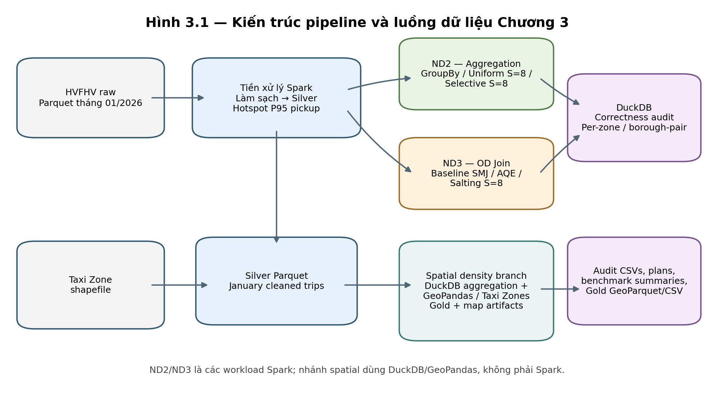
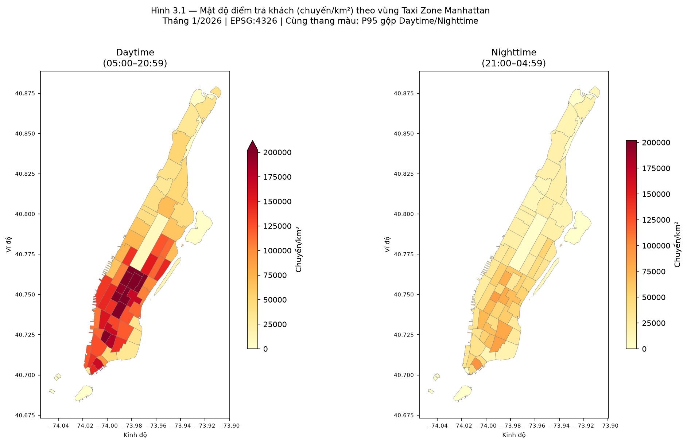

# NYC HVFHV Data Pipeline & Spark Skew Benchmarks

**Một project dữ liệu lớn từ Raw đến benchmark phân tán và bản đồ Manhattan.** Project dùng dữ liệu chuyến xe công nghệ HVFHV của New York để nghiên cứu lệch tải trong Apache Spark, kiểm chứng kết quả bằng DuckDB và phân tích mô tả điểm trả khách theo Taxi Zone.

> **Trạng thái đồ án:** bản báo cáo hiện có nội dung Chương 1–3. Artifact dữ liệu và benchmark chính đã được tạo; Chương 4 đang ở mức kế hoạch viết, Chương 5 chưa hoàn thiện.

## Bài toán

Khi dữ liệu chuyến tập trung ở một số vùng, các task Spark có thể nhận khối lượng không đều. Project triển khai và đo hai workload:

- **ND2 — Aggregation:** tổng hợp số chuyến, giá vé trung bình và tổng quãng đường theo `PULocationID`; so sánh Baseline GroupBy, Uniform Salting S=8 và Selective Salting S=8.
- **ND3 — Shuffle Join:** nối chuyến với OD dimension theo `(PULocationID, DOLocationID)`; so sánh Baseline Sort-Merge Join, Spark AQE và Salting Join S=8.
- **Spatial analysis:** tổng hợp điểm trả theo `DOLocationID` và khung Ngày/Đêm, chuẩn hóa theo diện tích Taxi Zone, xuất Gold và Kepler.gl.

Đây là OD key-based join, không phải geometric Spatial Join.

**Công nghệ:** Apache Spark 3.5.9 · PySpark · Parquet · DuckDB · Python · GeoPandas/Shapely · Podman Compose · Spark REST API · Kepler.gl.

## Pipeline



Luồng chính: **Raw Parquet → tiền xử lý → Silver + hotspot P95 + OD dimension → ND2/ND3 trên Spark → metrics và execution plan → DuckDB correctness audit**. Nhánh spatial dùng Silver tháng 01 cùng Taxi Zone geometry để tạo Gold và bản đồ.

### Những gì project hiện thực

- Tiền xử lý Raw Parquet, audit bộ lọc và tạo Silver.
- Tìm hotspot bằng nearest-rank P95; lưu artifact để các lần chạy có thể tái lập.
- Chạy benchmark Spark Standalone, ghi application ID, manifest, worker evidence, task/stage metrics và physical plan.
- Đối soát kết quả aggregate/join độc lập bằng DuckDB.
- Tạo Gold GeoParquet/CSV và Kepler.gl artifact cho phân tích không gian.

## Kết quả chính

Các số dưới đây là median của **3 lượt đo chính thức trên Silver tháng 01/2026**, Spark 3.5.9, hai Worker. Đây là thống kê mô tả với ba lượt đo, không phải kiểm định ý nghĩa thống kê hay khẳng định tổng quát cho mọi cụm/workload.

### ND2 — Aggregation

| Phương án | Thời gian median | Shuffle Write median |
|---|---:|---:|
| Baseline GroupBy | 1,214 s | 0,06 MB |
| Selective Salting S=8 | 3,064 s | 0,10 MB |
| Uniform Salting S=8 | 3,638 s | 0,45 MB |

Selective Salting ghi ít Shuffle Write hơn Uniform Salting trong run này, nhưng cả hai phương án salting chạy lâu hơn Baseline.

### ND3 — Shuffle Join

| Phương án | Thời gian median | TSR median | Shuffle Read median | Memory / Disk Spill median |
|---|---:|---:|---:|---:|
| Baseline Sort-Merge | 7,218 s | 3,19 | 295,72 MB | 0 / 0 MB |
| Spark AQE | 7,216 s | 1,03 | 295,22 MB | 480 / 128,36 MB |
| Salting Join S=8 | 8,448 s | 2,92 | 326,47 MB | 0 / 0 MB |

Final plan của các run AQE không cho thấy skew-specific partition split. Salting Join tăng OD dimension tháng 01 từ **58.747 lên 83.646 hàng** (**+24.899 hàng**), không phải mức tăng byte.

### Kiểm tra qua các tháng

ND2 và ND3 cũng đã chạy trên Silver tháng 02–05. Cả năm tháng là **các input độc lập**, không phải tập dữ liệu tích lũy. Trong toàn bộ 90 run-level records hiện có, collector đều `OK` và DuckDB validation đều `PASS`. Silver dao động khoảng 19,0–21,1 triệu dòng, nên đây là kiểm tra độ ổn định trên dải kích thước hẹp, không phải benchmark scaling quy mô lớn.

### Spatial result



Gold tháng 01 phân loại 263 Taxi Zone thành 41 zone phía Nam, 23 phía Bắc, 5 vùng mơ hồ và 194 zone ngoài Manhattan theo đường 60th Street xấp xỉ. Đây là mô tả địa lý, **không phải phân loại CRZ chính thức hay kết quả nhân quả**. Daytime dài 16 giờ, Nighttime 8 giờ; chỉ so Bắc–Nam trong cùng khung giờ, hoặc chuẩn hóa theo giờ nếu đối chiếu Ngày với Đêm.

## Bắt đầu

### Yêu cầu

- Fedora/Linux với Podman và `podman-compose`.
- Project dependencies và dữ liệu đầu vào trong `data/`.
- Với benchmark official: Spark Standalone 3.5.9, Master, hai Worker và Driver.
- Môi trường container được mô tả trong [`docker-compose.yml`](docker-compose.yml), [`Dockerfile.spark`](Dockerfile.spark) và [`requirements-spark.txt`](requirements-spark.txt).

### Khởi động cụm

```bash
podman-compose up -d
podman ps -a
```

Mở Spark Master UI tại [http://localhost:8080](http://localhost:8080) và xác nhận hai Worker đã đăng ký. Có thể chạy Pi smoke test từ Driver để kiểm tra cụm:

```bash
podman exec spark-driver /opt/spark/bin/spark-submit \
  --master spark://spark-master:7077 \
  --deploy-mode client \
  --conf spark.driver.host=spark-driver \
  --conf spark.driver.bindAddress=0.0.0.0 \
  /opt/spark/examples/src/main/python/pi.py 10
```

### Chạy thử benchmark

Pilot dùng cùng Silver tháng 01 với benchmark official; pilot chỉ giảm số lượt đo, **không dùng tập dữ liệu nhỏ hơn**.

```bash
python scripts/chapter_03/run_benchmark_nd2.py --mode pilot
python scripts/chapter_03/run_benchmark_nd3.py --mode pilot
```

### Chạy lại toàn bộ

Tiền xử lý tháng 01:

```bash
python scripts/chapter_02/02_preprocess_and_audit.py
```

Benchmark official và benchmark tháng 02–05 cần đúng volume, dependencies và Spark network trong container Driver. Xem hướng dẫn lệnh đầy đủ cùng điều kiện kiểm tra ở [artifact audit Chương 3](chapters/03_pipeline_skew_benchmarks/docs/chapter3_artifact_audit.md) và [scripts README](scripts/README.md). Kiểm tra biến môi trường/đường dẫn và sao lưu output cần giữ trước khi chạy lại các bước ghi dữ liệu.

## Kết quả và tài liệu

| Artifact | Vị trí |
|---|---|
| ND2/ND3 run CSV, summary, audit, plans | `data/benchmarks/` |
| Kết quả từng tháng độc lập | `data/benchmarks/scaling/` |
| Gold GeoParquet, CSV, Kepler.gl | `data/gold/` |
| Hướng dẫn notebook | [notebooks/README.md](notebooks/README.md) |
| Scripts theo chương | [scripts/README.md](scripts/README.md) |
| Bản thảo và audit Chương 3 | [chapters/03_pipeline_skew_benchmarks/README.md](chapters/03_pipeline_skew_benchmarks/README.md) |
| Kế hoạch viết Chương 4 | [chapters/04_results_tradeoffs/plan_chuong_4.md](chapters/04_results_tradeoffs/plan_chuong_4.md) |
| Tổ chức tài liệu Chương 1–5 | [chapters/README.md](chapters/README.md) |

## Giới hạn hiện tại

- Năm input tháng có quy mô gần nhau; chưa chứng minh xu hướng hiệu năng khi dữ liệu tăng nhiều lần.
- Chưa có LightGBM/ML skew detector, SparkListener tùy biến hoặc phép đo mức sử dụng CPU/RAM cgroup theo từng application.
- Spatial analysis dùng một tháng hậu chính sách và nhóm Taxi Zone theo ranh giới xấp xỉ; không thể suy ra tác động nhân quả của chính sách thu phí.
- Airflow service có trong Compose nhưng thư mục `dags/` chưa có DAG; các workflow hiện chạy bằng scripts/CLI.

Xem [ghi chú đối chiếu nghiên cứu](chapters/research_alignment_notes.md) để biết project tham khảo CIBPartitioner, MFTune và nghiên cứu chính sách Zhang et al. ở phạm vi nào; project không tuyên bố đã triển khai các phương pháp đó.
