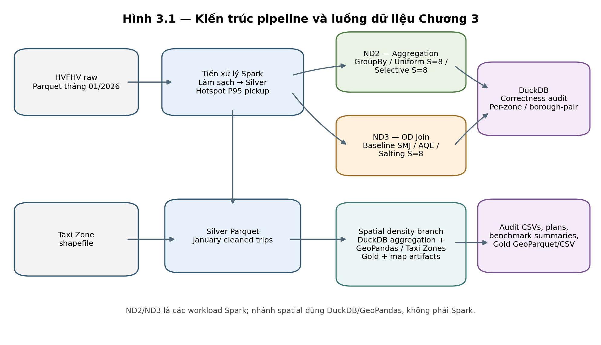
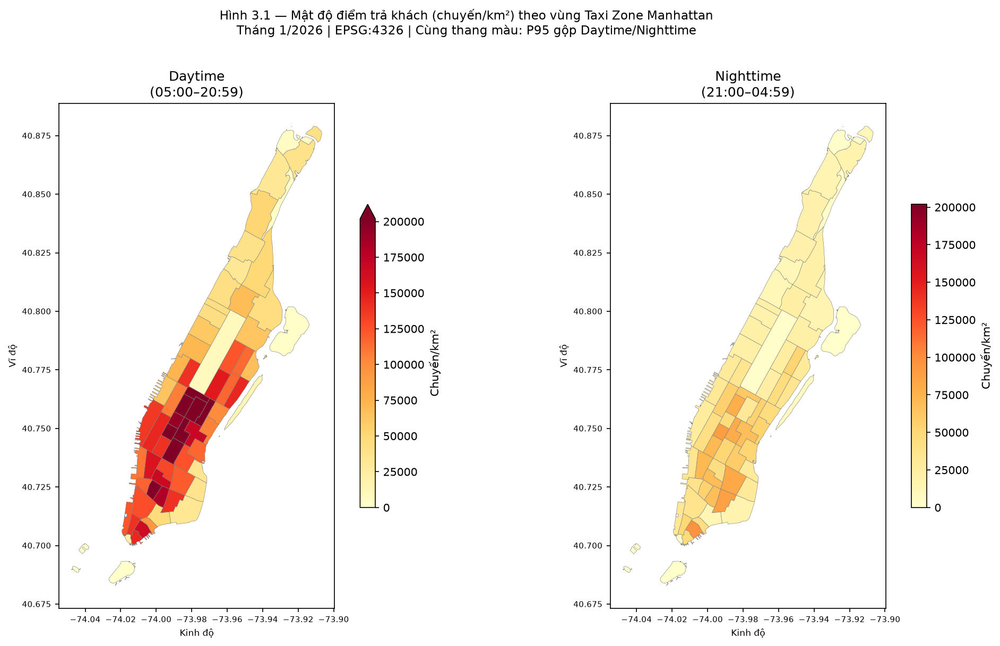

# NYC HVFHV Data Pipeline & Spark Skew Benchmarks

**Một project dữ liệu lớn từ Raw đến benchmark phân tán và bản đồ Manhattan.** Project dùng dữ liệu chuyến xe công nghệ HVFHV của New York để nghiên cứu lệch tải trong Apache Spark, kiểm chứng kết quả bằng DuckDB và phân tích mô tả điểm trả khách theo Taxi Zone.

> **Trạng thái đồ án:** Chương 1–3 đã có artifacts; Chương 4 có bản thảo đầy đủ các mục 4.1–4.8; ND4 tháng 03 đã chạy toàn DAG Airflow thành công ngày 20/11/2026. Kết quả ND4 được lưu riêng, không trộn với chuỗi benchmark tháng 01–05 trước đó. Chương 5 chưa hoàn thiện.

**Tìm nhanh:** [Bản đồ project](chapters/README.md) · [Bản thảo Chương 3](chapters/03_pipeline_skew_benchmarks/manuscript/chapter3_complete.md) · [Bản thảo Chương 4](chapters/04_results_tradeoffs/manuscript/chapter4_results.md) · [Báo cáo và hồ sơ nghiên cứu](docs/refactor/README.md) · [Scripts ND2/ND3 và Phase C](scripts/chapter_03/README.md).

## Bài toán

Khi dữ liệu chuyến tập trung ở một số vùng, các task Spark có thể nhận khối lượng không đều. Project triển khai và đo hai workload:

- **ND2 — Aggregation:** tổng hợp số chuyến, giá vé trung bình và tổng quãng đường theo `PULocationID`; so sánh Baseline GroupBy, Uniform Salting S=8 và Selective Salting S=8.
- **ND3 — Shuffle Join:** nối chuyến với OD dimension theo `(PULocationID, DOLocationID)`; so sánh Baseline Sort-Merge Join, Spark AQE và Salting Join S=8.
- **Spatial analysis:** tổng hợp điểm trả theo `DOLocationID` và khung Ngày/Đêm, chuẩn hóa theo diện tích Taxi Zone, xuất Gold và Kepler.gl.

Đây là OD key-based join, không phải geometric Spatial Join.

**Công nghệ:** Apache Spark 3.5.9 · PySpark · Parquet · DuckDB · Python · GeoPandas/Shapely · Podman Compose · Spark REST API · Kepler.gl.

## Pipeline



Luồng chính: **Raw Parquet → tiền xử lý → Silver + hotspot P95 + OD dimension → ND2/ND3 trên Spark → metrics và execution plan → DuckDB correctness audit**. Nhánh spatial dùng Silver tháng 01 cùng Taxi Zone geometry để tạo Gold và bản đồ.

### Những gì project hiện thực

- Tiền xử lý Raw Parquet, audit bộ lọc và tạo Silver.
- Tìm hotspot bằng nearest-rank P95; lưu artifact để các lần chạy có thể tái lập.
- Chạy benchmark Spark Standalone, ghi application ID, manifest, worker evidence, task/stage metrics và physical plan.
- Đối soát kết quả aggregate/join độc lập bằng DuckDB.
- Tạo Gold GeoParquet/CSV và Kepler.gl artifact cho phân tích không gian.

## Kết quả chính

Các số dưới đây là median của **3 lượt đo official Standalone chạy ngày 03/11/2026 trên Silver tháng 01/2026**, Spark 3.5.9, hai Worker. Đây là thống kê mô tả với ba lượt đo, không phải kiểm định ý nghĩa thống kê hay khẳng định tổng quát cho mọi cụm/workload. Dung lượng dùng MiB (1 MiB = 1.048.576 byte).

### ND2 — Aggregation

| Phương án | Thời gian median | Shuffle Write median |
|---|---:|---:|
| Baseline GroupBy | 2,022 s | 0,057 MiB |
| Selective Salting S=8 | 4,400 s | 0,103 MiB |
| Uniform Salting S=8 | 4,859 s | 0,451 MiB |

Selective Salting ghi ít Shuffle Write hơn Uniform Salting khoảng 77% và nhanh hơn khoảng 9%, nhưng vẫn chậm hơn Baseline khoảng 2,2 lần. TSR/PSR ở stage được chọn thấp hơn Baseline; điều đó không chuyển thành wall-time tốt hơn.

### ND3 — Shuffle Join

| Phương án | Thời gian median | TSR median | Shuffle Read median | Memory / Disk Spill median |
|---|---:|---:|---:|---:|
| Baseline Sort-Merge | 8,165 s | 3,95 | 295,72 MiB | 0 / 0 MiB |
| Spark AQE | 7,157 s | 1,04 | 295,22 MiB | 480 / 128,37 MiB |
| Salting Join S=8 | 13,858 s | 3,84 | 326,47 MiB | 0 / 0 MiB |

AQE có median ngắn hơn Baseline khoảng 12% trong ba lượt đo nhưng có spill; final plan không cho thấy skew-specific partition split. Salting Join tăng OD dimension tháng 01 từ **58.747 lên 83.646 hàng** (**+24.899 hàng**), không phải mức tăng byte.

### Kiểm tra qua các tháng

ND2 và ND3 cũng đã chạy trên Silver tháng 02–05. Cả năm tháng là **các input độc lập**, không phải tập dữ liệu tích lũy. Trong toàn bộ 90 run-level records hiện có, collector đều `OK` và DuckDB validation đều `PASS`. Silver dao động khoảng 19,0–21,1 triệu dòng, nên đây là kiểm tra độ ổn định trên dải kích thước hẹp, không phải benchmark scaling quy mô lớn.

### Spatial result



Gold tháng 01 phân loại 263 Taxi Zone thành 41 zone phía Nam, 23 phía Bắc, 5 vùng mơ hồ và 194 zone ngoài Manhattan theo đường 60th Street xấp xỉ. Đây là mô tả địa lý, **không phải phân loại CRZ chính thức hay kết quả nhân quả**. Daytime dài 16 giờ, Nighttime 8 giờ; chỉ so Bắc–Nam trong cùng khung giờ, hoặc chuẩn hóa theo giờ nếu đối chiếu Ngày với Đêm.

## Bắt đầu

### Yêu cầu

- Fedora/Linux với Podman và `podman-compose`.
- Project dependencies và dữ liệu đầu vào trong `data/`.
- Với benchmark official: Spark Standalone 3.5.9, Master, hai Worker; Driver chạy trong container `spark-driver` hoặc Airflow service khi điều phối ND4.
- Môi trường container được mô tả trong [`docker-compose.yml`](docker-compose.yml), [`Dockerfile.spark`](Dockerfile.spark), [`Dockerfile.airflow`](Dockerfile.airflow) và [`requirements-spark.txt`](requirements-spark.txt).

### Khởi động cụm Compose

```bash
podman compose up -d --build
podman ps -a
```

Mở Spark Master UI tại [http://localhost:8080](http://localhost:8080) và xác nhận hai Worker đã đăng ký. Nếu Podman không tải được image từ Docker Hub, Compose sẽ chưa khởi động; kiểm tra DNS/TLS tới registry trước khi chạy lại.

#### Chạy Spark Standalone trên host khi registry không truy cập được

Project có PySpark 3.5.9 trong `.venv` và JDK 17 ở `/usr/lib/jvm/java-17`. Có thể dùng cụm host fallback:

```bash
scripts/chapter_04/start_spark_host_fallback.sh
```

Nó bật Master ở `spark://127.0.0.1:7077` và hai Worker, UI tại [http://localhost:8080](http://localhost:8080). Dừng bằng:

```bash
scripts/chapter_04/stop_spark_host_fallback.sh
```

Fallback này chạy các tiến trình trực tiếp trên host, không có giới hạn CPU/RAM cgroup của Compose và không được dùng làm kết quả benchmark official. Nó phù hợp để kiểm tra Spark hoặc chạy pilot có provenance riêng.

Có thể chạy Pi smoke test từ Driver trong Compose để kiểm tra cụm:

```bash
podman exec spark-driver /opt/spark/bin/spark-submit \
  --master spark://spark-master:7077 \
  --deploy-mode client \
  --conf spark.driver.host=spark-driver \
  --conf spark.driver.bindAddress=0.0.0.0 \
  /opt/spark/examples/src/main/python/pi.py 10
```

### Chạy thử benchmark

Pilot dùng cùng Silver tháng 01 với benchmark official; pilot chỉ giảm số lượt đo, **không dùng tập dữ liệu nhỏ hơn**.

```bash
python scripts/chapter_03/run_benchmark_nd2.py --mode pilot
python scripts/chapter_03/run_benchmark_nd3.py --mode pilot
```

Để kiểm tra thêm mốc Broadcast Hash Join trên cụm Compose, dùng `--include-broadcast` với runner ND3 ở chế độ pilot; `--pilot-iterations 3` chạy ba lượt và xoay thứ tự phương án. Nhánh này được ép bằng hint và không ghi vào các CSV `official_standalone`. Lần thử có kiểm chứng ngày 21/11/2026 cùng lệnh chạy và giới hạn diễn giải nằm tại [pilot ND3 Broadcast](chapters/03_pipeline_skew_benchmarks/docs/phase_b/pilot_nd3_broadcast_20261121.md).

### Chạy ND4 bằng Airflow trên tháng 03/2026

```bash
podman compose up -d --build spark-master spark-worker-1 spark-worker-2 airflow-standalone
podman exec airflow-standalone airflow dags unpause chapter4_nd4_march_2026_benchmark
podman exec airflow-standalone airflow dags trigger chapter4_nd4_march_2026_benchmark
```

DAG chạy ND2 rồi ND3 tuần tự, thu Spark REST/Event Log, manifest và Worker evidence, sau đó đối soát bằng DuckDB. Lần chạy ND4 ngày 20/11/2026 có ba lượt đo/phương án; ND2 có action warm-up, ND3 cũ không tạo job warm-up. Runner ND3 đã được sửa ngày 21/11/2026 và có pilot riêng xác nhận warm-up hoạt động; kết quả ND4 cũ chưa được chạy lại. Bảng, biểu đồ và provenance của lần chạy đã hoàn tất nằm tại `data/benchmarks/nd4_airflow/2026_03/nd4-march-clean-20261120/`. Tạo lại gói tổng hợp sau một lần chạy mới bằng:

```bash
python scripts/chapter_04/build_nd4_march_artifacts.py --airflow-run-id <dag-run-id>
```

Airflow UI: [http://localhost:8085](http://localhost:8085). Kết quả lần chạy 20/11/2026 đã lưu tách biệt với các artifacts tháng 03 cũ.

### Chạy lại toàn bộ

Tiền xử lý tháng 01:

```bash
python scripts/chapter_02/02_preprocess_and_audit.py
```

Benchmark official và benchmark tháng 02–05 cần đúng volume, dependencies và Spark network trong container Driver. Xem hướng dẫn lệnh đầy đủ cùng điều kiện kiểm tra ở [artifact audit Chương 3](chapters/03_pipeline_skew_benchmarks/docs/chapter3_artifact_audit.md) và [scripts README](scripts/README.md). Kiểm tra biến môi trường/đường dẫn và sao lưu output cần giữ trước khi chạy lại các bước ghi dữ liệu.

## Kết quả và tài liệu

| Artifact | Vị trí |
|---|---|
| ND2/ND3 run CSV, summary, audit, plans | `data/benchmarks/` |
| Kết quả từng tháng độc lập | `data/benchmarks/scaling/` |
| Gold GeoParquet, CSV, Kepler.gl | `data/gold/` |
| Hướng dẫn notebook | [notebooks/README.md](notebooks/README.md) |
| Scripts theo chương | [scripts/README.md](scripts/README.md) |
| Bản thảo và audit Chương 3 | [chapters/03_pipeline_skew_benchmarks/README.md](chapters/03_pipeline_skew_benchmarks/README.md) |
| Kế hoạch tổng hợp DETOUR | [docs/refactor/00_plan_tong_hop_detour.md](docs/refactor/00_plan_tong_hop_detour.md) |
| Tổ chức tài liệu Chương 1–5 | [chapters/README.md](chapters/README.md) |

## Bản đồ theo 4 nội dung đồ án

| Nội dung | Mã nguồn bắt đầu từ | Notebook | Ảnh/bằng chứng chính |
|---|---|---|---|
| **1 — Môi trường và khảo sát dữ liệu** | `scripts/chapter_02/02_preprocess_and_audit.py`; các audit/figure ở `scripts/chapter_02/` | Chưa có notebook riêng; quy trình chính chạy bằng script | Hình khảo sát ở `data/zones/`; cấu hình cụm ở `docker-compose.yml` |
| **2 — Lệch tải trong aggregation** | `scripts/chapter_03/run_benchmark_nd2.py` và `benchmark_engine.py` | `notebooks/chapter_03/02_benchmark_aggregation_salting.ipynb` | Bảng, plan và hình benchmark ở `data/benchmarks/` |
| **3 — Lệch tải trong join** | `scripts/chapter_03/run_benchmark_nd3.py`, `build_monthly_od_matrix.py` | `notebooks/chapter_03/03_benchmark_join_skew.ipynb` | Run CSV, DuckDB audit và execution plan ở `data/benchmarks/` |
| **4 — Tự động hóa và đánh giá** | `dags/chapter4_march_benchmark.py`, `Dockerfile.airflow`, `scripts/chapter_04/build_nd4_march_artifacts.py` | Chưa có notebook riêng | DAG tháng 03 chạy thành công cả ba task; runs, audit, bảng, hình và provenance ở `data/benchmarks/nd4_airflow/2026_03/nd4-march-clean-20261120/` |

> **Phạm vi hiện thực:** DAG Airflow tháng 03 chạy thành công ngày 20/11/2026 trên Compose với hai Worker; cả ba task của run `nd4-march-clean-20261120` đều `success`. Kết quả nằm ở `data/benchmarks/nd4_airflow/2026_03/nd4-march-clean-20261120/`, tách khỏi chuỗi monthly run cũ. Một lượt thử trước cần chạy lại bước đóng gói; lượt clean sau khi cập nhật image xác nhận toàn DAG. Xem [bản đồ mã nguồn và artifact](docs/project_map_content_1_to_4.md).

Hình được chia theo mục đích: hình trình bày cố định nằm trong `docs/assets/`; hình sinh từ số liệu và bảng kiểm toán ở cạnh dữ liệu/kết quả trong `data/zones/`, `data/benchmarks/` hoặc `data/gold/`. Vị trí dữ liệu hiện tại được giữ nguyên.

## Giới hạn hiện tại

- Năm input tháng có quy mô gần nhau; chưa chứng minh xu hướng hiệu năng khi dữ liệu tăng nhiều lần.
- Chưa có LightGBM/ML skew detector, SparkListener tùy biến hoặc phép đo mức sử dụng CPU/RAM cgroup theo từng application.
- Spatial analysis dùng một tháng hậu chính sách và nhóm Taxi Zone theo ranh giới xấp xỉ; không thể suy ra tác động nhân quả của chính sách thu phí.
- DAG ND4 đã chạy thành công trên Compose; run xác nhận clean hoàn tất cả ba task. Airflow UI ở cổng 8085. Chưa có SparkListener tùy biến hoặc số đo mức sử dụng CPU/RAM cgroup theo từng application. Docker Hub có thể gặp timeout lại; host fallback không tương đương Compose và không được gộp vào kết quả official.

Xem [ghi chú đối chiếu nghiên cứu](chapters/shared/research_alignment_notes.md) để biết project tham khảo CIBPartitioner, MFTune và nghiên cứu chính sách Zhang et al. ở phạm vi nào; project không tuyên bố đã triển khai các phương pháp đó.
