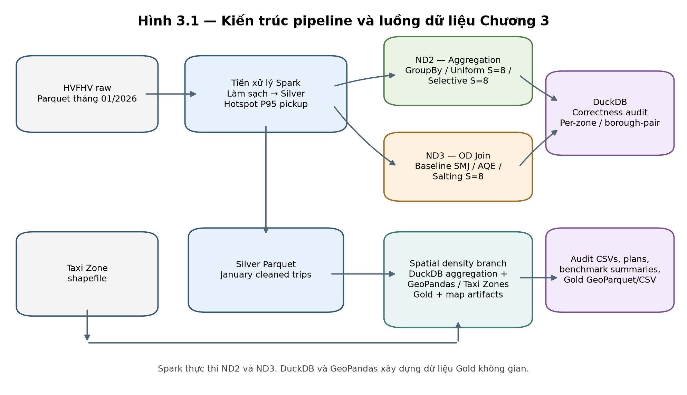
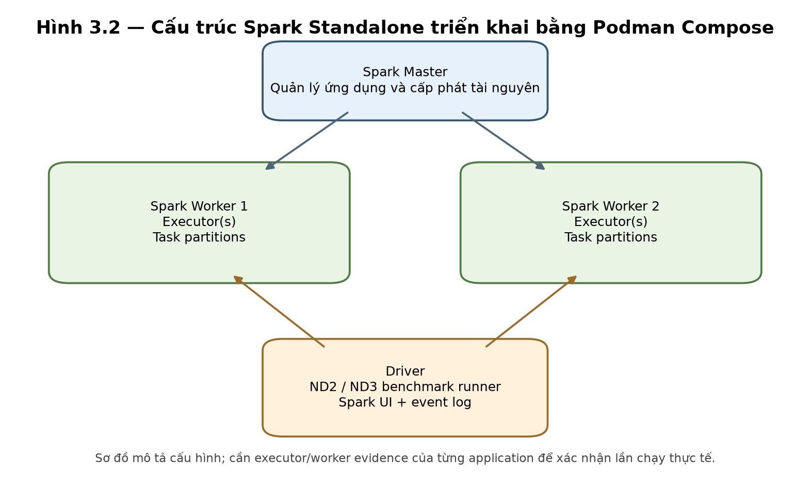
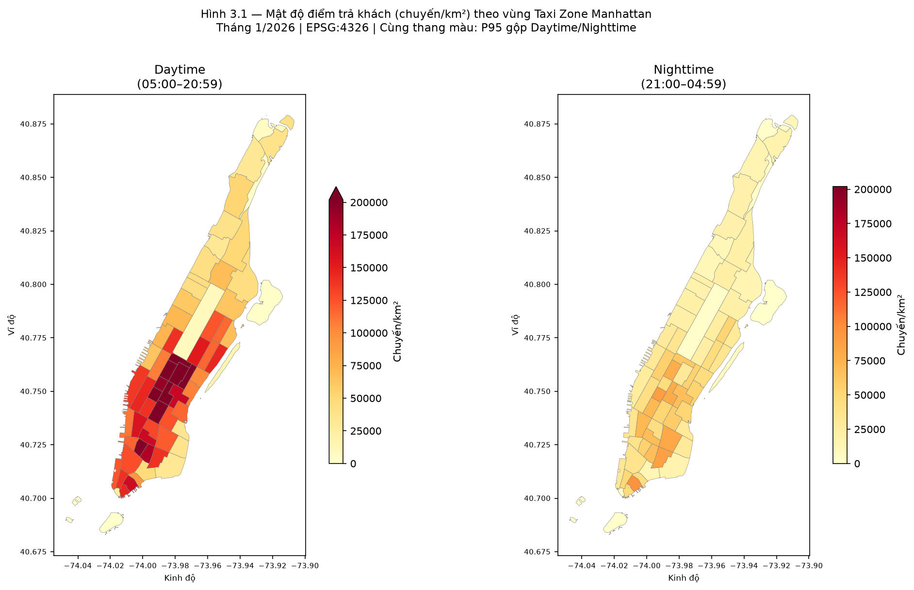

# CHƯƠNG 3. PIPELINE, TỐI ƯU HÓA LỆCH TẢI VÀ THIẾT KẾ THỰC NGHIỆM

Chương này trình bày kiến trúc pipeline, phương pháp xử lý lệch tải và quy trình kiểm chứng trên dữ liệu chuyến đi HVFHV của New York. Hai bài toán thực nghiệm gồm tổng hợp chuyến theo vùng đón (ND2) và nối dữ liệu chuyến với bảng chiều nguồn–đích (ND3). Sau khi xác định cách đo và kiểm soát các phương án, chương mô tả phần mở rộng Phase C trên dữ liệu NYC S3 và dữ liệu tổng hợp. Phần cuối trình bày cách xây dựng tầng Gold phục vụ phân tích mật độ trả khách quanh đường tham chiếu phố 60th tại Manhattan.

## 3.1. Kiến trúc pipeline và mô hình hóa bài toán lệch tải

### 3.1.1. Kiến trúc tổng thể và luồng xử lý dữ liệu phân tán trên Apache Spark

Nghiên cứu tổ chức dữ liệu theo luồng từ dữ liệu chuyến đi thô đến hai nhánh phân tích. Ở lớp đầu vào, dữ liệu HVFHV tháng 01/2026 được làm sạch và lưu thành các tệp Parquet Silver. Tập Silver này là đầu vào thống nhất cho hai thực nghiệm Spark: ND2 tổng hợp theo vùng đón khách (`PULocationID`), còn ND3 nối chuyến đi với bảng chiều ma trận nguồn–đích (OD) theo cặp (`PULocationID`, `DOLocationID`). Bảng OD cung cấp thuộc tính vùng cho từng cặp, từ đó kết quả join có thể được tổng hợp theo cặp quận nguồn–đích. Danh sách vùng đón khách nóng được tính từ phân bố số chuyến theo `PULocationID` và được dùng nhất quán trong nhánh Selective Salting của ND2 và Salting Join của ND3.

*Hình 3.1. Kiến trúc pipeline và luồng dữ liệu.*

*Hình 3.2. Cấu trúc cụm Spark Standalone triển khai bằng Podman Compose.*

Trong ND2, Spark phân phối các bản ghi theo khóa tổng hợp. Baseline thực hiện `groupBy(PULocationID)`; hai phương án salting tạo khóa trung gian `(PULocationID, salt)`, tổng hợp từng nhóm con rồi gộp lại theo `PULocationID`. Trong ND3, dữ liệu chuyến được join với OD dimension trên hai khóa vùng. Ba nhánh được so sánh là Sort-Merge Join cơ sở, Sort-Merge Join có AQE skew handling và Salting Join với số salt bằng 8. Việc materialize kết quả buộc Spark thực thi phép biến đổi trước khi thu các bảng tổng hợp nhỏ về driver.

Sau mỗi nhánh, kết quả tổng hợp được so sánh với phép tính độc lập bằng DuckDB. Dữ liệu chi tiết vẫn được xử lý phân tán trong Spark; chỉ bảng tổng hợp theo vùng hoặc borough-pair được đưa về driver để đối chiếu. Phân tích mật độ điểm trả khách là một nhánh riêng: DuckDB đếm chuyến theo vùng/kỳ, còn GeoPandas xử lý hình học vùng. Vì vậy, kết quả không gian không được trình bày như kết quả thực thi phân tán của Spark.

### 3.1.2. Phân biệt mức độ tập trung dữ liệu tự nhiên, cân bằng khối lượng dữ liệu và lệch tải tính toán

Ba khái niệm cần được tách biệt khi diễn giải hiện tượng lệch tải. Thứ nhất, **mức độ tập trung dữ liệu tự nhiên** mô tả phân bố của đại lượng nghiên cứu theo khóa nghiệp vụ. Với ND2, số chuyến có thể tập trung không đồng đều giữa các `PULocationID`; đây là đặc điểm của nhu cầu đi lại và vị trí địa lý trong dữ liệu. Một vài vùng có số chuyến lớn chưa tự nó chứng minh rằng Spark đã tạo ra một tác vụ bị nghẽn.

Thứ hai, **cân bằng khối lượng dữ liệu giữa partition** mô tả số bản ghi hoặc lượng dữ liệu mà mỗi partition nhận sau khi phân vùng. Phân bố khóa nghiệp vụ và cách partition/shuffle tương tác với nhau để quyết định lượng dữ liệu ở từng partition. Nhiều khóa nhỏ có thể được đặt cùng một partition; một khóa lớn có thể chi phối partition chứa khóa đó. Do vậy, tần suất khóa và kích thước partition có liên quan nhưng không đồng nhất.

Thứ ba, **lệch tải tính toán** là chênh lệch công việc thực hiện được quan sát giữa các task: một số task mất nhiều thời gian hơn đáng kể, xử lý nhiều bản ghi hơn, đọc/ghi shuffle lớn hơn hoặc phát sinh spill nhiều hơn. Đây là biểu hiện ở cấp thực thi. Thời lượng task còn chịu ảnh hưởng của tài nguyên executor, I/O, garbage collection và cạnh tranh tài nguyên; vì vậy cần đọc PSR/TSR cùng shuffle, spill và trạng thái collector, thay vì suy ra lệch tải chỉ từ biểu đồ tần suất khóa.

Trong ND3, khóa join là cặp OD chứ không phải riêng vùng đón. Bảng chiều OD có quy mô nhỏ hơn dữ liệu chuyến, còn mỗi khóa OD có thể xuất hiện với tần suất khác nhau trong chuyến đi. Vì vậy, phân bố số chuyến theo pickup zone giúp xác định tập ứng viên cho salting, nhưng không thay thế việc kiểm tra phân bố task của chính phép join. Bài toán nghiên cứu là đánh giá liệu các biện pháp chia nhỏ công việc có cải thiện phân bố thực thi và thời gian trong các cấu hình thử nghiệm hay không; không mặc định rằng mọi tập trung tự nhiên đều gây ra skew xử lý.

### 3.1.3. Các chỉ số định lượng độ lệch tải (PSR, TSR) và tiêu chí nhận diện khóa nóng H

Thực nghiệm sử dụng hai tỷ số max/median để mô tả độ lệch tại task. **Task Skew Ratio (TSR)** được tính bằng thời lượng task thành công lớn nhất chia cho trung vị thời lượng task thành công. Thời lượng lấy từ `executorRunTime` theo mili giây; nếu metric này không có thì dùng thời lượng task do Spark ghi nhận. **Partition Skew Ratio (PSR)** được tính bằng số bản ghi lớn nhất chia cho trung vị số bản ghi trên các task thành công. Bộ thu thập chọn metric bản ghi chung đầu tiên có sẵn theo thứ tự: shuffle read records, shuffle write records, input records, rồi output records. PSR chỉ được báo cáo khi metric được chọn có ở mọi task thành công.

Để hai tỷ số có phạm vi nhất quán, bộ thu thập chọn stage đã hoàn thành có tổng shuffle read và write lớn nhất trong job group; nếu bằng nhau thì chọn stage có executor runtime lớn hơn. TSR và PSR được tính trên các task thành công của stage đó. Tổng shuffle và spill được cộng trên các stage đã hoàn thành của job group. Nếu metric không thu thập được, không tồn tại task thành công phù hợp hoặc mẫu số bằng 0, giá trị được để trống/không khả dụng, không thay bằng 0. Vì TSR/PSR là tỷ số max/median, chúng mô tả độ chênh tương đối trong stage đã chọn, không phải tỷ lệ phần trăm và cũng không xác định nguyên nhân gây chênh lệch.

Ký hiệu **H** dùng cho tập khóa nóng pickup được chọn bằng ngưỡng P95 chính xác. Trước hết, đếm số chuyến theo từng `PULocationID`, sắp tăng dần các số đếm có giá trị, rồi lấy phần tử ở hạng gần nhất `ceil(0,95 × n)` làm ngưỡng `T95`, trong đó `n` là số khóa pickup có số đếm hợp lệ. Tập khóa được định nghĩa:

> **H = {k : count(k) ≥ T95}.**

Cách lấy mọi khóa bằng hoặc lớn hơn ngưỡng giữ lại các trường hợp đồng hạng tại P95. Với Silver hiện có, audit độc lập ghi nhận 261 nhóm pickup khác null, `T95 = 194.522` chuyến và 14 khóa thuộc H: 7, 37, 61, 76, 79, 112, 132, 138, 161, 181, 230, 231, 234 và 255. Đây là tiêu chí vận hành được dùng trong thí nghiệm này, không phải một ngưỡng phổ quát cho mọi bộ dữ liệu.

*Hình 3.3. Số chuyến theo khóa pickup, ngưỡng `T95` và các khóa thuộc H. Nguồn: artifact P95 tháng 01/2026 của đồ án. Hình mô tả tần suất khóa nghiệp vụ, không phải thời lượng task Spark.*

### 3.1.4. Thiết kế các nhánh đối chứng, ma trận thực nghiệm và các biến kiểm soát

Mỗi bài toán có một phương án cơ sở và hai phương án xử lý lệch tải. Thực nghiệm ND3 mở rộng thêm nhánh Spark tự chọn chiến lược nối.

**Bảng 3.1. Ma trận phương pháp thực nghiệm**

| Bài toán | Nhánh đối chứng | Nhánh xử lý 1 | Nhánh xử lý 2 |
|---|---|---|---|
| ND2 — aggregation theo `PULocationID` | Baseline `groupBy` trực tiếp | Uniform Salting, S=8 | Selective Salting, S=8; chỉ khóa trong H được chia salt |
| ND3 — join theo (`PULocationID`, `DOLocationID`) | Sort-Merge Join, tắt AQE và broadcast | Spark AQE skew join, bật adaptive skew handling | Salting Join, S=8; chia salt cho chuyến có pickup thuộc H và nhân bản hàng OD tương ứng |

Ở ND2, cả ba nhánh tính cùng các đại lượng đầu ra: số chuyến, giá vé cơ sở trung bình và tổng quãng đường. Uniform Salting chia mọi khóa thành tám bucket; Selective Salting chỉ chia các khóa trong H, còn khóa khác giữ salt 0. Hai nhánh dùng tổng hợp hai giai đoạn rồi gộp về vùng pickup. Ở ND3, cả ba nhánh dùng cùng dữ liệu Silver, OD dimension, khóa join và inner-join semantics. Nhánh AQE dùng cấu hình skew factor 2 và ngưỡng 16 MiB theo runner. Nhánh salting gán một salt cho mỗi chuyến liên quan đến H và tạo các bản sao OD dimension tương ứng cho salt 0–7. Tính đúng đắn được kiểm tra bằng các tổng hợp borough-pair so với DuckDB; tính duy nhất của khóa OD cần được lưu cùng bằng chứng của lần chạy được báo cáo.

Các biến được giữ cố định trong mỗi bộ so sánh gồm tập Silver đầu vào, bảng OD ở ND3, danh sách H, số partition shuffle (mặc định 200), số salt (8), biểu thức đầu ra và quy tắc materialize. Baseline ND3 tắt AQE/broadcast để làm nhánh Sort-Merge Join đối chứng; nhánh AQE thay đổi cấu hình thích ứng được nghiên cứu; salting thay đổi khóa/replication theo thiết kế. Thiết kế yêu cầu một action warm-up riêng trước các lượt đo; ND2 cũ thực thi bước này, còn ND3 official cũ không tạo job warm-up vì thiếu action trong runner. Runner ND3 đã sửa ngày 21/11/2026 và pilot sau sửa xác nhận job warm-up. Các phiên theo giao thức ban đầu thực hiện ba lượt đo và xoay thứ tự phương pháp qua các lượt để giảm ảnh hưởng do thứ tự chạy. Kết quả từng lượt cần gắn với application ID, Spark version, master, executor/worker evidence, manifest dữ liệu, cấu hình thực tế và plan tương ứng trước khi dùng để kết luận hiệu năng.

**Bảng 3.2. Cấu hình và biến kiểm soát của các nhánh benchmark**

| Bài toán/phương án | Đầu vào và khóa | Cấu hình Spark chính | Salt/AQE | Warm-up và lượt đo | Thứ tự đo | Kiểm tra đúng đắn | Chỉ số ghi nhận |
|---|---|---|---|---|---|---|---|
| ND2 — Baseline GroupBy | Silver 01/2026; `PULocationID` | `spark.sql.shuffle.partitions=200` mặc định; AQE tắt trong runner ND2 | Không salting | 1 warm-up; full mode 3 lượt | Xoay thứ tự giữa 3 phương án theo lượt | Count, fare trung bình, tổng miles đối chiếu DuckDB theo pickup zone | Wall time, TSR, PSR nếu có, shuffle read/write, memory/disk spill |
| ND2 — Uniform Salting | Cùng Silver và khóa với baseline | Cùng số shuffle partition; AQE tắt | S=8; mọi pickup key được chia bucket | 1 warm-up; full mode 3 lượt | Xoay thứ tự | Như baseline | Như baseline |
| ND2 — Selective Salting | Cùng Silver; khóa nóng H từ artifact P95 | Cùng số shuffle partition; AQE tắt | S=8; chỉ key trong H được chia, key khác salt 0 | 1 warm-up; full mode 3 lượt | Xoay thứ tự | Như baseline; kèm tập H/threshold | Như baseline |
| ND3 — Baseline Sort-Merge Join | Silver + OD dimension; join `(PULocationID, DOLocationID)` | AQE tắt; broadcast tắt (`autoBroadcastJoinThreshold=-1`); shuffle partitions mặc định 200 | Không salting | Thiết kế: 1 action warm-up + 3 lượt; official cũ thiếu warm-up, pilot mới có | Xoay thứ tự giữa 3 phương án theo lượt | Count, fare, miles, distinct pickup zone và pair coverage đối chiếu DuckDB | Wall time, TSR, PSR nếu có, shuffle read/write, memory/disk spill |
| ND3 — Spark AQE Skew Join | Cùng Silver, OD và composite key | AQE bật; broadcast tắt; skew factor 2; threshold 16 MiB; shuffle partitions mặc định 200 | AQE skew join | Cùng điều kiện ND3 Baseline | Xoay thứ tự | Như baseline; lưu executed final plan để xác định có skew split | Như baseline; thêm AQE config và trạng thái plan |
| ND3 — Salting Join | Cùng Silver, OD và composite key | AQE skew join tắt; broadcast tắt; shuffle partitions mặc định 200 | S=8; salt chuyến thuộc H, nhân bản hàng OD tương ứng | Cùng điều kiện ND3 Baseline | Xoay thứ tự | Như baseline; kiểm tra OD key uniqueness cùng manifest run | Như baseline; theo dõi thêm replication overhead |
| ND3 — Spark tự chọn, đối chứng bổ sung | Cùng Silver S3, OD và composite key của các nhánh core | Không join hint; AQE tắt; auto-broadcast threshold 10 MiB; 200 shuffle partitions | Spark chọn chiến lược tĩnh theo thống kê | 1 action warm-up + 3 lượt | Ba phép xoay đầu của chu kỳ 4 nhánh; chưa cân bằng đủ mọi vị trí | DuckDB cấp phương án; final plan, cùng manifest và hai Worker | Wall time, TSR, PSR nếu khả dụng, shuffle/spill; giữ riêng phiên bổ sung |

*Ghi chú:* cấu hình `200` là mặc định của runner và có thể đổi qua tham số `--partitions`; các run theo tháng dưới đây dùng 200. Giao thức ban đầu dùng ba lượt đo và luân phiên thứ tự. Phiên 10 block áp dụng cách xáo trộn tại mục 3.5.5. Warm-up phải được xác nhận bằng job trong Event Log; ND3 official cũ không đáp ứng điều kiện đó. Ba nhánh ND3 core dùng `MERGE` hint; nhánh Spark tự chọn không gắn hint. Mỗi nhánh đều lưu physical plan. Hash manifest nhận diện bộ tệp qua đường dẫn tương đối, kích thước và thời gian sửa đổi, không phải checksum nội dung.

### 3.1.5. Thiết kế thực nghiệm theo nhiều quy mô dữ liệu và giới hạn suy rộng kết quả từ quy mô nhỏ

Các benchmark theo tháng dùng Silver từng tháng và tính OD/P95 trên đúng đầu vào. ND2 và ND3 tháng 01 ngày 03/11 là phiên tham chiếu. Bốn tháng 02–05 dùng các phiên ngày 30/10. Các kết quả liên tháng mô tả những đầu vào độc lập, với 19,0–21,1 triệu chuyến mỗi tháng.

Ba mức dữ liệu tích lũy gồm S1 (Silver tháng 01, 19.993.097 dòng), S2 (01–03, 60.133.386 dòng) và S3 (01–05, 101.263.728 dòng). Mỗi mức có OD và danh sách P95 tính theo dữ liệu đầu vào tương ứng. Cả số dòng và phân bố khóa thay đổi theo mức. Các phiên được lưu riêng theo manifest và application. S3 còn được dùng trong đối chứng Phase C ở mục 3.5.5. Các bảng thời gian và phạm vi suy rộng được trình bày ở Chương 4.

## 3.2. Tối ưu hóa lệch tải trong phép toán tổng hợp (Aggregation) bằng Selective Salting

### 3.2.1. Phương pháp Baseline và cơ chế tổng hợp dữ liệu phân tán bằng groupBy

Phép tổng hợp ND2 nhóm dữ liệu chuyến theo `PULocationID`. Với mỗi vùng đón, hệ thống tính số chuyến, giá vé cơ sở trung bình (`base_passenger_fare`) và tổng quãng đường (`trip_miles`). Phương án Baseline áp dụng trực tiếp `groupBy("PULocationID")` và các phép tổng hợp tương ứng trên DataFrame Spark.

Trong thực thi phân tán, phép nhóm theo khóa yêu cầu các bản ghi cùng khóa được đưa về cùng nhóm tổng hợp. Nếu một số khóa có tần suất lớn, khối lượng công việc của các nhóm/partition liên quan có thể cao hơn. Baseline được dùng làm mốc để so sánh với các biến thể salting trên cùng dữ liệu và cùng đại lượng đầu ra. Không suy luận rằng khóa có nhiều chuyến chắc chắn gây task skew nếu chưa quan sát metric task ở Spark.

### 3.2.2. Nhận diện khóa nóng dựa trên phân vị P95 và lựa chọn khóa cần tối ưu

Số chuyến theo từng `PULocationID` được tính trước để xác định ngưỡng P95. Quy tắc nearest-rank sắp các số đếm tăng dần, lấy phần tử hạng `ceil(0,95 × n)` làm ngưỡng và chọn toàn bộ khóa có số đếm lớn hơn hoặc bằng ngưỡng. Cách lấy `>=` giữ lại cả các khóa đồng hạng tại ngưỡng. Đây là tập H được chia sẻ bởi Selective Salting ND2 và Salting Join ND3.

Với Silver tháng 01/2026 hiện có, phép kiểm tra độc lập cho 261 vùng pickup khác null, hạng P95 là 248, ngưỡng 194.522 chuyến và 14 khóa H: 7, 37, 61, 76, 79, 112, 132, 138, 161, 181, 230, 231, 234 và 255. Artifact lưu tại `data/silver/hotspots_p95_pu_2026_01/`. Trước khi báo cáo benchmark, cần gắn danh sách/threshold này với manifest dữ liệu của cùng lần chạy. Loader chính ưu tiên artifact đã lưu; nhánh fallback trong mã dùng `QUANTILE_DISC`, do đó nếu chạy mà thiếu artifact cần kiểm tra sự tương đương của tập được tái tạo với quy tắc nearest-rank đã công bố.

Phân bố chuyến và ngưỡng P95 đã được trình bày tại Hình 3.3 trong mục 3.1.3; không dùng tần suất khóa để thay thế bằng chứng về thời gian task.

### 3.2.3. Cơ chế Two-Stage Aggregation và gán Salt có chọn lọc (S=8)

Hai phương án salting đều thực hiện tổng hợp hai giai đoạn. Ở giai đoạn đầu, mỗi chuyến được gán `salt` từ 0 đến 7 bằng hàm băm xác định trên các thuộc tính chuyến (`pickup_datetime`, `dropoff_datetime`, `trip_miles`), sau đó nhóm theo `(PULocationID, salt)`. Với Uniform Salting, mọi vùng được chia thành các bucket. Với Selective Salting, chỉ chuyến có `PULocationID` thuộc H được chia; các vùng còn lại nhận salt 0.

Giai đoạn hai gộp các kết quả từng bucket theo `PULocationID`. Số chuyến và tổng quãng đường được cộng từ partial aggregates. Giá vé trung bình được tính từ tổng fare chia cho số fare không null, nhờ đó kết quả trung bình được tái dựng đúng từ các bucket thay vì lấy trung bình không trọng số của các trung bình từng bucket. Mục tiêu của Selective Salting là giảm tập khóa phải xử lý bằng khóa trung gian, trong khi vẫn giữ nguyên các khóa thông thường ở một bucket.

### 3.2.4. Hiện thực hóa trên Apache Spark và đánh giá tác động đến Shuffle

Ba nhánh ND2 được triển khai trong `scripts/chapter_03/benchmark_engine.py` và gọi bởi `scripts/chapter_03/run_benchmark_nd2.py`; notebook `notebooks/chapter_03/02_benchmark_aggregation_salting.ipynb` chứa luồng chạy và đầu ra notebook đã lưu. Runner full có warm-up riêng cho mỗi phương án, sau đó đo ba lượt và xoay thứ tự chạy giữa các lượt. Mặc định `spark.sql.shuffle.partitions` là 200, có thể thay đổi bằng `--partitions`.

Bộ thu thập lưu thời gian wall-clock của job group, TSR, PSR khi metric task phù hợp khả dụng, shuffle read/write và memory/disk spill. Audit DuckDB theo từng `PULocationID` so sánh số chuyến, giá vé trung bình và tổng miles giữa Spark với phép tính độc lập. Mỗi ứng dụng ND2 lưu audit ở cấp phương án cho kết quả cuối của phương án đó; trạng thái audit được gán cho metadata của các lượt đo cùng phương án. Các lượt chính thức lưu manifest và worker evidence. Kết quả ND2 tháng 01 và phép đối chiếu từng tháng nằm ở Chương 4.

## 3.3. Xử lý lệch tải trong phép kết nối phân tán (Join) bằng Spark AQE

### 3.3.1. Đặc điểm phép nối OD theo khóa và sự khác biệt với Spatial Join dựa trên quan hệ hình học

ND3 nối chuyến đi với bảng chiều OD bằng cặp khóa `(PULocationID, DOLocationID)` theo inner join. Bảng OD gắn thuộc tính vùng nguồn/đích cho từng cặp; sau join, kết quả được tổng hợp theo `PU_Borough` và `DO_Borough`. Đây là equi-join trên ID vùng, không phải spatial join: phép nối không kiểm tra giao nhau, chứa trong hoặc khoảng cách giữa các hình học đa giác.

Phân tích đa giác Taxi Zone ở mục 3.6 là một nhánh địa lý khác. Việc hai vùng có quan hệ không gian không phải điều kiện của ND3; join OD dựa trên khóa đã có trong dữ liệu. Nêu rõ khác biệt này giúp tránh gọi phép OD key join là “spatial join”.

CIBPartitioner của Yang và cộng sự ước lượng cường độ tính toán bằng histogram dạng lưới để cân bằng phân hoạch cho phép nối hình học. Đồ án vận dụng câu hỏi về sự khác nhau giữa số lượng bản ghi và khối lượng công việc. ND3 dùng khóa ghép OD và đo công việc qua các chỉ số task của Spark. [Yang và cộng sự, CIBPartitioner](https://doi.org/10.1080/10095020.2025.2510364)

Flow-Join++ (Panduman, Ito & Onizuka, 2026) giải quyết skew trong distributed OLAP joins bằng cách ước lượng cardinality/fanout để nhận diện heavy hitter; bài còn đề xuất Heavy Hitter Push-Down và Broadcast Fast-Path, với thực nghiệm Phone Bill/TPC-H trên cụm Spark EMR nhiều nút (*Journal of Information Processing*, 34, 671–685, DOI: [10.2197/ipsjjip.34.671](https://doi.org/10.2197/ipsjjip.34.671)). Điểm liên quan là bài đặt ra câu hỏi chiến lược join nên xét cả fanout khóa và khả năng broadcast, không chỉ cân bằng số bản ghi. Phạm vi của đồ án khác: ND3 là một phép inner equi-join hai bảng trên khóa OD, so sánh AQE và salting có quy tắc P95 trên dữ liệu taxi; project chưa có mô hình Scardina, cardinality prediction hay Heavy Hitter Push-Down. Câu hỏi thực nghiệm trong phạm vi đề tài là: trên workload OD thực và một cụm Spark cùng host, các nhánh AQE/Selective Salting biểu hiện thế nào so với baseline có kiểm soát và chiến lược Spark tự chọn. Đây là đối chiếu thực nghiệm theo workload, không phải triển khai hoặc tái lập Flow-Join++.

### 3.3.2. Cơ chế nhận diện và chia nhỏ phân vùng lệch tải trong AQE Skew Join

Adaptive Query Execution (AQE) cho phép Spark điều chỉnh một số quyết định thực thi dựa trên thống kê runtime sau các stage shuffle. Trong nhánh thí nghiệm này, AQE và `spark.sql.adaptive.skewJoin.enabled` được bật; ngưỡng skew factor đặt bằng 2 và ngưỡng kích thước partition là 16 MiB. Partition chỉ được xử lý như skew nếu thỏa điều kiện của Spark theo thống kê partition và cấu hình thực tế. Bật cấu hình không đồng nghĩa chắc chắn có partition nào được tách.

Do đó, sự kiện AQE skew split phải được chứng minh bằng final adaptive physical plan/Spark UI của đúng lượt đo sau khi action đã materialize. Plan phải thể hiện skew join/shuffle partition splitting tương ứng. Nếu plan cuối không có dấu hiệu này, kết luận phù hợp là AQE được bật nhưng lần chạy đó không chứng minh được skew split; không viết rằng AQE đã xử lý skew chỉ dựa trên config.

### 3.3.3. Cấu hình AQE và kiểm soát kế hoạch thực thi Sort-Merge Join

Baseline ND3 tắt `spark.sql.adaptive.enabled`, tắt skew join và đặt `spark.sql.autoBroadcastJoinThreshold=-1` để loại broadcast join khỏi đối chứng. Nhánh AQE bật adaptive execution và skew join, đặt factor 2, threshold 16 MiB, đồng thời vẫn tắt broadcast. Cả hai dùng cùng Silver, OD dimension, composite join key và inner semantics. Runner mặc định dùng 200 shuffle partitions, nhưng giá trị có thể được override; khi báo cáo cần lấy config thực tế trong run CSV.

Runner áp dụng `.hint("merge")` ở cả hai đầu join để yêu cầu Sort-Merge Join, đồng thời lưu physical plan sau khi materialize kết quả, gắn với iteration/application ID và config.

Để có thêm mốc triển khai ngoài các nhánh ép SMJ, runner có nhánh đối chứng `Spark_AutoJoin_Reference`: không gắn join hint, tắt AQE để cô lập lựa chọn chiến lược tĩnh của Spark, và đặt `spark.sql.autoBroadcastJoinThreshold=10485760` byte. Final physical plan xác định Spark thực sự chọn `BroadcastHashJoin` hay `SortMergeJoin`. Đây là đối chứng vận hành có liên hệ với câu hỏi Broadcast Fast-Path của Flow-Join++, không tương đương phương pháp đó. Nhánh được chạy trong một phiên S3 đối chứng riêng ngày 22/11/2026, application `app-20261122074817-0000`, cùng manifest với S3 official; cả bốn phương án có warm-up và ba lượt đo. Kết quả được trình bày riêng ở mục 4.7. Ngưỡng Spark 10 MiB là tham số cấu hình của đối chứng, không tương đương ngưỡng cost/size-ratio Broadcast Fast-Path trong Flow-Join++.

### 3.3.4. Giới hạn của AQE và các điều kiện đối chứng trong thực nghiệm

AQE có thể không kích hoạt skew splitting nếu partition không vượt ngưỡng, skew factor không đạt, hoặc phép join/plan không thuộc trường hợp Spark có thể tối ưu. Kết quả cũng phụ thuộc vào thống kê sau shuffle và điều kiện runtime. AQE không thay thế correctness audit, không bảo đảm mọi dạng lệch dữ liệu được xử lý, và chi phí điều chỉnh có thể ảnh hưởng thời gian.

Đối chứng giữ nguyên dữ liệu, join key, join type, số shuffle partitions và hành động materialize; chỉ thay đổi AQE/skew settings theo ma trận. Các official final plan theo tháng thể hiện `isFinalPlan=true`, `SortMergeJoin` và AQE coalescing nhưng không có skew-specific partition splitting. Vì vậy kết quả hiện xác nhận AQE chạy, song skew split không được kích hoạt/không được chứng minh trên các input và cấu hình đã đo.

Đối chiếu physical plan cuối của cùng đợt chạy được trình bày ở Bảng 4.7: Baseline giữ `SortMergeJoin` và hai `Exchange`; AQE có `AQEShuffleRead coalesced` nhưng không có node skew split. Các plan development được lưu riêng và không dùng làm bằng chứng cho kết luận chính thức.

## 3.4. Xử lý lệch tải trong phép kết nối phân tán (Join) bằng Salting Join

### 3.4.1. Nguyên lý biến đổi khóa, gán Salt và nhân bản dữ liệu phía kết nối

Salting Join thêm thành phần `salt` vào khóa join để chia các bản ghi chuyến thuộc vùng pickup nóng thành nhiều nhóm con. Với H và S=8, mỗi chuyến có pickup trong H nhận salt xác định bằng `pmod(abs(hash(pickup_datetime, dropoff_datetime, trip_miles)), 8)`. Các chuyến ngoài H nhận salt 0.

Để giữ nguyên tính khớp, hàng OD có pickup thuộc H được bung thành tám bản sao với salt 0–7; hàng OD không nóng chỉ có salt 0. Join sau đó dùng `(PULocationID, DOLocationID, salt)`. Bằng cách này, chuyến nóng được phân tán qua các khóa mở rộng, còn bản ghi OD tương ứng được nhân bản để mỗi chuyến vẫn khớp đúng một bản sao theo salt. Đây là đánh đổi giữa khả năng phân chia tải và lượng dữ liệu dimension được nhân thêm.

### 3.4.2. Hiện thực hóa Salting Sort-Merge Join trên ma trận hành trình Đi–Đến (OD Matrix)

Hàm `join_salting` trong `scripts/chapter_03/benchmark_engine.py` tạo salt cho DataFrame chuyến, dùng `explode` trên mảng salt để nhân các hàng OD liên quan đến H, rồi inner join theo ba trường khóa. AQE skew join và broadcast được tắt trong nhánh này; hai phía join có `MERGE` hint để yêu cầu Sort-Merge Join. Physical plan vẫn được lưu để kiểm chứng cách thực thi.

Nếu bảng OD ban đầu có N hàng và H hàng thuộc các pickup nóng, số hàng sau nhân bản dự kiến là N + (S − 1)H. Runner đối chiếu số hàng đã materialize với giá trị này và lưu byte shuffle riêng.

### 3.4.3. Kiểm chứng tính đúng đắn của kết quả Join và chi phí nhân bản dữ liệu

Sau join, Spark tổng hợp theo cặp borough nguồn–đích: trip count, total miles, total fare và số `PULocationID` phân biệt. DuckDB tính ground truth độc lập từ Silver và OD trên cùng composite key. Audit outer-join hai bảng tổng hợp và kiểm tra coverage, sai khác trip count, fare, miles và distinct pickup zones. Mỗi ứng dụng official ND3 tháng 01–05 lưu audit cho kết quả cuối của từng phương án cùng application ID, manifest Silver/OD và worker evidence; các audit phương án đều PASS. Trạng thái PASS được gán cho ba dòng metadata lượt đo của phương án, không phải ba lần audit riêng.

Với khóa k = (PULocationID, DOLocationID), số kết quả join theo khóa là f(k) = n_trips(k) × n_OD(k). Khi dimension OD duy nhất, n_OD(k) = 1 cho khóa khớp, nên f(k) bằng tần suất chuyến của cặp OD. Điều này phân biệt tổng fanout theo khóa với số hàng dimension khớp cho từng chuyến.

Kiểm toán bổ sung sau phiên đo đếm tần suất từng cặp OD bằng DuckDB và đối chiếu tập khóa thuộc pickup P95 với P95 tần suất composite OD. Quy trình này làm rõ đơn vị khóa và số kết quả join theo khóa; đó là mô tả chính xác dữ liệu đã quan sát, không phải dự đoán fanout, nhãn task skew hoặc ngưỡng heavy hitter của Flow-Join++. Danh sách H của các lượt benchmark được giữ đúng artifact đầu vào đã chốt.

Trước khi chạy ND3, kiểm tra tính duy nhất và giá trị null của composite key trong bảng OD. Runner ghi manifest Silver và OD theo từng application. Kết quả đối soát, số hàng nhân bản và số byte shuffle được trình bày ở Chương 4.

## 3.5. Thiết kế quy trình benchmark và kiểm chứng tính đúng đắn

### 3.5.1. Cấu hình cụm Spark và chuẩn hóa điều kiện thực nghiệm

Các phép đo chính chạy trên Spark Standalone 3.5.9 với một Master và hai Worker trong Podman Compose, cùng một máy vật lý. Driver nộp ứng dụng lên Master; metadata mỗi application ghi master URL, phiên bản Spark và các worker host đã cấp executor. Giới hạn CPU/bộ nhớ container là cấu hình khai báo, không phải chuỗi đo mức sử dụng tài nguyên theo từng run. Chương 4 trình bày các giá trị khai báo và application ID cụ thể.

Trong từng bài toán, các phương án đọc cùng Silver và cùng bảng phụ trợ tương ứng, dùng 200 shuffle partitions, cùng môi trường thực thi và cùng đầu ra logic. ND2 tắt AQE ở cả ba nhánh để so sánh cách tổng hợp. ND3 tắt broadcast và dùng MERGE hint để cô lập ba cách xử lý Sort-Merge Join; đây là đối chứng cho shuffle join, không phải lựa chọn tối ưu mặc định khi triển khai. Nhánh AQE đặt skew factor 2 và ngưỡng 16 MiB; trạng thái can thiệp phải được đọc từ plan cuối của đúng run.

### 3.5.2. Quy trình chạy thử, warm-up và đo lặp

Giao thức ban đầu có một action warm-up riêng cho mỗi phương án, sau đó ba lượt đo. Mục 3.5.5 trình bày giao thức mở rộng. ND2 thực hiện action này; ở các artifact ND3 chính thức tháng 01–05 và ND4 tháng 03 trước ngày 21/11/2026, Event Log không có job warm-up vì runner ND3 cũ chỉ dựng DataFrame. Lỗi runner đã được sửa bằng `collect()` và được kiểm tra qua pilot riêng sau sửa. Thứ tự phương án luân phiên giữa các vòng đo để tránh một phương án luôn chạy đầu hoặc cuối. Lượt warm-up, khi thực sự được thực thi, không tham gia bảng kết quả. Mỗi lượt đo có job group, mốc bắt đầu/kết thúc, application ID, cấu hình, đường dẫn tập dữ liệu và manifest dựa trên tên Parquet tương đối, kích thước và thời điểm sửa đổi; manifest này nhận diện tập tệp, không phải checksum nội dung.

Các lượt được giữ để tổng hợp khi collector có trạng thái `OK` và audit đúng đắn của phương án `PASS`; trạng thái audit cấp phương án được ghi lại ở các dòng iteration liên quan. Bảng kết quả dùng trung vị và khoảng nhỏ nhất–lớn nhất của ba lượt. Ba lần đo chưa đủ để khẳng định ý nghĩa thống kê hoặc ổn định trên cụm khác. Benchmark chạy riêng từng tháng 01–05 mô tả sự thay đổi giữa tháng; chúng không phải phép đo trên một đầu vào tích lũy năm tháng.

### 3.5.3. Thời gian, TSR/PSR, shuffle, spill và kiểm tra tải tính toán

Thời gian toàn phần là khoảng từ lúc bắt đầu job group tới khi hành động materialize hoàn tất. Collector chọn stage hoàn tất có tổng shuffle read và write lớn nhất, dùng executor runtime của successful tasks để tính TSR = thời gian task lớn nhất / trung vị; PSR dùng cùng một trường số bản ghi khả dụng cho mọi task trong stage. Mẫu số bằng 0 hoặc metric thiếu được ghi là không khả dụng. Shuffle và spill được cộng trên các stage hoàn tất thuộc job group; vì thế các đại lượng này có phạm vi khác TSR/PSR. Khi thêm nhánh broadcast, stage được chọn có thể thực hiện tổng hợp sau join thay vì phân phối lại dữ liệu cho join; các tỷ số skew cần được đọc cùng vai trò stage và physical plan, không coi chúng là cùng một đơn vị công việc giữa mọi chiến lược.

Số chuyến tập trung vào một khóa, số record trong task và thời gian task là ba mức quan sát khác nhau. Để kiểm tra liệu cân bằng số bản ghi có đi cùng cân bằng tải tính toán, phân tích bổ sung đối chiếu shuffle-read records với executor runtime trên *cùng stage* và từng run, không gộp task từ các stage khác nhau. Tương quan ở cấp task là mô tả cơ chế, không chứng minh riêng hot key nào gây chậm hoặc nguyên nhân CPU/I/O. Các phép đo CPU/memory của container chỉ được diễn giải khi có collector tương ứng; cấu hình cgroup không thay thế số đo sử dụng thực tế.

### 3.5.4. Đối soát kết quả bằng DuckDB và xác nhận tính toàn vẹn sau tối ưu hóa

DuckDB được dùng làm đường tính độc lập, không dựa trên kết quả trung gian của các nhánh Spark. ND2 đối chiếu theo `PULocationID`: trip count phải bằng nhau; average fare và total miles được so với dung sai được đặt trong hàm kiểm chứng. ND3 đối chiếu theo cặp borough nguồn–đích: trip count, total fare, total miles, distinct pickup zones và coverage của các cặp. Đầu ra audit lưu sai khác từng nhóm để phát hiện thiếu, thừa hoặc nhân bản kết quả.

Trong benchmark ND3, OD dimension cần duy nhất theo composite key. Preflight trong mỗi application ghi OD uniqueness và manifest. Các dòng đo được đưa vào summary khi collector status là `OK` và phương án có correctness validation `PASS`; trạng thái phương án được gán cho các dòng iteration tương ứng. Tất cả các tháng official hiện có đều đủ provenance và audit ở cấp phương án đạt.

Trình tự benchmark sau khi sửa runner là: chuẩn bị input và manifest → action warm-up từng phương án → ba lượt đo luân phiên thứ tự → thu metrics và plan cuối → đối soát DuckDB → lọc run hợp lệ → tổng hợp trung vị và độ phân tán. Event Log phải xác nhận job warm-up của từng phương án; không suy ra warm-up đã chạy chỉ vì source code có nhãn đó. Mỗi bước ghi nhận đường dẫn artifact để kết quả ở Chương 4 truy được về đúng run.

### 3.5.5. Thiết kế thực nghiệm mở rộng Phase C

Phase C đánh giá khi nào chi phí của Salting Join được bù bởi cải thiện thời gian thực thi, với Baseline SMJ, AQE và chiến lược không hint do Spark chọn làm đối chứng. Nhánh tự chọn tắt AQE và dùng ngưỡng broadcast 10 MiB. Trên Silver S3 tích lũy tháng 01–05, mỗi phương án thực hiện một action khởi động, sau đó được đo một lần trong mỗi block. Phiên này gồm 10 block với thứ tự phương án được xáo trộn bằng seed 20261123. Ba so sánh chính sử dụng Baseline làm mốc trong cùng block. Báo cáo dùng trung vị tỷ số thời gian ghép cặp, khoảng bootstrap 95% từ 10.000 lần lấy mẫu lại theo block và kiểm định đổi dấu với hiệu chỉnh Holm. Ngưỡng chênh lệch có ý nghĩa thực hành là 5%. Event Log của phiên 10 block ghi hai executor trên hai Worker, mỗi executor được cấp hai core và cấu hình heap 1.500 MiB. Hai phiên S3 trước đó ghi một core mỗi executor. Phân tích ghép cặp chỉ dùng phiên 10 block.

Chi phí phát hiện hotspot được đo bằng một job Spark riêng trên cùng Silver S3. Thời gian chính dùng danh sách P95 đã lưu. Tổng thời gian khi phải tính hotspot được ước lượng bằng cách cộng hai phép đo. Event Log cung cấp tổng thời gian task, thời gian CPU của executor và thời gian JVM GC. Đây là các chỉ số tích lũy qua task. GC là một thành phần được báo riêng. Với nhánh tự chọn, phép trích xuất bổ sung ghép job group và mã SQL execution rồi đọc bộ đếm `data size` và số hàng của `BroadcastExchange`. Các ô không thực hiện exchange này để trống chỉ số kích thước.

Để khảo sát sự thay đổi của hotspot, DuckDB đếm chuyến theo `PULocationID` theo tháng và theo từng giờ lấy từ `pickup_datetime` của Silver. Mỗi tập dùng P95 theo hạng gần nhất và giữ mọi zone đạt ngưỡng, kể cả trường hợp bằng nhau. Độ tương đồng Jaccard bằng số zone giao nhau chia cho số zone hợp lại. Hai phép so sánh dùng các giờ liền nhau trong cùng tháng và cùng giờ ở hai tháng liền nhau. Báo cáo kèm tỷ trọng chuyến của hotspot trong từng nhóm quan sát.

Thực nghiệm tổng hợp v3 giữ hai triệu dòng fact mỗi ô, dùng ba mức Zipf (0, 1 và 2) và bốn kích thước bảng chiều. Bảng chiều được mở rộng bằng khóa bổ sung không khớp fact, nên số khóa khớp giữ ở 256. Kích thước dùng để thiết kế lưới là dung lượng Parquet nén đo trên đĩa. Mỗi ô có năm block ghép cặp và đối soát DuckDB theo phương án. Phân tích độ nhạy dùng một ô cố định, thay số phân vùng shuffle 64, 200 và 400 cho mọi nhánh, rồi khảo sát ngưỡng skew AQE 4 và 64 MiB ở 200 phân vùng.

Phân hoạch tổng hợp gồm chín ô phát triển và ba ô giữ lại được chỉ định trong manifest trước khi đo. Quy tắc thăm dò chọn phương án có trung vị thấp nhất ở ô phát triển gần nhất theo số mũ Zipf và log₂ dung lượng Parquet. Đánh giá dùng chênh lệch tương đối với phương án khả thi, đúng kết quả và có trung vị thấp nhất ở ô giữ lại. Phép đối chiếu luôn chọn AQE giúp đánh giá liệu quy tắc dùng hai biến đầu vào có đem thêm giá trị trên lưới này hay không. Hồ sơ thiết kế nằm trong [giao thức Phase C](../docs/phase_c/implementation_protocol_v1.md).

### 3.5.6. Điều phối ND4 và tái lập thực nghiệm

DAG `chapter4_nd4_march_2026_benchmark` dùng Silver tháng 03 đã chuẩn bị. DAG gọi ND2, ND3 rồi kiểm chứng và đóng gói các kết quả. Thời gian benchmark lấy từ job group Spark. Mỗi lượt lưu DAG run ID, application ID, CSV đo, audit và fingerprint đầu vào. Phiên ngày 20/11 dùng runner ND3 cũ. Hai phiên ngày 22/11 xác nhận action warm-up và dùng cùng manifest Silver trong các lượt đo lặp.

Khi tái lập, xác nhận hai Worker đã đăng ký và chọn Silver, OD cùng danh sách hotspot đúng phạm vi. Đối chiếu job warm-up, application ID, số core cấp phát, final plan và audit DuckDB. [Hồ sơ tái lập](../docs/chapter3_artifact_audit.md) và [sổ thực nghiệm](../../../docs/detour-consolidation/experiment_registry.md).

## 3.6. Phương pháp phân tích mật độ trả khách quanh ranh giới thu phí Manhattan

### 3.6.1. Bối cảnh Congestion Relief Zone và nghiên cứu liên quan

CRZ là khu vực Manhattan phía nam và bao gồm 60th Street, đồng thời có một số roadway/connection được loại trừ. Vì builder hiện tại gán các Taxi Zone citywide bằng đường tham chiếu 60th Street xấp xỉ và quy tắc diện tích 95%, kết quả được gọi là nhóm phân tích bắc/nam; không coi đó là lớp xác định zone nằm chính thức trong CRZ. Chi tiết đường tham chiếu và cách phân nhóm được ghi trong [ghi chú phương pháp không gian](../docs/chapter3_spatial_research_notes.md).

Zhang, Sang và Wu phân tích chính sách bằng dữ liệu ride-hailing và subway giai đoạn 2024–2025, mô hình two-way fixed effects và khai thác khoản credit Lyft tạm thời để tách biệt phản ứng giữa các nền tảng. Abstract của bài báo cáo Uber giảm tối đa 6%, Lyft tăng 2–5% trong giai đoạn credit, tổng ride-hailing giảm 0,5–1,5% và subway tăng khoảng 1% theo thiết kế của họ. Đây là nghiên cứu SSRN preprint mà bản PDF ghi chưa qua peer review. Đồ án này khác về kỳ quan sát (01/2026), đơn vị tổng hợp (Taxi Zone × Day/Night), dữ liệu đầu ra và thiết kế: chỉ mô tả mật độ, không có kỳ trước chính sách/nhóm đối chứng để ước lượng tác động. Vì thế các ước lượng của bài Zhang et al. chỉ dùng làm bối cảnh và đối chiếu phương pháp, không dùng làm ground truth hay bằng chứng nhân quả cho số liệu Gold.

### 3.6.2. Xây dựng nhóm Taxi Zone theo phía đường tham chiếu

Đường tham chiếu nối hai mốc xấp xỉ trên phố 60th. Zone 161 được dùng để định hướng phía Nam. Zone Manhattan chỉ được gán vào một phía nếu tâm hình học và ít nhất 95% diện tích cùng thuộc phía đó. Các trường hợp còn lại được giữ trong nhóm biên. Gold có 41 zone phía Nam, 23 zone phía Bắc, 5 zone biên và 194 zone ngoài Manhattan. Tập ứng viên kiểm tra gần đường 60th gồm 16 zone và là một phần của phân nhóm Gold.

### 3.6.3. Tổng hợp lượt trả khách theo zone và khung giờ

Drop-off counts được nhóm theo `DOLocationID` và `time_period` của Silver. Daytime là giờ 05:00–20:59; Nighttime là 21:00–04:59. Gold giữ đủ mỗi zone × hai kỳ, gồm cả các zone-period có count bằng 0.

### 3.6.4. Chuẩn hóa theo diện tích polygon

Diện tích tính từ polygon đã dissolve theo LocationID, sau khi chiếu sang EPSG:32618, đơn vị mét vuông và quy đổi km². Mật độ bằng trip count / polygon area (km²). Zone geometry invalid được sửa bằng `make_valid`; zone có area không dương được gắn density null thay vì thay bằng 0.

### 3.6.5. Kepler.gl và giới hạn phân tích mô tả

Hệ thống xuất GeoParquet và CSV có hình học WKT theo EPSG:4326 để hiển thị. Tệp `dropoff_density_by_zone_period.gl` dùng hai lớp đa giác 2D cho Ngày và Đêm. Tệp `nd5_kepler_map.json` dùng một lớp đa giác 3D, với bộ lọc khung giờ, nhóm và Taxi Zone. Hình tĩnh dùng thang màu theo P95 gộp của hai khung giờ. Khi đối chiếu bản đồ tương tác giữa các khung giờ, đọc giá trị số trong tooltip.

*Hình 3.4. Mật độ lượt trả khách theo Taxi Zone và khung giờ, dùng chung thang màu P95 gộp.*

So sánh Bắc và Nam được thực hiện trong cùng khung giờ. Khi so Ngày với Đêm, cần tính đến số giờ quan sát khác nhau. Với tổng theo tháng, mật độ trung bình theo giờ bằng tổng số chuyến chia cho diện tích và tổng số giờ quan sát của khung tương ứng. Kết quả phản ánh vị trí trả khách theo mã Taxi Zone. Độ phân giải của đa giác, số zone khác nhau, mục đích sử dụng đất và việc chỉ quan sát tháng 01/2026 giới hạn diễn giải. Phép phân tích mô tả này không có thiết kế trước–sau hay nhóm đối chứng để ước lượng tác động chính sách.

### 3.6.6. Nguồn tham khảo và phạm vi vận dụng

Định nghĩa hành chính và các tuyến đường được loại trừ dựa trên [NYC311](https://portal.311.nyc.gov/article/?kanumber=KA-03612) và bộ dữ liệu [MTA Central Business District Geofence](https://catalog.data.gov/dataset/mta-central-business-district-geofence-beginning-june-2024). Nghiên cứu của Zhang, Sang và Wu được dùng để đặt bối cảnh cho dữ liệu ride-hailing. Đối chiếu thiết kế và kết quả chính sách nằm ở mục 4.6.3. [SSRN 5549128](https://ssrn.com/abstract=5549128)

## 3.7. Tổng kết chương

Chương xây dựng quy trình xử lý từ dữ liệu Raw đến Silver và Gold. Nhánh Spark dùng phép tổng hợp theo vùng đón khách và phép nối theo cặp vùng nguồn–đích. Tập P95 cung cấp khóa ứng viên cho salting. Mức lệch tải được đánh giá bằng chỉ số ở cấp task, kết hợp thời gian thực thi, shuffle, spill và kế hoạch vật lý. DuckDB đối soát các đầu ra tổng hợp ở cấp phương án.

Thiết kế thực nghiệm gồm benchmark các tháng độc lập, benchmark trên các phạm vi S1–S3 và phần mở rộng Phase C. Trên S3, phép đo 10 block cho phép so sánh bốn phương án trong cùng phiên, đồng thời xem xét chi phí tìm hotspot và công việc của executor. Lưới tổng hợp khảo sát thêm sự thay đổi theo phân bố khóa, kích thước bảng chiều và cấu hình shuffle. Chương 4 trình bày các kết quả theo từng phạm vi, kể cả bằng chứng về chiến lược Spark tự chọn và giới hạn của quy tắc chọn phương án.

Nhánh Gold tổng hợp mật độ trả khách theo Taxi Zone và khung giờ quanh đường tham chiếu xấp xỉ phố 60th. Ứng dụng này bổ sung góc nhìn không gian mô tả cho pipeline taxi.
