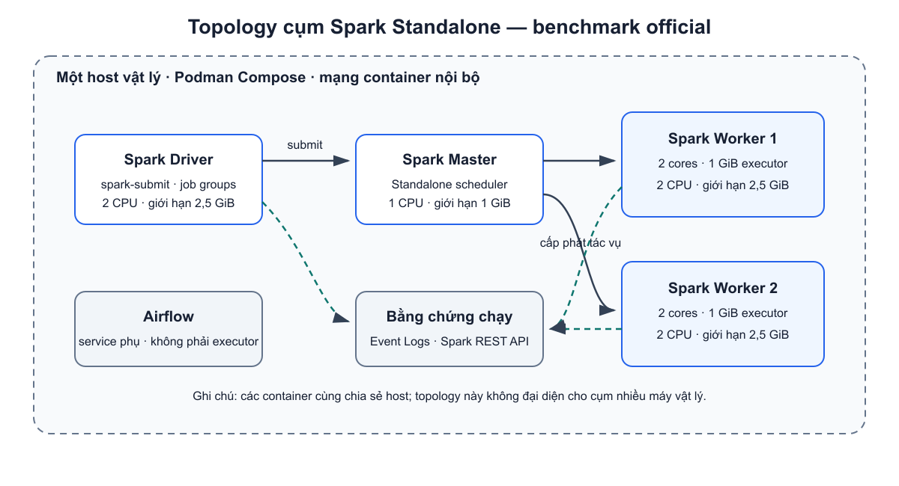
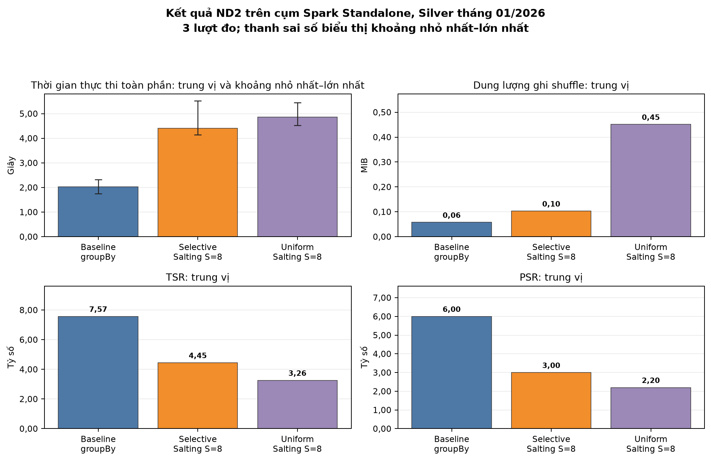
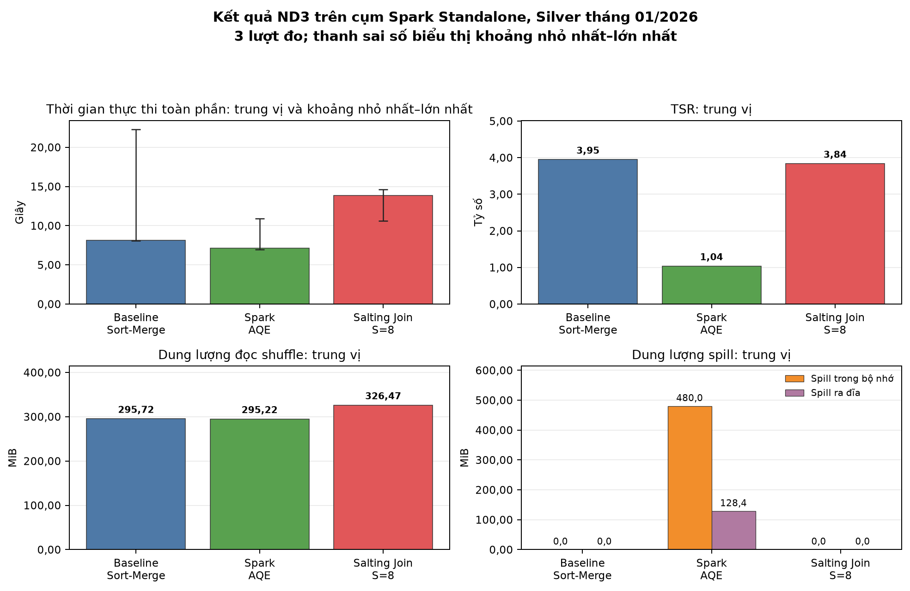
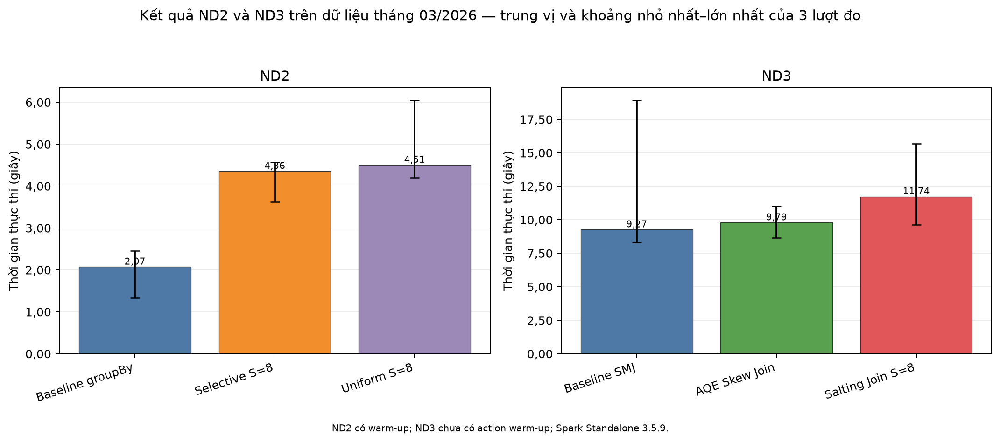
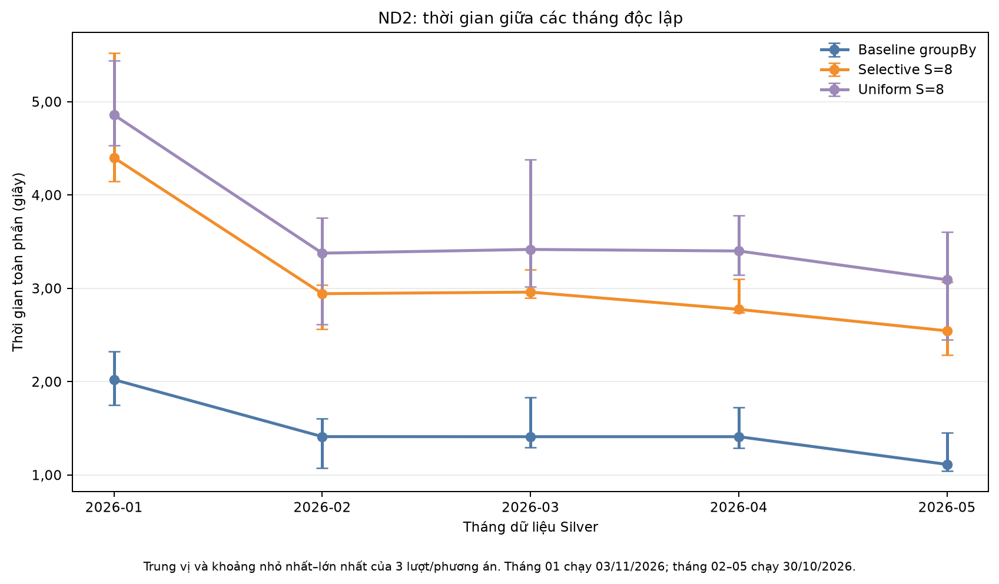
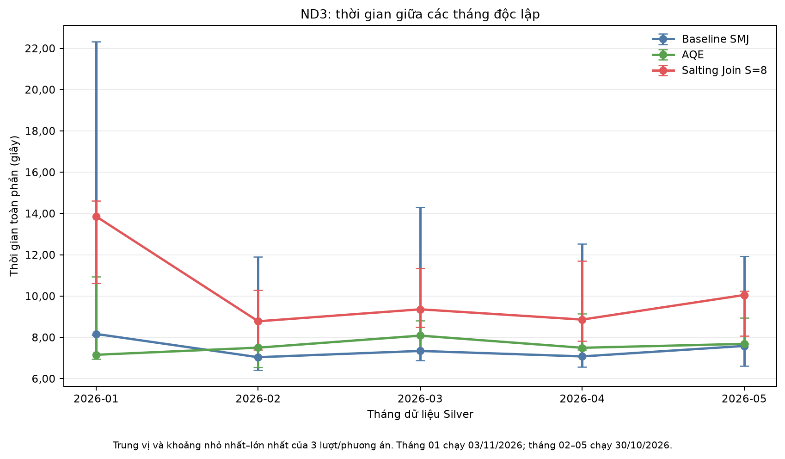
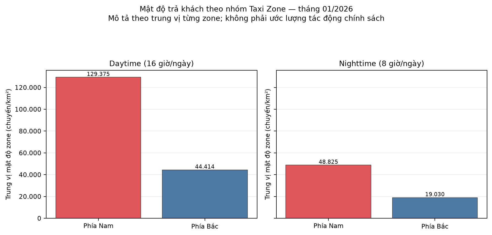
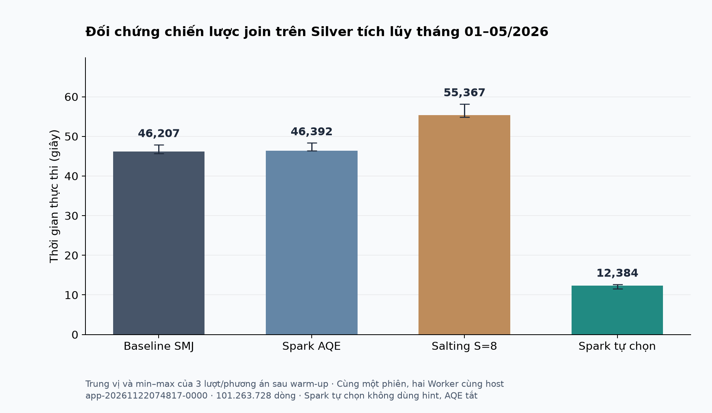

# CHƯƠNG 4. KẾT QUẢ THỰC NGHIỆM VÀ PHÂN TÍCH ĐÁNH ĐỔI HIỆU NĂNG

Chương này trình bày kết quả thực nghiệm và phân tích các đánh đổi hiệu năng của quy trình xử lý dữ liệu. Mục 4.1 mô tả môi trường và quy trình đo; mục 4.2 và 4.3 lần lượt phân tích hai bài toán ND2 (tổng hợp dữ liệu) và ND3 (kết nối phân tán); mục 4.4 kiểm chứng tính đúng đắn bằng DuckDB; mục 4.5 xem xét độ ổn định qua các tập dữ liệu tháng độc lập và kết quả tự động hóa ND4; mục 4.6 trình bày ứng dụng không gian mô tả của tầng Gold tại Manhattan; cuối cùng, mục 4.7 tổng hợp khuyến nghị kỹ thuật và mục 4.8 kết luận chương.

Các bảng benchmark báo cáo trung vị và khoảng nhỏ nhất–lớn nhất của ba lượt đo. ND2 official tháng 01 và ND3 official S3 có action warm-up; các lượt ND3 tháng 01–05 cũ và lượt ND4 ngày 20/11 không có job warm-up thực thi cho ND3, nên được phân biệt khi diễn giải. Chương tách benchmark từng tháng độc lập khỏi các tier tích lũy S1–S3; riêng S3 ND3 đã có kết quả official trên Silver tích lũy tháng 01–05. Quy ước trình bày số: dấu phẩy là dấu thập phân, dấu chấm phân tách hàng nghìn; dung lượng dùng MiB (1 MiB = 1.048.576 byte).

Câu hỏi được xem xét trong chương là: **trong workload tổng hợp và kết nối dữ liệu taxi đã đo, các lựa chọn Baseline, salting, AQE và chiến lược join do Spark tự chọn liên hệ thế nào với thời gian thực thi, mức lệch task và lượng dữ liệu shuffle?** Phân tích trả lời trong phạm vi cấu hình, dữ liệu và các phiên thực nghiệm đã lưu.

## 4.1. Thiết lập môi trường và quy trình đo lường thực nghiệm

### 4.1.1. Cấu hình cụm Apache Spark bằng Podman Compose

Thực nghiệm dùng cụm Apache Spark Standalone gồm Master, hai Worker và Driver, khởi chạy bằng Podman Compose trên cùng một máy vật lý. Các ứng dụng được báo cáo ghi nhận Spark 3.5.9 và hai Worker hoạt động. ND2/ND3 official tháng 01 dùng Silver tháng 01/2026; ND3 đọc OD gồm 58.747 cặp khóa duy nhất. Đợt ND3 S3 official dùng Silver tích lũy tháng 01–05/2026 (101.263.728 dòng) và OD gồm 63.572 composite key, có manifest riêng. Phiên đối chứng Spark tự chọn chiến lược join ngày 22/11 dùng lại đúng manifest S3 này, cùng hai Worker và cấu hình executor; phiên được báo riêng vì chạy ở application và thời điểm khác.

**Bảng 4.1. Tài nguyên khai báo cho các dịch vụ trong cụm thực nghiệm**

| Thành phần | Giới hạn CPU | Bộ nhớ Spark được khai báo | Giới hạn bộ nhớ container |
|---|---:|---:|---:|
| Spark Master | 1 CPU | — | 1 GiB |
| Mỗi Spark Worker (2 Worker) | 2 CPU | 2 GiB cho Spark Worker | 2,5 GiB |
| Spark Driver | 2 CPU | Không đặt heap riêng trong cấu hình Standalone được lưu | 2,5 GiB |
| Airflow Standalone trong benchmark tháng 01 | 1,5 CPU | — | 2 GiB |
| Airflow + Spark Driver trong ND4 tháng 03 | 2 CPU | Spark driver heap mặc định 1 GiB | 2,5 GiB |
| Executor trong S3 official và S3 mở rộng | `spark.cores.max=4` (mức trần) | 2 executor thực cấp × 1 core × 1.500 MiB mỗi executor | — |

*Nguồn: cấu hình dịch vụ trong `docker-compose.yml` và siêu dữ liệu ứng dụng Spark của các lượt benchmark được báo cáo.*

Các giá trị ở Bảng 4.1 là giới hạn được khai báo cho container và dung lượng Worker được cấp phép; đây không phải số liệu sử dụng CPU hay bộ nhớ đo trong từng ứng dụng. Metadata của cả S3 official (9/9 lượt) và S3 mở rộng (12/12 lượt) ghi nhận hai executor thực cấp, một core và 1.500 MiB cho mỗi executor, phân bố trên hai Worker. Vì vậy, `spark.cores.max=4` là mức trần được yêu cầu, không phải bốn core đã được cấp. Ở các lượt benchmark tháng 01, log ghi executor được cấp hai lõi và 1 GiB bộ nhớ. Airflow là dịch vụ phụ trợ, không tham gia thực thi task Spark; tuy nhiên, dịch vụ này cùng chia sẻ tài nguyên của máy chủ. Nghiên cứu không thu thập mức sử dụng CPU/bộ nhớ theo thời gian hoặc thông lượng mạng, vì vậy không dùng các giới hạn khai báo để suy ra mức tiêu thụ thực tế. Do hai Worker chạy trên cùng máy vật lý, kết quả cũng không đại diện trực tiếp cho cụm Spark nhiều máy giao tiếp qua mạng vật lý.

*Nguồn: Tác giả tổng hợp từ cấu hình cụm thực nghiệm. Driver gửi ứng dụng đến Master; Master cấp phát tài nguyên thực thi cho hai Worker. Spark REST API và Event Log cung cấp thông tin về tiến trình chạy, stage và task.*

### 4.1.2. Cấu hình giới hạn tài nguyên và các biến kiểm soát thực nghiệm

Để các phương án có thể so sánh trong cùng điều kiện, số phân vùng shuffle được đặt ở 200 cho cả hai bài toán. Với ND2, AQE (Adaptive Query Execution, cơ chế thực thi truy vấn thích ứng) được tắt trong cả ba nhánh để cô lập ảnh hưởng của cách gán salt. Trong ba nhánh ND3 chính, broadcast join bị tắt nhằm giữ phép nối theo sort-merge join (SMJ) cho Baseline, AQE và Salting Join. Phiên mở rộng có thêm nhánh tham chiếu không hint, AQE tắt và ngưỡng broadcast 10 MiB để quan sát lựa chọn tĩnh của Spark. Nhánh AQE bật cơ chế thực thi thích ứng và nhận diện phân vùng lệch với hệ số 2 cùng ngưỡng cấu hình 16 MiB. Đây là các tham số đầu vào của thực nghiệm; việc cấu hình AQE không tự chứng minh rằng nó đã chia nhỏ một phân vùng lệch.

Compose khai báo hạn mức CPU/bộ nhớ như Bảng 4.1. Với ND3 S3 official ba nhánh, project lưu telemetry lấy mẫu theo cửa sổ hai giây trong warm-up và cả chín lượt; phiên S3 mở rộng bốn nhánh cũng có telemetry đủ 12/12 cửa sổ. Các mẫu gồm host load, CPU/IO PSI, throttled time và bộ nhớ container. Đây là bối cảnh theo phiên, không phải phân bổ mức dùng CPU/I/O cho từng stage. Các lượt official tháng 01–05 cũ và ND4 tháng 03 không có cùng bộ telemetry host/cgroup; không dùng giới hạn Compose để suy ra usage hay chi phí cloud.

Trong mỗi bài toán, dữ liệu đầu vào, kiểu phép toán, số phân vùng shuffle, tài nguyên cụm và số lượt đo được giữ cố định. Biến thay đổi giữa các nhánh là chiến lược tổng hợp/phân vùng, trạng thái AQE hoặc việc bổ sung khóa salt như mô tả ở Bảng 4.2.

**Bảng 4.2. Ma trận phương án và biến kiểm soát trong benchmark ND2/ND3**

| Bài toán | Phương án | Phép toán / khóa | AQE | Broadcast | Số phân vùng shuffle | Salt |
|---|---|---|---|---|---:|---:|
| ND2 | Baseline | `groupBy(PULocationID)` | Tắt | Không áp dụng | 200 | — |
| ND2 | Uniform Salting | Tổng hợp hai giai đoạn | Tắt | Không áp dụng | 200 | 8 cho mọi khóa |
| ND2 | Selective Salting | Tổng hợp hai giai đoạn | Tắt | Không áp dụng | 200 | 8 cho hotspot P95; khóa khác salt 0 |
| ND3 | Baseline SMJ | Nối trong theo `(PULocationID,DOLocationID)` | Tắt | Tắt | 200 | — |
| ND3 | AQE Skew Join | Cùng phép nối và khóa | Bật; hệ số 2, ngưỡng 16 MiB | Tắt | 200 trước điều chỉnh thích ứng | — |
| ND3 | Salting Join | SMJ theo khóa ghép và `salt` | Tắt | Tắt | 200 | S=8 cho hotspot pickup; bảng OD được nhân bản |
| ND3 tham chiếu | Spark tự chọn chiến lược join | Inner join theo composite OD key; không ép `MERGE` | Tắt | Không ép hint; threshold 10 MiB | 200 | Không salting |

*Nguồn: cấu hình benchmark và mã triển khai ND2/ND3 của đồ án; ba nhánh chính được lưu trong artifact `official_standalone`, nhánh tham chiếu S3 nằm trong artifact `flowjoin_auto_strategy_20261122T074810Z`.*

Mỗi phương án có ba lượt đo, với thứ tự được luân phiên giữa các lượt. ND2 có một job warm-up cho từng phương án; kiểm tra Event Log ND3 cũ không thấy job thuộc các nhóm warm-up, dù mã runner có đoạn mang tên này. Kết quả được tóm tắt bằng trung vị và khoảng từ giá trị nhỏ nhất đến lớn nhất. Việc luân phiên thứ tự giảm khả năng một phương án luôn chạy đầu hoặc cuối, nhưng không thay thế warm-up. Với ba lượt đo, các thống kê này chỉ mô tả kết quả quan sát được.

### 4.1.3. Quy trình warm-up, đo lặp và thu thập số liệu

Quy trình mong muốn bắt đầu bằng một action warm-up trên cùng dữ liệu, sau đó chạy phép toán cần đo trong một nhóm công việc riêng (job group). Thời gian từ lúc bắt đầu nhóm đến khi action tính kết quả hoàn tất được gọi là thời gian thực thi toàn phần (wall-clock time). Bộ thu thập lấy thời lượng tác vụ (task), số lượng bản ghi và dữ liệu shuffle từ Spark REST API và Event Log; shuffle là lượng dữ liệu trao đổi giữa các phân vùng, còn spill là dữ liệu trung gian phải ghi ra bộ nhớ hoặc đĩa. Cuối cùng, runner lưu cấu hình, application ID, manifest đầu vào, Worker evidence và kế hoạch thực thi vật lý. Kiểm tra Event Log cho ND3 chính thức tháng 01–05 và lượt ND4 ngày 20/11 không thấy job warm-up: mã trước ngày 21/11/2026 gọi hàm dựng DataFrame mà thiếu action. Runner hiện đã được sửa để gọi `collect()`; phiên S3 mở rộng và hai phiên ND4 ngày 22/11 dùng runner đã sửa. Do đó, thời gian ND3 cũ phải được hiểu là các lượt đo **không có warm-up thực thi** và không gộp với pilot sau sửa.

Các chỉ số TSR và PSR, công thức tính, quy tắc chọn stage và cách xử lý giá trị không khả dụng được định nghĩa tại mục 3.1.3; mục này áp dụng nguyên các quy ước đó. Vì TSR/PSR được tính trên các task thuộc stage được chọn, các tỷ số này mô tả độ phân tán công việc trong stage đó, không thay thế thời gian thực thi toàn phần. Lượng shuffle và spill trong bảng được cộng qua các stage hoàn tất thuộc job group tương ứng. Bộ thu thập dùng Spark REST API và Event Log, không có SparkListener tùy biến. Telemetry host/cgroup có đủ cửa sổ cho S3 official ba nhánh (9/9 lượt) và phiên đối chứng bốn nhánh (12/12 lượt); các lượt cũ không có phép đo tương ứng. Hiện chưa có attribution CPU/I/O theo stage hoặc đo thông lượng mạng vật lý. JVM GC time có trong Event Log nhưng không phải chỉ số tổng hợp chính của các bảng.

Lượt xác nhận ND4 được điều phối bằng DAG Airflow `chapter4_nd4_march_2026_benchmark` theo thứ tự ND2 rồi ND3. Mã lượt chạy Airflow và ID ứng dụng Spark được ghi tại Bảng 4.12 để kết quả có thể truy nguyên. Cả ba task benchmark, kiểm định và đóng gói của lượt xác nhận đều hoàn tất thành công.

Một lượt đo chỉ được giữ trong tập kết quả hợp lệ khi bộ thu thập hoàn tất và kiểm tra tính đúng đắn trả về `PASS`. Manifest nhận diện phiên bản đầu vào bằng tên tương đối, kích thước và thời điểm sửa đổi của các tệp Parquet; nó giúp xác định tập tệp đã dùng nhưng không phải mã kiểm tra toàn bộ nội dung tệp.

## 4.2. Kết quả thực nghiệm trên phép toán tổng hợp dữ liệu

### 4.2.1. So sánh thời gian thực thi và các chỉ số tổng hợp

ND2 là bài toán tổng hợp dữ liệu (aggregation), thực hiện tổng hợp chuyến theo mã vùng đón `PULocationID`, gồm số chuyến, giá vé cơ sở trung bình và tổng quãng đường. Baseline dùng phép `groupBy` trực tiếp. Uniform Salting chia mọi mã vùng vào tám salt; Selective Salting chỉ chia các mã vùng được xác định là hotspot theo ngưỡng P95, còn các mã khác nhận salt 0. Bảng 4.3 trình bày kết quả ba lượt đo của mỗi phương án trên Silver tháng 01/2026. Lượt benchmark ND2 được thực thi trong ứng dụng Spark `app-20261103153557-0001`.

**Bảng 4.3. Kết quả benchmark ND2 trên Silver tháng 01/2026**

| Phương án | Số lượt | Thời gian thực thi toàn phần: trung vị [nhỏ nhất–lớn nhất] (giây) | TSR trung vị | PSR trung vị | Dung lượng ghi shuffle trung vị (MiB) | Spill trong bộ nhớ (MiB) | Spill ra đĩa (MiB) |
|---|---:|---:|---:|---:|---:|---:|---:|
| Baseline GroupBy | 3 | 2,022 [1,747–2,325] | 7,57 | 6,00 | 0,057 | 0 | 0 |
| Selective Salting S=8 | 3 | 4,400 [4,148–5,520] | 4,45 | 3,00 | 0,103 | 0 | 0 |
| Uniform Salting S=8 | 3 | 4,859 [4,530–5,442] | 3,26 | 2,20 | 0,451 | 0 | 0 |

*Nguồn: CSV cấp lượt đo của ND2, ứng dụng Spark `app-20261103153557-0001`. Các giá trị spill bằng 0 được ghi nhận bằng 0 trong dữ liệu nguồn; giá trị không khả dụng, nếu có, không được thay bằng 0.*

Baseline đạt thời gian trung vị thấp nhất, 2,022 giây. Selective Salting cần 4,400 giây, tương đương khoảng 2,18 lần thời gian Baseline; Uniform Salting cần 4,859 giây, khoảng 2,40 lần Baseline. Trong hai phương án có salting, Selective nhanh hơn Uniform khoảng 9,4%. Như vậy, với tập Silver và cấu hình đang khảo sát, việc chia salt chưa giúp giảm thời gian toàn phần so với phép tổng hợp cơ sở.

So với Uniform Salting, Selective Salting giảm ghi shuffle từ 0,451 MiB xuống 0,103 MiB, tương đương khoảng 77%. Tuy nhiên, mức giảm tuyệt đối chỉ khoảng 0,348 MiB (xấp xỉ 365 KiB); đồng thời ghi shuffle của Selective vẫn cao hơn Baseline (0,057 MiB). Vì thế không nên diễn giải mức giảm tương đối 77% như một lượng dữ liệu lớn được tiết kiệm ở cấp hệ thống. Kết quả phù hợp với kế hoạch thực thi: các nhánh salting phải xử lý thêm salt và tổng hợp hai giai đoạn, trong khi Baseline đã có bước tổng hợp cục bộ trước khi trao đổi dữ liệu. Đây là cách lý giải dựa trên cấu trúc kế hoạch; thực nghiệm chưa đo riêng thời gian CPU của từng thao tác.

### 4.2.2. Mức độ lệch tải tác vụ và tác vụ kéo dài

Trong cả ba phương án, stage được chọn có trung vị 200 task. Baseline có TSR 7,57 và PSR 6,00; các tỷ số tương ứng của Selective Salting là 4,45 và 3,00, còn Uniform Salting là 3,26 và 2,20. Theo các chỉ số này, thời lượng và số bản ghi giữa các task trong stage được chọn phân tán hơn ở Baseline. Tuy nhiên, đây không đủ để kết luận các hotspot P95 chính là nguyên nhân gây tác vụ kéo dài: P95 được xác định từ phân bố chuyến theo vùng, trong khi TSR/PSR mô tả phân bố task ở stage. Hơn nữa, các tỷ số thấp hơn ở hai nhánh salting không làm giảm thời gian toàn phần. Do đó, hiệu quả phải được đánh giá đồng thời bằng chỉ số lệch task, thời gian toàn phần và lượng dữ liệu shuffle.

Phân tích bổ sung trên event log của chính ứng dụng tháng 01 đối chiếu `shuffle read records` với `executorRunTime` của 200 successful tasks trong stage được chọn cho từng lượt. Hệ số tương quan hạng Spearman của Baseline qua ba lượt là 0,293/0,281/0,311; Selective là 0,166/0,159/0,314; Uniform là 0,007/0,044/0,034. Mối liên hệ giữa số record và thời gian task không đồng đều giữa các phương án. Đây là mô tả trong từng stage, không chứng minh riêng khóa P95 gây nghẽn hoặc xác định CPU là nút thắt.

### 4.2.3. Chi phí shuffle và spill

Trong ba lượt tháng 01, không phương án ND2 nào ghi nhận spill trong bộ nhớ hoặc spill ra đĩa. Về ghi shuffle, Selective Salting thấp hơn Uniform Salting nhưng cao hơn Baseline. Kết hợp với thời gian thực thi, kết quả cho thấy cân bằng task tốt hơn và giảm shuffle so với một nhánh salting khác chưa đủ để tạo lợi ích đầu-cuối so với Baseline trên bài toán này.

### 4.2.4. Đánh giá lựa chọn hotspot P95

Tập hotspot P95 tháng 01 được tính trên 261 mã vùng đón khác null. Theo quy tắc nearest-rank, hạng P95 là 248, ngưỡng đếm là 194.522 chuyến; các vùng có số chuyến bằng hoặc vượt ngưỡng được chọn, tạo thành tập 14 mã `PULocationID`. Việc chỉ chia salt cho các mã này giới hạn số khóa bị biến đổi so với Uniform Salting. Dù vậy, Selective Salting vẫn có thời gian trung vị cao hơn Baseline khoảng 2,18 lần. Kết quả không phủ nhận khả năng salting hữu ích trong bài toán khác; nó cho thấy trong thí nghiệm hiện tại, giảm phạm vi áp dụng salting chưa loại bỏ chi phí của các bước bổ sung.

Ngưỡng P95 là heuristic dựa trên số chuyến của từng vùng, không phải nhãn được tạo từ thời lượng task hoặc dung lượng partition. Vì vậy, 14 vùng được chọn là các vùng có tần suất chuyến cao theo quy tắc P95; chưa thể khẳng định mọi vùng đó trực tiếp gây lệch tải tính toán.

Kế hoạch thực thi vật lý thể hiện khác biệt về số bước: Baseline tổng hợp cục bộ theo `PULocationID`, trao đổi dữ liệu theo khóa này rồi hoàn tất tổng hợp; hai nhánh salting thêm bước gán salt và tổng hợp theo `(PULocationID, salt)`, sau đó lại trao đổi và gộp theo `PULocationID`. Selective Salting chỉ gán salt khác 0 cho các hotspot, nhờ đó ghi shuffle thấp hơn Uniform Salting; nhưng cả hai vẫn phải thực hiện bước gộp thứ hai.

Kết quả Airflow ND4 trên Silver tháng 03 được trình bày riêng ở Bảng 4.12; không gộp vào số liệu ND2 tháng 01 trong Bảng 4.3 hoặc Hình 4.2.

*Hình 4.2. Thời gian thực thi toàn phần và lượng dữ liệu ghi shuffle được so sánh cùng TSR/PSR của stage được chọn. Thanh sai số ở biểu đồ thời gian thể hiện nhỏ nhất–lớn nhất của ba lượt đo. Nguồn: kết quả benchmark ND2 tháng 01/2026, ứng dụng Spark `app-20261103153557-0001`.*

## 4.3. Kết quả thực nghiệm trên phép kết nối phân tán

### 4.3.1. So sánh thời gian thực thi

ND3 là phép nối trong (inner join) giữa bảng chuyến đi và bảng chiều OD theo cặp mã vùng đón–trả `(PULocationID, DOLocationID)`. Đây là phép nối theo khóa, không phải phép nối không gian dựa trên giao cắt hay khoảng cách giữa các đa giác. Ba phương án chính gồm Sort-Merge Join cơ sở (Baseline SMJ), Sort-Merge Join có AQE và Salting Join S=8. Ngoài ra, một phiên mở rộng so sánh thêm nhánh tham chiếu Spark tự chọn chiến lược join, không hint, trên cùng manifest S3; kết quả được trình bày riêng ở mục 4.7 vì application và thời điểm đo khác với S3 official ba nhánh. Bảng 4.4 đặt kết quả official tháng 01 cạnh tier S3 tích lũy; mỗi phương án có ba lượt đo, nhưng phiên tháng 01 không có warm-up thực thi còn S3 có warm-up. Vì thế các nhóm được so sánh mô tả riêng theo phạm vi, không gộp lượt. Tháng 01 chạy trong ứng dụng `app-20261103153727-0002`; S3 ba nhánh dùng application `app-20261121180448-0005`; phiên mở rộng bốn nhánh dùng `app-20261122074817-0000` và cùng fingerprint đầu vào S3.

**Bảng 4.4. Kết quả ND3 official theo hai phạm vi dữ liệu**

| Phạm vi / phương án | Số lượt | Thời gian thực thi toàn phần: trung vị [nhỏ nhất–lớn nhất] (giây) | TSR trung vị | PSR trung vị | Shuffle Read trung vị (MiB) | Memory spill (MiB) | Disk spill (MiB) |
|---|---:|---:|---:|---:|---:|---:|---:|
| Tháng 01 — Baseline SMJ | 3 | 8,165 [8,108–22,316] | 3,95 | 2,06 | 295,72 | 0 | 0 |
| Tháng 01 — Spark AQE | 3 | 7,157 [6,955–10,935] | 1,04 | 1,00 | 295,22 | 480,00 | 128,37 |
| Tháng 01 — Salting S=8 | 3 | 13,858 [10,634–14,618] | 3,84 | 1,60 | 326,47 | 0 | 0 |
| S3 tích lũy — Baseline SMJ | 3 | 45,902 [45,419–46,076] | 1,94 | 1,95 | 1.496,69 | 0 | 0 |
| S3 tích lũy — Spark AQE | 3 | 45,052 [44,800–45,143] | 1,22 | 1,07 | 1.496,24 | 0 | 0 |
| S3 tích lũy — Salting S=8 | 3 | 54,013 [53,749–54,103] | 1,62 | 1,55 | 1.650,64 | 0 | 0 |

*Nguồn: tháng 01 — CSV lượt đo ứng dụng `app-20261103153727-0002`; S3 — official application `app-20261121180448-0005`, Spark 3.5.9 Standalone, hai Worker. Số 0 là giá trị ghi nhận; metric thiếu phải giữ NA.*

Ba dòng tháng 01 là lượt official cũ, không có job warm-up thực thi. Ba dòng S3 là tier tích lũy 01–05/2026, có warm-up và telemetry host/cgroup đủ 9/9 cửa sổ. Trước official, pilot lặp đạt gate ±10% median đã chốt trước phiên; mức này là tiêu chí nội bộ cho lần lặp, không phải chuẩn phổ quát. Fingerprint manifest Silver/OD và toàn bộ plan, audit, task records nằm trong `data/benchmarks/scaling/s3_jan_may/nd3_official_20261122/`. Hai nhóm được đặt cạnh nhau để đối chiếu phạm vi; không gộp thành một thí nghiệm cùng phiên hay suy ra quan hệ tuyến tính theo kích thước dữ liệu.

Trong lượt tháng 01, AQE có median thấp hơn Baseline khoảng 12,4%, còn Salting cao hơn khoảng 69,7%; Baseline có một lượt chậm được giữ lại theo quy tắc đã định. Ở S3 official, AQE thấp hơn Baseline khoảng 1,9%, trong khi Salting cao hơn khoảng 17,7%. Chênh lệch AQE–Baseline ở S3 nhỏ và chỉ gồm ba lượt trong một phiên; chưa đủ cơ sở gọi đó là ưu thế ổn định. S3 Salting có Shuffle Read cao hơn Baseline khoảng 10,3%.

**Bảng 4.5. Thời gian thực thi toàn phần của từng lượt ND3**

| Phương án | Lượt đo 1 (giây) | Lượt đo 2 (giây) | Lượt đo 3 (giây) | Nhận xét |
|---|---:|---:|---:|---|
| Baseline Sort-Merge | 22,316 | 8,165 | 8,108 | Lượt 1 cao hơn rõ rệt; vẫn giữ trong thống kê vì bộ thu thập số liệu `OK` và kiểm chứng `PASS` |
| Spark AQE | 10,935 | 7,157 | 6,955 | Cả ba lượt cùng xu hướng giảm; tuy nhiên, số lượt đo còn ít |
| Salting Join S=8 | 14,618 | 13,858 | 10,634 | Khoảng dao động nhỏ hơn Baseline trong lượt này |

*Nguồn: CSV cấp lượt đo ND3 của ứng dụng Spark `app-20261103153727-0002`.*

Để xác định vị trí phát sinh biến động, Event Log của ứng dụng Spark `app-20261103153727-0002` được đối chiếu theo từng lượt. Kết quả cho thấy stage shuffle được chọn của lượt 1 (stage 14, gồm 200 task) kéo dài khoảng 14,98 giây; cùng stage ở lượt 2 (stage 44) và lượt 3 (stage 52) lần lượt kéo dài 5,15 và 5,49 giây. Stage đọc và trao đổi dữ liệu đầu vào trước đó lần lượt mất 3,77; 1,84; và 1,67 giây. Số dòng và số byte đầu vào được ghi nhận là như nhau giữa ba lượt; Event Log không đánh dấu task chạy suy đoán (speculative task).

**Bảng 4.6. Chỉ số Event Log của stage được chọn trong ba lượt Baseline**

| Lượt Baseline | Mã stage | Số task | Thời gian stage (giây) | Thời gian task lớn nhất / trung vị (giây) | Tổng thời gian GC của task (giây) |
|---:|---:|---:|---:|---:|---:|
| 1 | 14 | 200 | 14,982 | 1,541 / 0,236 | 0,822 |
| 2 | 44 | 200 | 5,150 | 0,232 / 0,088 | 0,314 |
| 3 | 52 | 200 | 5,490 | 0,328 / 0,083 | 0,241 |

*Nguồn: Spark Event Log của ứng dụng `app-20261103153727-0002`; tổng hợp theo stage được chọn ở từng lượt Baseline.*

Thời gian GC cộng dồn của các task ở stage 14 là 0,822 giây, so với 0,314 và 0,241 giây ở hai lượt còn lại. Đây là dấu hiệu GC tăng đồng thời với thời gian stage, nhưng tổng GC được cộng từ các task chạy song song nên không thể xem là phần thời gian trực tiếp cấu thành thời gian thực thi toàn phần. Log cũng chưa cung cấp số đo mức sử dụng CPU của host, hoạt động I/O hệ thống hoặc tranh chấp tài nguyên đủ để kết luận nguyên nhân. Vì lượt 1 có bộ thu thập số liệu `OK` và kiểm tra đúng đắn `PASS`, nghiên cứu giữ lượt này trong thống kê thay vì loại bỏ sau khi quan sát kết quả. Với ba lượt đo, AQE có trung vị thấp nhất, nhưng cần thận trọng vì một lượt Baseline kéo dài làm khoảng nhỏ nhất–lớn nhất của Baseline rộng hơn.

Kết quả Airflow ND4 cho ND3 tháng 03 được báo riêng ở Bảng 4.12; không gộp vào các thống kê tháng 01 của Bảng 4.4–4.8.

### 4.3.2. Độ lệch task, shuffle và spill

Trong stage được chọn, AQE có năm task ở cả ba lượt sau khi Spark gộp các phân vùng shuffle; Baseline và Salting Join mỗi phương án có 200 task. Vì số lượng và cách hình thành task khác nhau, TSR/PSR của AQE không được tính trên một tập task có cấu trúc tương đương với hai nhánh còn lại. Kế hoạch cuối có `AQEShuffleRead coalesced`, thể hiện thao tác gộp phân vùng; tuy nhiên, kế hoạch không có dấu hiệu chia nhỏ phân vùng do skew. Do đó, TSR=1,04 và PSR=1,00 của AQE chỉ cho biết độ phân tán thấp trong stage được chọn sau coalescing, không chứng minh cơ chế skew join đã xử lý hot key.

AQE ghi nhận 480 MiB memory spill và 128,37 MiB disk spill tính trên các stage hoàn tất của job group. Baseline và Salting Join không ghi nhận spill. Salting Join đọc 326,47 MiB shuffle, cao hơn Baseline 295,72 MiB khoảng 10,4%; mặc dù TSR/PSR của Salting thấp hơn Baseline, thời gian trung vị của Salting vẫn cao hơn. Kết quả này cho thấy các chỉ số lệch task cần được xem cùng lượng dữ liệu trao đổi, spill và thời gian toàn phần.

Trên event log tháng 01, tương quan hạng Spearman giữa `shuffle read records` và `executorRunTime` trong stage được chọn là 0,422/0,499/0,516 cho ba lượt Baseline; 0,248/0,276/0,356 cho Salting; và 0,700/0,600/0,700 cho AQE. Mỗi stage AQE ở đây chỉ có năm task sau coalescing, trong khi Baseline và Salting có 200 task; các hệ số không nên dùng để xếp hạng chất lượng cân bằng tải giữa ba phương án. Phép tính cũng không tách được thời gian CPU, chờ shuffle hoặc GC thành các nguyên nhân độc lập.

### 4.3.3. Physical plan và hành vi AQE

Kế hoạch thực thi vật lý cuối của AQE có `AdaptiveSparkPlan isFinalPlan=true`, `SortMergeJoin` và `AQEShuffleRead coalesced`. Không có node thể hiện skew-specific partition split. Đây là bằng chứng AQE đã tạo kế hoạch thích ứng và gộp dữ liệu shuffle trong lần chạy, nhưng không có bằng chứng nó đã chia nhỏ phân vùng lệch. Kết luận này giới hạn ở cấu hình đã dùng: 200 shuffle partitions, ngưỡng 16 MiB, hệ số skew 2 và phép nối Sort-Merge. Không thể suy ra một phân vùng vượt ngưỡng chỉ từ tổng shuffle của toàn stage.

**Bảng 4.7. Đối chiếu các thành phần chính trong kế hoạch thực thi ND3**

| Phương án | Bằng chứng trong kế hoạch thực thi | Diễn giải |
|---|---|---|
| Baseline SMJ | `SortMergeJoin` trên `(PULocationID,DOLocationID)`; hai phía có `Exchange hashpartitioning(..., 200)` và `Sort` | Join phân tán theo khóa OD, không phải phép nối hình học |
| AQE | `AdaptiveSparkPlan isFinalPlan=true`, `AQEShuffleRead coalesced`, `SortMergeJoin`; không có node chia nhỏ phân vùng skew | AQE đã gộp các phân vùng shuffle trong lần chạy này; cấu hình không tạo bằng chứng về chia nhỏ phân vùng skew |
| Salting Join S=8 | Join key đổi thành `(PULocationID,DOLocationID,salt)`; nhánh OD có `Generate explode(...)` | Salt được gắn cho trip và replicate cho OD dimension để bảo toàn cặp khớp |
| Spark tự chọn (phiên S3 mở rộng) | `BroadcastHashJoin`, OD ở phía build; mã nhánh không có join hint | Spark chọn broadcast trong cấu hình AQE tắt, threshold 10 MiB; đây là hành vi của phiên đo, không phải Flow-Join++ |

*Nguồn: ba kế hoạch S3 official trong `data/benchmarks/nd3_plans/official_standalone/`; kế hoạch của phiên Spark auto-strategy nằm trong `data/benchmarks/scaling/s3_jan_may/flowjoin_auto_strategy_20261122T074810Z/nd3_plans/`.*

Ở Baseline, hai phía của phép nối được phân vùng theo cặp mã vùng OD rồi sắp xếp trước khi thực hiện Sort-Merge Join. Ở Salting Join, salt được thêm vào khóa nối của chuyến đi, còn các dòng OD ứng với vùng pickup nóng được nhân bản qua các salt để duy trì tính đúng đắn. Kế hoạch của AQE cho thấy coalescing, không phải chia phân vùng skew. Các kế hoạch cuối của ba phương án được lưu cùng ứng dụng Spark `app-20261103153727-0002` để có thể đối chiếu với kết quả định lượng.

### 4.3.4. Chi phí nhân bản dimension của Salting Join

Ở ND3 tháng 01, OD có 58.747 dòng, trong đó 3.557 dòng thuộc pickup hotspot; với S=8, phép nhân bản làm tăng `3.557 × (8 − 1) = 24.899` dòng, tạo bảng 83.646 dòng. Ở S3, OD có 63.572 dòng; sau salting được materialize thành 88.828 dòng, tăng 25.256 dòng. Phần tăng S3 tương ứng 3.608 dòng hotspot được nhân thêm bảy bản sao mỗi dòng. Đây là số đếm sau materialize; byte và mức dùng bộ nhớ riêng của bảng dimension không được tách đo.

**Bảng 4.8. Số dòng OD trước và sau nhân bản trong Salting Join**

| Chỉ tiêu bảng OD | Tháng 01/2026 | S3 tích lũy 01–05/2026 | Diễn giải |
|---|---:|---:|---|
| Trước salting | 58.747 | 63.572 | Số composite key duy nhất sau preflight |
| Dòng hotspot được nhân bản | 3.557 | 3.608 | S3 suy ra từ `25.256 ÷ (8 − 1)` |
| Hàng phát sinh thêm | 24.899 | 25.256 | `số dòng hotspot × (S − 1)` |
| Sau explode/replication | 83.646 | 88.828 | Số dòng materialize trước phép nối |

*Nguồn: audit OD tháng 01 và artifact S3 official `app-20261121180448-0005`; số dòng sau salting được đếm sau materialize.*

Số dòng OD tăng khoảng 42,4% ở tháng 01 và 39,8% ở S3. Đây là tỷ lệ tăng số dòng, không phải tỷ lệ tăng dung lượng byte hay mức dùng bộ nhớ.

Sau các lượt chính thức, pilot ngày 21/11/2026 chạy thêm nhánh Broadcast Hash Join trên cùng Silver và OD tháng 01, ba lượt đo/phương án sau action warm-up và xoay thứ tự. Cả 12 lượt có telemetry `OK` và DuckDB `PASS`; kế hoạch thực thi xác nhận `BroadcastHashJoin`. Trung vị Broadcast là 2,403 giây [2,368–2,710], so với Baseline SMJ 9,658 giây [8,961–9,802] trong cùng phiên pilot. Nhánh Broadcast dùng hint tường minh; kết quả này chưa chứng minh Spark mặc định sẽ chọn Broadcast hay hiệu năng ổn định qua nhiều phiên. Số liệu và provenance được lưu riêng trong tài liệu `phase_b/pilot_nd3_broadcast_20261121.md`; không gộp vào Bảng 4.4–4.8.

Ở tháng 01, AQE có median thấp nhất nhưng phát sinh spill; ở S3, spill bằng 0 và AQE chỉ coalesce, không có skew-specific split. Salting có runtime và Shuffle Read cao hơn Baseline trong cả hai phạm vi đã đo, đồng thời tăng số dòng OD sau replication. Đây là kết quả của cấu hình và các phiên cụ thể, không khẳng định mọi workload đều bất lợi cho salting.

*Hình 4.3. Thời gian thực thi toàn phần, TSR, lượng dữ liệu đọc shuffle và spill của ba phương án. Thanh sai số ở biểu đồ thời gian thể hiện nhỏ nhất–lớn nhất của ba lượt đo. Nguồn: kết quả benchmark ND3 tháng 01/2026, ứng dụng Spark `app-20261103153727-0002`.*

## 4.4. Kiểm chứng tính đúng đắn và nhất quán dữ liệu bằng DuckDB

### 4.4.1. Đối soát kết quả phép tổng hợp

Kết quả ND2 được tổng hợp theo 261 mã vùng đón. Với mỗi mã vùng, DuckDB được dùng để tính độc lập số chuyến, giá vé cơ sở trung bình và tổng quãng đường; các giá trị này được so sánh với kết quả Spark. Sai khác được tính theo trị tuyệt đối `|Spark − DuckDB|`. Dung sai được đặt bằng 0 chuyến cho số đếm, `1e-4` cho giá vé trung bình và `1e-2` cho tổng quãng đường. Không có vùng nào vượt các dung sai này.

### 4.4.2. Đối soát kết quả phép nối

Kết quả ND3 được tổng hợp theo cặp vùng hành chính nguồn–đích (borough pair). Với mỗi cặp, phép đối soát kiểm tra số chuyến, tổng giá vé, tổng quãng đường, số vùng đón phân biệt và mức độ bao phủ các cặp có trong kết quả DuckDB. Hai phía Spark và DuckDB làm tròn tổng giá vé và tổng quãng đường đến hai chữ số thập phân trước khi tính sai khác. Sai khác dùng trị tuyệt đối `|Spark − DuckDB|`; dung sai là 0,05 cho tổng giá vé và tổng quãng đường, bằng 0 cho số chuyến, số vùng đón phân biệt và tính đầy đủ của tập cặp.

Cả 32 cặp borough trong kết quả DuckDB đều xuất hiện trong kết quả của cả ba phương án Spark. Số chuyến và số vùng đón phân biệt khớp chính xác. Sai khác tổng quãng đường lớn nhất lưu trong audit là khoảng `0,01000000001`, được trình bày làm tròn thành `0,01`. Sai khác tổng giá vé bằng 0 ở độ chính xác audit sau khi làm tròn hai chữ số; điều này không khẳng định hai tổng chưa làm tròn bằng nhau ở độ chính xác đầy đủ. Ba phương án cho cùng tổng 19.993.097 chuyến.

Các giá trị ND2 trong Bảng 4.9 là sai khác tuyệt đối lớn nhất trên 261 vùng của một bảng audit tổng hợp cho từng phương án. Các giá trị ND3 là sai khác lớn nhất trên 32 cặp borough. Vì vậy, mỗi dòng tóm tắt các nhóm trong audit của phương án tương ứng; đây không phải cực đại tính qua ba bảng audit độc lập theo từng lượt đo.

**Bảng 4.9. Sai khác lớn nhất giữa kết quả Spark và DuckDB cho ND2/ND3**

| Bài toán | Phương án | Số nhóm đối soát | Nhóm sai khác số chuyến | Sai khác giá vé tối đa | Sai khác quãng đường tối đa | Nhóm sai khác số vùng đón | Mức bao phủ | Kết quả |
|---|---|---:|---:|---:|---:|---:|---:|---|
| ND2 | Baseline GroupBy | 261 mã vùng đón | 0 | 5,08e-13 | 2,70e-8 | — | 261/261 | PASS |
| ND2 | Selective Salting S=8 | 261 mã vùng đón | 0 | 3,77e-13 | 3,08e-8 | — | 261/261 | PASS |
| ND2 | Uniform Salting S=8 | 261 mã vùng đón | 0 | 4,83e-13 | 3,08e-8 | — | 261/261 | PASS |
| ND3 | Baseline Sort-Merge | 32 cặp borough | 0 | 0,00 | 0,01 | 0 | 32/32 | PASS |
| ND3 | Spark AQE | 32 cặp borough | 0 | 0,00 | 0,01 | 0 | 32/32 | PASS |
| ND3 | Salting Join S=8 | 32 cặp borough | 0 | 0,00 | 0,01 | 0 | 32/32 | PASS |

*Nguồn: các tệp audit đối soát DuckDB chính thức của ND2 và ND3 tháng 01/2026.*

### 4.4.3. Kiểm tra khóa OD và phạm vi trạng thái các lượt chạy

Trước phép nối, bảng OD có 58.747 dòng và 58.747 cặp khóa `(PULocationID, DOLocationID)` phân biệt; không có khóa null hoặc trùng. Điều kiện này bảo đảm mỗi cặp chuyến đi khớp tối đa một dòng OD trước khi áp dụng salting. Với Salting Join, số dòng sau khi nhân bản được tính đầy đủ và đếm là 83.646, đúng bằng số dự kiến. Mỗi lượt đo cũng lưu đường dẫn Silver/OD và manifest nhận diện tệp Parquet theo tên tương đối, kích thước và thời điểm sửa đổi. Manifest giúp nhận diện tập đầu vào nhưng không phải checksum nội dung.

Phạm vi kiểm chứng cần được hiểu theo cách runner tạo audit. Trong mỗi ứng dụng, runner giữ kết quả Spark của lượt đo cuối cùng cho từng phương án, đối chiếu kết quả đó với DuckDB một lần, rồi gán trạng thái kiểm chứng của phương án vào metadata của cả ba lượt. Do đó, audit theo vùng/cặp borough ở mục này kiểm tra một kết quả tổng hợp cho mỗi phương án; trạng thái `PASS` lặp lại ở ba dòng metadata không phải ba lần đối soát DuckDB độc lập. Riêng tháng 01, có sáu kết quả phương án được đối soát chi tiết: ba phương án ND2 và ba phương án ND3; cả sáu đều đạt dung sai. Ở S3 ND3 official, 9/9 lượt ghi collector `OK` và DuckDB `PASS`; kết quả dùng manifest riêng, không cộng vào audit tháng 01–05. Phiên S3 mở rộng có bốn phương án và 12/12 dòng run ghi collector `OK`; DuckDB `PASS` được kiểm tra một lần ở cấp phương án rồi gắn vào ba iteration của phương án đó, không phải 12 lần audit độc lập. Cả bốn phương án dùng cùng fingerprint Silver/OD; 12 final plan và worker evidence được lưu cùng artifact phiên. Nhánh Spark tự chọn khớp 101.263.728 chuyến với 63.572 khóa OD duy nhất, không có khóa null/trùng hoặc chuyến không khớp.

Trong năm tháng dữ liệu, mỗi bài toán có 45 dòng metadata đo lường (ba phương án × ba lượt × năm tháng), tổng cộng 90 dòng cho ND2 và ND3. Cả 90 dòng đều ghi bộ thu thập số liệu `OK` và trạng thái kiểm chứng cấp phương án là `PASS`; không có dòng nào bị loại khỏi bảng tổng hợp theo hai trạng thái này. Con số 90/90 mô tả trạng thái của các dòng metadata, không phải 90 phép đối soát DuckDB độc lập. Các dòng của ND4 Airflow tháng 03 không nằm trong 90 dòng theo tháng này; ND4 có thêm 18 dòng riêng ở lượt `nd4-march-clean-20261120`, đều `OK`/`PASS`.

**Bảng 4.10. Trạng thái bộ thu thập số liệu và kiểm chứng được ghi trong metadata benchmark tháng 01–05**

| Bài toán | Phương án | Số dòng lượt đo | Thu thập số liệu thành công | Kiểm chứng cấp phương án đạt | Dòng bị loại |
|---|---|---:|---:|---:|---:|
| ND2 | Baseline GroupBy | 15 | 15 | 15 | 0 |
| ND2 | Selective Salting S=8 | 15 | 15 | 15 | 0 |
| ND2 | Uniform Salting S=8 | 15 | 15 | 15 | 0 |
| ND3 | Baseline Sort-Merge | 15 | 15 | 15 | 0 |
| ND3 | Spark AQE | 15 | 15 | 15 | 0 |
| ND3 | Salting Join S=8 | 15 | 15 | 15 | 0 |

*Nguồn: CSV metadata lượt đo ND2/ND3 thuộc hạng `official_standalone` cho tháng 01–05/2026.*

Các kết quả trong mục này được đối chiếu từ metadata lượt chạy, audit DuckDB, kế hoạch thực thi vật lý và Event Log của cụm Spark Standalone. Kết quả tháng 01 dùng lần chạy ngày 03/11/2026; trạng thái tháng 02–05 lấy từ bộ metadata đã lưu trước đó. Sự khác biệt về ngày chạy được giữ rõ trong phạm vi phân tích, không xem kết quả tháng 01 mới và tháng 02–05 cũ là cùng một đợt thực nghiệm liên tục.

## 4.5. Đánh giá tính ổn định của kết quả qua năm tháng dữ liệu độc lập

### 4.5.1. Phạm vi dữ liệu và nguồn lượt chạy

Bảng 4.11 phân biệt số dòng Raw với số dòng Silver dùng làm đầu vào benchmark. Raw là bản ghi taxi nguyên gốc của tháng; Silver là dữ liệu đã qua các bước lọc ở Chương 2. Mỗi tháng là một tập riêng, không phải dữ liệu tích lũy từ tháng 01.

**Bảng 4.11. Quy mô Raw và Silver theo tháng**

| Tháng | Raw (dòng) | Silver (dòng) | Silver (MiB) | Ngày chạy benchmark official |
|---|---:|---:|---:|---|
| 01/2026 | 20.940.373 | 19.993.097 | 324,79 | 03/11/2026 |
| 02/2026 | 19.875.686 | 19.045.927 | 308,79 | 30/10/2026 |
| 03/2026 | 22.058.358 | 21.094.362 | 345,69 | 30/10/2026 |
| 04/2026 | 20.995.953 | 20.038.336 | 327,10 | 30/10/2026 |
| 05/2026 | 22.125.744 | 21.092.006 | 345,20 | 30/10/2026 |

*Nguồn: thống kê dữ liệu tháng trong `data/benchmarks/figure_3_4_data_scale.csv` và các tệp Silver Parquet tháng 01–05/2026.*

Các lượt benchmark đều ghi nhận Spark 3.5.9, hai Worker hoạt động và ba lượt đo hợp lệ cho mỗi phương án. Tuy nhiên, lượt tháng 01 được chạy lại ngày 03/11, còn tháng 02–05 lấy từ các ứng dụng Spark ngày 30/10. Vì vậy, phần so sánh dưới đây là mô tả các lượt official đã lưu, không phải một đợt đo đồng thời; chênh lệch điều kiện theo thời điểm chạy là một giới hạn cần giữ khi diễn giải. Pilot là chế độ chạy thử local trên Silver tháng 01, không phải tập dữ liệu 7 ngày.

Bên cạnh các lượt benchmark theo tháng, ND4 được thực hiện riêng trên Silver tháng 03 bằng Airflow Compose ngày 20/11/2026. Bảng 4.12 và Hình 4.4 sử dụng lượt xác nhận sạch `nd4-march-clean-20261120`; chúng không thay thế điểm tháng 03 ngày 30/10 trong Hình 4.5 và Hình 4.6. Mỗi bài toán có 9 dòng đo (3 phương án × 3 lượt). Cả 18 dòng đều ghi bộ thu thập số liệu `OK`, kiểm chứng DuckDB `PASS`, phiên bản Spark 3.5.9 và bằng chứng hai Worker. Cả ba task trong DAG đều kết thúc thành công. DuckDB đối soát một lần cho kết quả cuối của mỗi phương án; trạng thái được gắn vào ba dòng lượt đo của phương án đó, không phải 18 audit độc lập. Lượt ngày 20/11 được trình bày riêng vì runner ND3 khi đó chưa thực hiện action warm-up.

Để kiểm tra tính tái lập sau khi sửa action warm-up ND3, DAG chạy thêm hai phiên ngày 22/11/2026: `nd4-march-repeat-20261122` và `nd4-march-repeat2-20261122`. Cả 6/6 task Airflow thành công; 36/36 dòng metadata ghi `collector_status=OK` và `validation_status=PASS`, cùng manifest Silver tháng 03 và bằng chứng hai Worker. Trạng thái PASS phản ánh audit DuckDB ở cấp kết quả phương án trong từng phiên, không phải 36 phép audit độc lập. ND2 giữ thứ tự trung vị Baseline < Selective < Uniform ở cả hai phiên. ND3 Baseline có trung vị thấp nhất ở cả hai; AQE và Salting đổi thứ tự với chênh lệch nhỏ ở phiên đầu. Mỗi phiên có CSV, hình và provenance riêng; không gộp các lượt thành một median. Ba lượt ND2 có PSR không khả dụng (một ở phiên đầu, hai ở phiên sau) và được giữ `NA`. Biên bản [kiểm tra tái lập ND4](nd4_reproducibility_20261122.md) ghi đủ trung vị, min–max và ứng dụng Spark của từng phiên.

**Bảng 4.12. Kết quả benchmark ND4 qua Airflow trên Silver tháng 03/2026**

| Bài toán | Phương án | Thời gian thực thi toàn phần: trung vị [nhỏ nhất–lớn nhất] (giây) | TSR trung vị | PSR trung vị | đọc/ghi shuffle trung vị (MiB) | spill trong bộ nhớ/ra đĩa trung vị (MiB) |
|---|---|---:|---:|---:|---:|---:|
| ND2 | Baseline GroupBy | 2,07 [1,33–2,46] | 6,90 | 6,00 | 0,06 / 0,06 | 0,00 / 0,00 |
| ND2 | Selective Salting S=8 | 4,36 [3,63–4,56] | 4,95 | 3,00 | 0,10 / 0,10 | 0,00 / 0,00 |
| ND2 | Uniform Salting S=8 | 4,51 [4,20–6,04] | 4,51 | 2,20 | 0,45 / 0,45 | 0,00 / 0,00 |
| ND3 | Baseline SMJ | 9,27 [8,30–18,91] | 3,68 | 1,97 | 313,33 / 313,33 | 0,00 / 0,00 |
| ND3 | AQE Skew Join | 9,79 [8,66–11,03] | 1,05 | 1,01 | 312,83 / 312,83 | 480,00 / 128,97 |
| ND3 | Salting Join S=8 | 11,74 [9,65–15,69] | 2,98 | 1,56 | 346,03 / 346,03 | 0,00 / 0,00 |

*Mã lượt Airflow: `nd4-march-clean-20261120`; ứng dụng Spark ND2: `app-20261120074816-0006`; ứng dụng Spark ND3: `app-20261120074935-0007`. ND2 có action warm-up; ND3 ở lượt 20/11 chưa có action warm-up; mỗi phương án có ba lượt đo. Nguồn: CSV lượt đo và tệp JSON truy nguyên của lượt chạy Airflow.*

Ở lượt này, Baseline ND2 có trung vị thời gian thấp nhất; hai nhánh salting giảm PSR so với Baseline nhưng tăng thời gian và shuffle. Với ND3, AQE có TSR và PSR thấp nhất nhưng phát sinh spill; Salting Join có shuffle và trung vị thời gian thực thi toàn phần cao nhất. Khoảng nhỏ nhất–lớn nhất của Baseline ND3 rộng do một lượt kéo dài; ba lượt chỉ hỗ trợ mô tả run này, không phải kiểm định ý nghĩa thống kê.

*Hình 4.4. Trung vị và khoảng nhỏ nhất–lớn nhất của ba lượt đo cho mỗi phương án trong ND4, thực hiện ngày 20/11/2026. Nguồn: CSV cấp lượt đo tại `data/benchmarks/nd4_airflow/2026_03/nd4-march-clean-20261120/`; tệp truy nguyên tại `nd4_march_2026_airflow_provenance.json`.*

**Bảng 4.13. Thời gian ND4 ở hai phiên lặp cùng manifest tháng 03/2026**

| Phiên | ND2 Baseline | ND2 Selective | ND2 Uniform | ND3 Baseline | ND3 AQE | ND3 Salting |
|---|---:|---:|---:|---:|---:|---:|
| Repeat 1 | 1,528 [1,283–2,752] | 3,566 [3,411–5,763] | 4,981 [4,130–6,539] | 7,669 [7,390–8,407] | 8,984 [8,599–9,473] | 8,966 [8,507–11,260] |
| Repeat 2 | 1,894 [1,592–2,159] | 4,204 [3,862–4,241] | 4,668 [3,864–5,264] | 8,467 [8,452–9,739] | 9,409 [9,132–9,628] | 9,579 [8,280–10,850] |

*Đơn vị: giây; mỗi ô là trung vị [min–max] của ba lượt sau warm-up. Hai phiên được trình bày riêng, không gộp median. Ba lượt ND2 có PSR NA. Nguồn: biên bản tái lập ND4.*

### 4.5.2. So sánh kết quả giữa các tháng

Hình 4.5 và Hình 4.6 thể hiện trung vị cùng khoảng nhỏ nhất–lớn nhất của ba lượt đo theo từng tháng. Mỗi điểm được tính từ CSV cấp lượt đo của cùng tháng và cùng bài toán; chỉ số không khả dụng được giữ là thiếu, không thay bằng 0. Quy mô Silver trong năm tháng dao động từ 19,05 đến 21,09 triệu dòng, tức mức lớn nhất cao hơn nhỏ nhất khoảng 10,8%. Dải này hẹp, nên không xem đây là benchmark tăng quy mô đáng kể.

*Hình 4.5. Trung vị và khoảng nhỏ nhất–lớn nhất của ba lượt ND2 cho mỗi phương án. Tháng 01 chạy ngày 03/11/2026; tháng 02–05 chạy ngày 30/10/2026. Nguồn: tệp CSV lượt đo thuộc hạng `official_standalone` và manifest dữ liệu.*

Trong cả năm tháng, Baseline GroupBy có thời gian trung vị thấp nhất của ND2. Selective Salting đứng giữa, còn Uniform Salting có trung vị cao nhất. Trên các run đang lưu, Baseline dao động khoảng 1,11–2,02 giây; Selective Salting khoảng 2,55–4,40 giây; Uniform Salting khoảng 3,09–4,86 giây. Mẫu hình này nhất quán về thứ tự phương án, nhưng không chứng minh một quy luật tăng/giảm thời gian theo số dòng: tháng 01 là một ứng dụng Spark chạy ở ngày khác, và năm mức dữ liệu có quy mô gần nhau.

*Hình 4.6. Trung vị và khoảng nhỏ nhất–lớn nhất của ba lượt ND3 cho mỗi phương án; thời điểm chạy của từng tháng được chú thích trong hình. Nguồn: tệp CSV lượt đo thuộc hạng `official_standalone` và manifest dữ liệu.*

Với ND3, Salting Join có thời gian trung vị cao nhất trong cả năm tháng, từ 8,78 đến 13,86 giây. Baseline SMJ nằm trong khoảng 7,04–8,17 giây; AQE trong khoảng 7,16–8,09 giây. AQE có trung vị thấp nhất ở tháng 01; ở các tháng 02–05, Baseline thấp hơn AQE trong bộ run đã lưu. Các median quan sát được khác nhau giữa tháng và phương án; không thấy scaling đơn điệu trong dải dữ liệu này. Ba lượt mỗi tháng chỉ dùng để mô tả, không kiểm định ý nghĩa thống kê và không đủ để khẳng định thứ hạng sẽ giữ nguyên khi dữ liệu tăng nhiều lần hoặc chạy trên cụm khác.

**Bảng 4.14. Quy mô và runtime ND3 theo tier tích lũy S1–S3**

| Tier | Phạm vi / trạng thái | Silver (dòng) | OD trước salting (khóa) | Baseline median (giây) | AQE median (giây) | Salting S=8 median (giây) |
|---|---|---:|---:|---:|---:|---:|
| S1 | Tháng 01 — Pilot | 19.993.097 | 58.747 | 9,658 | 9,639 | 10,781 |
| S2 | Tích lũy tháng 01–03 — Pilot controlled | 60.133.386 | 62.223 | 27,541 | 27,072 | 32,829 |
| S3 | Tích lũy tháng 01–05 — Official | 101.263.728 | 63.572 | 45,902 | 45,052 | 54,013 |

*Ba lượt đo mỗi phương án; median được tính riêng trong từng phiên. S1/S2 pilot, S3 official; các phiên/quy trình khác nhau nên đây không phải benchmark scaling được kiểm soát đầy đủ. S3 dùng 200 shuffle partitions trước AQE; final plan coalesce nhưng không skew split. Nguồn: artifact tại `chapters/03_pipeline_skew_benchmarks/docs/phase_c/`.*

### 4.5.3. Quan sát qua các tháng và giới hạn suy rộng

Cả hai bài toán đều có 45 lượt metadata trong năm tháng (3 phương án × 3 lượt × 5 tháng), tổng cộng 90 lượt. Các dòng đều ghi `collector_status=OK` và `validation_status=PASS`. Trạng thái này mô tả metadata được lưu; lần đối soát DuckDB chi tiết được thực hiện ở cấp kết quả phương án theo phạm vi nêu tại mục 4.4, không phải 90 phép đối soát độc lập.

Kết quả qua năm tháng chỉ hỗ trợ nhận xét về tính ổn định trong khoảng đầu vào Silver xấp xỉ 19–21 triệu dòng và cấu hình cụm đã nêu. Các lượt theo tháng độc lập không phải thí nghiệm scaling theo hệ số lớn. S3 bổ sung một tier tích lũy đến 101,3 triệu dòng, nhưng S1/S2 là pilot khác phiên và S3 mới là official; vì vậy chưa chứng minh quy luật scaling tổng quát hoặc hiệu năng trên cụm khác. Khác biệt về ngày chạy, phân bố zone/OD, bộ nhớ đệm và nhập/xuất dữ liệu và tài nguyên máy chủ cũng hạn chế khả năng suy rộng.

Các tier tích lũy được dựng với Silver, OD và hotspot từ cùng phạm vi. Bảng 4.14 tóm tắt tier, số dòng và runtime ND3 quan sát. S1/S2 là pilot; S3 là official. Khác biệt phiên và quy trình khiến các median được trình bày riêng, không gộp để suy ra scaling.

## 4.6. Ứng dụng không gian mô tả của tầng Gold tại Manhattan

### 4.6.1. Tổng hợp số chuyến và chuẩn hóa mật độ theo diện tích

Gold tháng 01/2026 gồm 263 Taxi Zone, mỗi zone có hai bản ghi tương ứng với hai khung giờ. Trong phạm vi Manhattan, 41 zone được xếp vào nhóm phía nam đường tham chiếu, 23 zone vào nhóm phía bắc và 5 zone vào nhóm mơ hồ. Có 194 zone còn lại nằm ngoài Manhattan. Bảng 4.15 trình bày số chuyến trong các zone Manhattan và trung vị mật độ của từng zone trong nhóm.

**Bảng 4.15. Số lượt trả khách và mật độ theo nhóm Taxi Zone trong Gold tháng 01/2026**

| Nhóm phân tích | Số zone | Ban ngày: số chuyến | Ban ngày: trung vị mật độ (chuyến/km²/zone) | Ban đêm: số chuyến | Ban đêm: trung vị mật độ (chuyến/km²/zone) |
|---|---:|---:|---:|---:|---:|
| Phía nam đường tham chiếu | 41 | 3.135.311 | 129.375 | 1.138.423 | 48.825 |
| Phía bắc đường tham chiếu | 23 | 1.395.133 | 44.414 | 489.236 | 19.030 |
| Mơ hồ tại đường tham chiếu | 5 | 384.837 | 116.298 | 105.544 | 28.937 |

*Nguồn: Gold không gian tháng 01/2026 và `data/benchmarks/chapter4_evidence/spatial_group_density_summary.csv`; số zone theo nhóm lấy từ audit phân loại không gian.*

*Quy ước đọc bảng: dấu chấm phân tách hàng nghìn, do đó 129.375 nghĩa là 129 nghìn 375 chuyến/km²/zone; dấu phẩy được dùng cho phần thập phân.*

Mật độ mỗi zone bằng số chuyến drop-off chia cho diện tích polygon tính bằng km². Trung vị theo zone giảm ảnh hưởng của một vài zone có mật độ đặc biệt cao. Đây là mật độ chuyến theo diện tích, chưa điều chỉnh theo dân số, số điểm đến, hoạt động kinh tế hoặc số xe hoạt động.

### 4.6.2. So sánh mật độ giữa hai nhóm theo khung giờ

Trong cùng khung giờ, trung vị mật độ của nhóm phía Nam cao hơn nhóm phía Bắc: khoảng 2,91 lần vào ban ngày và 2,57 lần ban đêm trong dữ liệu tháng này. Năm zone mơ hồ không đưa vào phép so sánh hai nhóm.

*Hình 4.7. So sánh trung vị mật độ của từng zone phía nam và phía bắc trong cùng khung giờ. Nguồn: bộ dữ liệu Gold không gian tháng 01/2026.*

Daytime kéo dài 16 giờ mỗi ngày, còn Nighttime kéo dài 8 giờ. Không so trực tiếp tổng chuyến Ngày với Đêm như hai khoảng thời gian bằng nhau. Để tính mật độ trung bình theo giờ trong tháng, mật độ tháng được chia cho tổng số giờ từng khung trong 31 ngày; các giá trị đã chuẩn hóa nằm trong `spatial_group_density_summary.csv`. So sánh phía nam với phía bắc trong cùng khung giờ có thời lượng quan sát như nhau.

### 4.6.3. Đối chiếu bối cảnh nghiên cứu và ranh giới CRZ

Các nhóm trong Gold được tạo bằng đường 60th Street xấp xỉ và tỷ lệ diện tích đa giác nằm về mỗi phía. Đây là **nhóm phân tích địa lý của đồ án**, không phải nhãn chính thức “trong CRZ/ngoài CRZ”. Mô tả chương trình và geofence MTA có các đoạn đường bị loại trừ; phép phân loại theo Taxi Zone không biểu diễn đầy đủ các ngoại lệ đó ([NYC311 — Congestion Pricing Program](https://portal.311.nyc.gov/article/?kanumber=KA-03612), [MTA Central Business District Geofence trên NY Open Data](https://catalog.data.gov/dataset/mta-central-business-district-geofence-beginning-june-2024)).

Nghiên cứu của Zhang, Sang và Wu về dịch vụ gọi xe, giao thông công cộng và phúc lợi được dùng làm tài liệu liên quan để đặt kết quả vào bối cảnh chính sách; bản được cung cấp là SSRN preprint 5549128, chưa phản biện ([SSRN 5549128](https://ssrn.com/abstract=5549128)). Dữ liệu Gold của đồ án chỉ mô tả lượt trả khách theo Taxi Zone và khung giờ, không tái tạo thiết kế đánh giá tác động hay các ước lượng của nghiên cứu đó. Một điểm trả khách ở zone phía nam cũng không tự chứng minh chuyến xe đã đi vào đúng geofence hoặc chịu khoản phí cụ thể.

### 4.6.4. Trực quan hóa bằng bản đồ Kepler.gl

Tệp Kepler.gl [`.gl`](../../data/gold/dropoff_density_by_zone_period.gl) lưu dữ liệu và cấu hình để xem hai khung giờ tương tác. Tài liệu hiện chưa có ảnh chụp xác nhận giao diện Kepler.gl; Hình 4.7 là biểu đồ cột so sánh trung vị mật độ theo nhóm Taxi Zone, không phải bản đồ choropleth.

### 4.6.5. Giới hạn của phân tích mô tả

Kết quả là mô tả không gian của tháng 01/2026, không phải ước lượng nhân quả. Không có nhóm đối chứng, dữ liệu trước–sau được thiết kế phù hợp, hay tọa độ hành trình chính xác để xác định từng xe có đi qua geofence. Ranh giới xấp xỉ, kích thước không đồng đều của Taxi Zone và chênh lệch số zone giữa hai nhóm đều cần được tính đến khi diễn giải.

## 4.7. Thảo luận đánh đổi và ma trận khuyến nghị kỹ thuật

Bảng 4.16 tóm lược các tín hiệu cần kiểm tra trước khi lựa chọn phương án. Đây là khuyến nghị kỹ thuật rút ra từ bài toán và cấu hình của đồ án, không phải quy tắc tối ưu áp dụng cho mọi hệ thống.

**Bảng 4.16. Ma trận quyết định sơ bộ cho lựa chọn phương án xử lý lệch tải**

| Tình huống quan sát | Phương án nên thử trước | Bằng chứng trong đồ án | Chi phí và điều kiện cần kiểm tra |
|---|---|---|---|
| Chưa có bằng chứng một khóa gây chậm task | Baseline `groupBy` hoặc SMJ | Thời gian ND2 tháng 01 thấp nhất ở Baseline; ND3 Baseline gần AQE và nhanh hơn Salting Join | Giữ làm mốc, kiểm tra phân bố task và correctness trước khi thêm logic đặc biệt |
| Phía OD sau projection đủ nhỏ để Broadcast theo cấu hình/tài nguyên thực tế | Kiểm tra chiến lược Spark tự chọn trước khi thêm logic salting | Phiên S3 bổ sung: Spark tự chọn BroadcastHashJoin không hint, median 12,384 giây so với Baseline 46,207 giây cùng phiên; DuckDB PASS | Một phiên, ba lượt; AQE tắt, threshold 10 MiB. Chưa đo riêng footprint broadcast hoặc kiểm tra ổn định giữa phiên; không coi đây là triển khai Flow-Join++ |
| Aggregation có hot key và task skew được xác nhận | Thử Selective Salting, chỉ giữ nếu thời gian thực thi toàn phần đầu-cuối tốt hơn | TSR/PSR của ND2 giảm so với Baseline tháng 01, nhưng thời gian thực thi toàn phần tăng khoảng 2,18 lần | Thêm hashing, hai giai đoạn tổng hợp và logic duy trì hotspot; đo cả shuffle và thời gian |
| Cần đối chứng hoặc bài toán có nhiều khóa lệch | Uniform Salting để làm nhánh thử nghiệm | Uniform giảm một số tỷ số lệch task nhưng thời gian và ghi shuffle ND2 cao hơn | Chia mọi khóa làm tăng xử lý; không dùng mặc định nếu hotspot tập trung ở một nhóm nhỏ |
| Join có thể hưởng lợi từ điều chỉnh runtime | Bật AQE rồi kiểm tra final kế hoạch thực thi vật lý | Tháng 01 AQE có median thấp nhất nhưng spill; ở S3 AQE gần Baseline, spill bằng 0 và final plan chỉ coalesce, không split skew | AQE bật không đồng nghĩa skew split đã xảy ra; kiểm tra partition-level statistics, plan và spill |
| Join còn skew sau AQE và phía dimension có thể nhân bản | Thử Salting Join có giới hạn | OD tăng 24.899 hàng ở tháng 01 và 25.256 ở S3; Salting có thời gian và Shuffle Read cao hơn Baseline trong hai phạm vi đã đo | Đo số hàng và byte phát sinh, shuffle, spill, correctness; chỉ giữ khi lợi ích bù được chi phí |

*Nguồn: tổng hợp và đề xuất của tác giả dựa trên các kết quả benchmark và kiểm toán trong chương; đây không phải ngưỡng quyết định đã được kiểm định độc lập.*

Flow-Join++ (Panduman, Ito & Onizuka, 2026) cung cấp cơ sở lý thuyết về dự đoán fanout/cardinality của heavy hitter, Heavy Hitter Push-Down và Broadcast Fast-Path cho distributed OLAP join. Đồ án chỉ thực hiện nhánh Spark tự chọn chiến lược join trên cùng workload OD để quan sát hành vi có liên quan một phần; đây không phải đối chứng Flow-Join++. Project chưa triển khai Scardina hoặc planner của Flow-Join++; ngưỡng auto-broadcast 10 MiB của Spark không tương đương cost/size-ratio threshold của Broadcast Fast-Path. Nguồn nghiên cứu: *Journal of Information Processing*, 34, 671–685, DOI: [10.2197/ipsjjip.34.671](https://doi.org/10.2197/ipsjjip.34.671).

**Bảng 4.17. Đối chứng chiến lược join trên S3 tích lũy trong cùng phiên bổ sung**

| Phương án | Median [min–max] (giây) | TSR | PSR | Shuffle Read (MiB) | Shuffle Write (MiB) | Memory/Disk Spill (MiB) |
|---|---:|---:|---:|---:|---:|---:|
| Baseline SMJ | 46,207 [45,727–47,886] | 1,90 | 1,95 | 1.496,69 | 1.496,69 | 0,00 / 0,00 |
| Spark AQE | 46,392 [46,331–48,342] | 1,18 | 1,07 | 1.496,24 | 1.496,24 | 0,00 / 0,00 |
| Salting S=8 | 55,367 [54,833–58,184] | 1,79 | 1,55 | 1.650,64 | 1.650,64 | 0,00 / 0,00 |
| Spark tự chọn (AQE tắt) | 12,384 [11,578–12,654] | 1,31 | NA | 0,06 | 0,06 | 0,00 / 0,00 |

*Nguồn: application `app-20261122074817-0000`, Silver S3 101.263.728 dòng, cùng manifest với S3 official; mỗi nhánh ba lượt sau action warm-up, hai Worker cùng host. Metadata ghi hai executor thực cấp, mỗi executor một core và 1.500 MiB; `spark.cores.max=4` là mức trần. 12/12 dòng run collector OK và validation cấp phương án PASS; telemetry đủ 12/12 cửa sổ. Không gộp các lượt này với Bảng 4.4 hoặc pilot có hint.*

Trong cùng phiên, Spark tự chọn `BroadcastHashJoin` với OD ở phía build; cả ba plan đều xác nhận lựa chọn này và mã nguồn nhánh không có hint. Median thấp hơn Baseline SMJ 73,2% (tỷ số thời gian Baseline/auto 3,73 lần). Đây là chênh lệch quan sát từ ba lượt sau warm-up trong một phiên, chưa kiểm định ý nghĩa thống kê hay chứng minh hiệu quả trên cụm khác. Các final plan AQE vẫn là SMJ có coalesce, không có skew split. Shuffle Read và Shuffle Write bằng nhau trong từng nhánh vì các bộ đếm tổng hợp bao gồm cặp ghi/đọc của các exchange trong job group. Với nhánh tự chọn, final plan cho thấy `BroadcastHashJoin` loại bỏ shuffle của phép nối, nhưng vẫn còn `Exchange hashpartitioning(PU_Borough, DO_Borough, 200)` cho phép tổng hợp kết quả theo cặp borough; 0,06 MiB vì thế không phải kích thước dữ liệu broadcast. Artifact run hiện không lưu metric dung lượng của `BroadcastExchange`, nên chưa thể định lượng riêng lượng broadcast đã chuyển. Shuffle Read trong bảng không phải tổng chi phí broadcast hay số byte NIC; không suy ra tốc độ mạng hoặc FinOps.

PSR của nhánh Spark tự chọn được giữ NA: ở stage được collector chọn (20 task), trường chung được ưu tiên là shuffle-read records và trung vị của trường này bằng 0. Đây là mẫu số 0 theo quy tắc đã chốt ở Chương 3, không phải PSR bằng 0 hoặc phép đo cân bằng hoàn hảo.

*Hình 4.8. Trung vị và min–max của ba lượt đo mỗi phương án trong cùng phiên S3 bổ sung. Nhánh Spark tự chọn có AQE tắt, không hint và threshold 10 MiB; final plan của ba lượt đều là BroadcastHashJoin.*

OD có 63.572 khóa duy nhất; 101.263.728 chuyến đều khớp, không có khóa OD null/trùng hoặc chuyến không khớp. Mỗi chuyến khớp đúng một hàng dimension; số kết quả join theo một khóa OD bằng tần suất chuyến của khóa đó. Hotspot pickup P95 có 14 vùng, chọn 3.608 khóa OD và 16,02% chuyến. P95 tần suất theo cặp OD (chỉ để chẩn đoán) chọn 3.179 khóa, bao phủ 61,95% chuyến; chỉ 535 trong số đó thuộc các pickup đã chọn. Hai quy tắc sử dụng đơn vị khóa khác nhau; chênh lệch tập khóa không tự chứng minh pickup P95 sai hoặc task bị skew. P95 OD không phải ngưỡng chi phí heavy hitter của Flow-Join++ và không được dùng để thay H trong benchmark.

Các chỉ số TSR/PSR trong Bảng 4.17 mô tả stage được collector chọn cho từng nhánh; khi đổi sang broadcast, stage đó có thể có vai trò khác stage của shuffle join. Vì vậy chênh lệch wall-time được diễn giải cùng physical plan và shuffle, không quy trực tiếp cho một thay đổi tỷ số skew. Phiên mới gồm ba lượt mỗi nhánh với ba phép xoay thứ tự đầu của chu kỳ bốn phương án; đây chưa phải thiết kế cân bằng đầy đủ mọi vị trí hay phép kiểm chứng thống kê. Chi tiết, audit đơn vị khóa và provenance ở [biên bản đối chứng S3](../03_pipeline_skew_benchmarks/docs/phase_c/flowjoin_auto_strategy_20261122.md).

Salting thêm thao tác hash và nhân bản dimension; kết quả ND3 tháng 01/S3 cho thấy runtime, Shuffle Read và số dòng OD tăng trong các phiên được đo. AQE coalesce ở cả hai phạm vi nhưng không có bằng chứng skew split. S3 có telemetry host/cgroup đủ phiên, song telemetry không phân bổ CPU, GC hay I/O theo stage; các lượt tháng 01/ND4 không có bộ telemetry tương đương. Vì vậy CPU tax, network bottleneck, GC impact và FinOps vẫn là giả thuyết cần phép đo riêng. Shuffle bytes không đồng nghĩa với byte truyền qua NIC.

## 4.8. Tổng kết chương

Phiên S3 bổ sung cho thấy Spark tự chọn `BroadcastHashJoin` không hint khi AQE tắt và ngưỡng broadcast là 10 MiB: median 12,384 giây so với 46,207 giây của Baseline SMJ trong cùng phiên. Kết quả gồm ba lượt mỗi phương án, chưa xác lập độ ổn định giữa các phiên. DuckDB xác nhận một lần cho kết quả logic của mỗi phương án, không phải 12 audit độc lập. Đồ án chưa triển khai mô hình dự đoán, Heavy Hitter Push-Down hay Broadcast Fast-Path của Flow-Join++.

Trong phạm vi dữ liệu và cấu hình đã đo, Baseline có median ND2 thấp nhất; final plan AQE có coalescing nhưng không có skew split; salting giảm một số tỷ số skew nhưng phát sinh thêm xử lý và shuffle. Chưa có bằng chứng để khuyến nghị AQE hoặc salting làm mặc định; nên thử trên workload thực tế và kiểm tra plan, skew, shuffle, spill, correctness cùng chi phí nhân bản. ND4 giữ riêng hai phiên trên cùng manifest. Năm tháng độc lập và các tier S1–S3 chưa chứng minh quy luật scaling tổng quát: S1/S2 là pilot, S3 mới là official. Cụm chạy trên một host; telemetry host/cgroup chỉ có cho S3 và không phân bổ CPU/I/O theo stage. Phân tích Manhattan là mô tả theo Taxi Zone với đường tham chiếu xấp xỉ, không xác định tác động nhân quả. Các kết luận chỉ áp dụng cho dữ liệu, cấu hình và artifact đã lưu; không xác lập ý nghĩa thống kê hay hiệu quả trên cụm khác.
