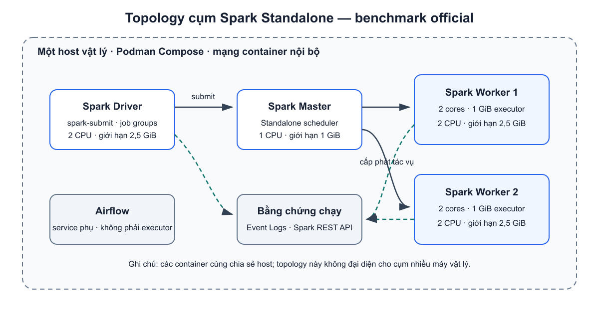
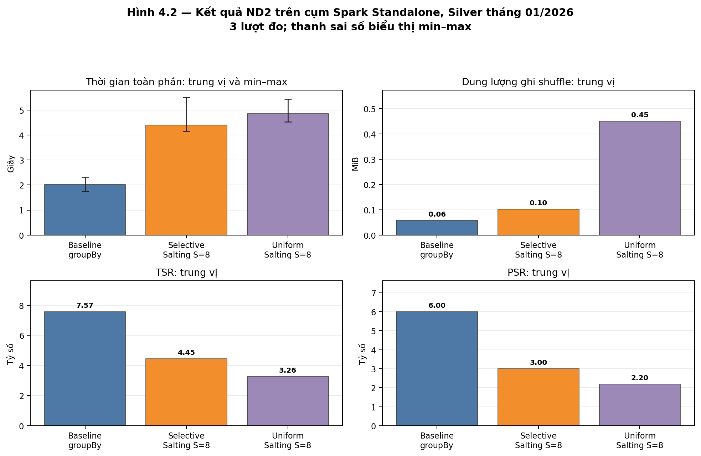
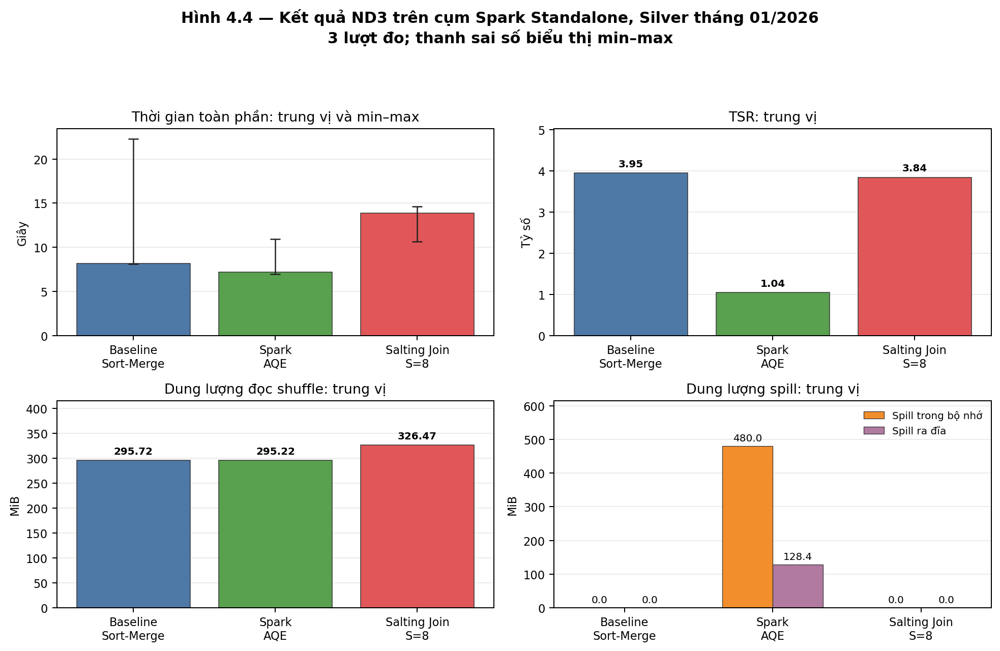

# CHƯƠNG 4. KẾT QUẢ THỰC NGHIỆM VÀ PHÂN TÍCH ĐÁNH ĐỔI HIỆU NĂNG

Các kết quả trong mục 4.2 và 4.3 được lấy từ lần chạy lại benchmark tháng 01/2026 trên cụm Spark Standalone ngày 03/11/2026. Mỗi phương pháp có ba lượt đo chính thức sau một lượt warm-up. ND2 được chạy trong application `app-20261103153557-0001`; ND3 trong application `app-20261103153727-0002`. Các kết quả tháng 02–05 được dùng để thống kê tình trạng hợp lệ ở mục 4.4 và được phân tích riêng như các tập dữ liệu tháng độc lập ở mục 4.5. Vì tháng 02–05 chưa được chạy lại cùng đợt với tháng 01, các số liệu đó không được gộp với kết quả tháng 01 mới để lập một chuỗi so sánh hiệu năng đồng nhất. Thời gian thực thi được tính bằng giây; dung lượng shuffle và spill được đổi sang MiB (1 MiB = 1.048.576 byte).

## 4.1. Thiết lập môi trường và quy trình đo lường thực nghiệm

### 4.1.1. Cấu hình cụm Apache Spark bằng Podman Compose

Thực nghiệm được triển khai trên cụm Apache Spark Standalone gồm một nút điều phối (Master), hai nút thực thi (Worker) và một tiến trình điều khiển ứng dụng (Driver). Các dịch vụ được khởi chạy bằng Podman Compose trên cùng một máy vật lý. Metadata của hai ứng dụng benchmark ghi nhận Spark phiên bản 3.5.9 và hai Worker hoạt động trong suốt các lượt đo. Cả ND2 và ND3 sử dụng tập Silver tháng 01/2026; riêng ND3 còn đọc bảng chiều OD gồm 58.747 cặp khóa Đi–Đến duy nhất.

**Bảng 4.1. Tài nguyên khai báo cho các dịch vụ trong cụm thực nghiệm**

| Thành phần | Giới hạn CPU | Bộ nhớ Spark được khai báo | Giới hạn bộ nhớ container |
|---|---:|---:|---:|
| Spark Master | 1 CPU | — | 1 GiB |
| Mỗi Spark Worker (2 Worker) | 2 CPU | 2 GiB cho Spark Worker | 2,5 GiB |
| Spark Driver | 2 CPU | Không đặt heap riêng trong cấu hình Standalone được lưu | 2,5 GiB |
| Airflow Standalone (service phụ) | 1,5 CPU | — | 2 GiB |

Các giá trị ở Bảng 4.1 là giới hạn được khai báo cho container và dung lượng Worker được cấp phép; đây không phải số liệu sử dụng CPU hay bộ nhớ đo trong từng ứng dụng. Mỗi executor trong log được cấp hai lõi và 1 GiB bộ nhớ. Airflow là dịch vụ phụ trợ, không tham gia thực thi task Spark; tuy nhiên, dịch vụ này cùng chia sẻ tài nguyên của máy chủ. Nghiên cứu không thu thập mức sử dụng CPU/bộ nhớ theo thời gian hoặc thông lượng mạng, vì vậy không dùng các giới hạn khai báo để suy ra mức tiêu thụ thực tế. Do hai Worker chạy trên cùng máy vật lý, kết quả cũng không đại diện trực tiếp cho cụm Spark nhiều máy giao tiếp qua mạng vật lý.

*Nguồn: Tác giả tổng hợp từ cấu hình cụm thực nghiệm. Driver gửi ứng dụng đến Master; Master cấp phát tài nguyên thực thi cho hai Worker. Spark REST API và Event Log cung cấp thông tin về tiến trình chạy, stage và task.*

### 4.1.2. Cấu hình giới hạn tài nguyên và các biến kiểm soát thực nghiệm

Để các phương án có thể so sánh trong cùng điều kiện, số phân vùng shuffle được đặt ở 200 cho cả hai workload. Với ND2, AQE (Adaptive Query Execution, cơ chế thực thi truy vấn thích ứng) được tắt trong cả ba nhánh để cô lập ảnh hưởng của cách gán salt. Với ND3, broadcast join bị tắt nhằm giữ phép nối theo sort-merge join (SMJ) cho cả Baseline, AQE và Salting Join. Nhánh AQE bật cơ chế thực thi thích ứng và nhận diện phân vùng lệch với hệ số 2 cùng ngưỡng cấu hình 16 MiB. Đây là các tham số đầu vào của thực nghiệm; việc cấu hình AQE không tự chứng minh rằng nó đã chia nhỏ một phân vùng lệch.

Compose áp hạn mức CPU/bộ nhớ container như bảng trên, nhưng project không lưu `cpu.stat`, memory peak/current hoặc memory events theo từng application. Vì vậy phần kết quả chỉ báo cáo cấu hình cấp phát cùng các Spark metrics có sẵn; không diễn giải thành mức sử dụng thực tế hay chi phí cloud.

Trong mỗi workload, dữ liệu đầu vào, kiểu phép toán, số phân vùng shuffle, tài nguyên cụm và số lượt đo được giữ cố định. Biến thay đổi giữa các nhánh là chiến lược tổng hợp/phân vùng, trạng thái AQE hoặc việc bổ sung khóa salt như mô tả ở Bảng 4.2.

**Bảng 4.2. Ma trận phương án và biến kiểm soát trong benchmark ND2/ND3**

| Bài toán | Phương án | Phép toán / khóa | AQE | Broadcast | Số phân vùng shuffle | Salt |
|---|---|---|---|---|---:|---:|
| ND2 | Baseline | `groupBy(PULocationID)` | Tắt | Không áp dụng | 200 | — |
| ND2 | Uniform Salting | Tổng hợp hai giai đoạn | Tắt | Không áp dụng | 200 | 8 cho mọi khóa |
| ND2 | Selective Salting | Tổng hợp hai giai đoạn | Tắt | Không áp dụng | 200 | 8 cho hotspot P95; khóa khác salt 0 |
| ND3 | Baseline SMJ | Nối trong theo `(PULocationID,DOLocationID)` | Tắt | Tắt | 200 | — |
| ND3 | AQE Skew Join | Cùng phép nối và khóa | Bật; hệ số 2, ngưỡng 16 MiB | Tắt | 200 trước điều chỉnh thích ứng | — |
| ND3 | Salting Join | SMJ theo khóa ghép và `salt` | Tắt | Tắt | 200 | S=8 cho hotspot pickup; bảng OD được nhân bản |

Mỗi phương án được thực thi một lần trước khi bắt đầu đo để làm nóng đường chạy. Sau đó mỗi phương án được đo ba lần, còn thứ tự thực hiện được luân phiên giữa các lượt. Kết quả được tóm tắt bằng trung vị (median) và khoảng nhỏ nhất–lớn nhất (min–max); lượt warm-up không tham gia tính toán. Việc luân phiên thứ tự giúp giảm khả năng một phương án luôn được hưởng lợi hoặc chịu bất lợi do vị trí cố định trong chuỗi chạy. Với ba lượt đo, các thống kê này được dùng để mô tả kết quả quan sát được, không phải kiểm định ý nghĩa thống kê.

### 4.1.3. Quy trình warm-up, đo lặp và thu thập số liệu

Với mỗi phương án, quy trình gồm bốn bước. Thứ nhất, đọc cùng bộ dữ liệu Silver và thực hiện lượt warm-up nhưng không đưa lượt này vào kết quả. Thứ hai, chạy phép toán cần đo trong một nhóm công việc riêng (job group) và ghi thời gian từ lúc bắt đầu nhóm đến khi hành động buộc kết quả được tính hoàn tất; thời gian này được gọi là thời gian thực thi toàn phần (wall-clock time). Thứ ba, thu thập thời lượng tác vụ (task), số lượng bản ghi và dữ liệu shuffle từ Spark REST API và Event Log. Shuffle là lượng dữ liệu được trao đổi giữa các phân vùng; spill là dữ liệu trung gian phải ghi ra bộ nhớ hoặc đĩa khi xử lý. Cuối cùng, lưu cấu hình chạy, mã ứng dụng, dấu vân tay manifest của dữ liệu, thông tin Worker và kế hoạch thực thi vật lý để truy nguyên kết quả.

Các chỉ số TSR và PSR, công thức tính, quy tắc chọn stage và cách xử lý giá trị không khả dụng được định nghĩa tại mục 3.1.3; mục này áp dụng nguyên các quy ước đó. Vì TSR/PSR được tính trên các task thuộc stage được chọn, các tỷ số này mô tả độ phân tán công việc trong stage đó, không thay thế thời gian thực thi toàn phần. Lượng shuffle và spill trong bảng được cộng qua các stage hoàn tất thuộc job group tương ứng. Bộ thu thập không có SparkListener tùy biến và không ghi mức sử dụng CPU/cgroup hay thông lượng mạng. JVM GC time có trong Event Log của Spark nhưng không nằm trong bộ chỉ số tổng hợp chính của các bảng.

Một lượt đo chỉ được giữ trong tập kết quả hợp lệ khi bộ thu thập hoàn tất và kiểm tra tính đúng đắn trả về `PASS`. Manifest nhận diện phiên bản đầu vào bằng tên tương đối, kích thước và thời điểm sửa đổi của các tệp Parquet; nó giúp xác định tập tệp đã dùng nhưng không phải mã kiểm tra toàn bộ nội dung tệp.

## 4.2. Kết quả thực nghiệm trên phép toán tổng hợp dữ liệu

### 4.2.1. So sánh thời gian thực thi và các chỉ số tổng hợp

ND2 (Aggregation) tổng hợp dữ liệu chuyến theo mã vùng đón `PULocationID`, gồm số chuyến, giá vé cơ sở trung bình và tổng quãng đường. Baseline dùng phép `groupBy` trực tiếp. Uniform Salting chia mọi mã vùng vào tám salt; Selective Salting chỉ chia các mã vùng được xác định là hotspot theo ngưỡng P95, còn các mã khác nhận salt 0. Bảng 4.3 trình bày kết quả ba lượt đo của mỗi phương án trên Silver tháng 01/2026.

**Bảng 4.3. Kết quả benchmark ND2 trên Silver tháng 01/2026**

| Phương án | Số lượt | Thời gian toàn phần: trung vị [min–max] (giây) | TSR trung vị | PSR trung vị | Dung lượng ghi shuffle trung vị (MiB) | Spill trong bộ nhớ (MiB) | Spill ra đĩa (MiB) |
|---|---:|---:|---:|---:|---:|---:|---:|
| Baseline GroupBy | 3 | 2,022 [1,747–2,325] | 7,57 | 6,00 | 0,057 | 0 | 0 |
| Selective Salting S=8 | 3 | 4,400 [4,148–5,520] | 4,45 | 3,00 | 0,103 | 0 | 0 |
| Uniform Salting S=8 | 3 | 4,859 [4,530–5,442] | 3,26 | 2,20 | 0,451 | 0 | 0 |

*Các giá trị spill bằng 0 là số liệu được ghi nhận bằng 0 trong các lượt; giá trị không khả dụng, nếu có, không được thay bằng 0.*

Baseline đạt thời gian trung vị thấp nhất, 2,022 giây. Selective Salting cần 4,400 giây, tương đương khoảng 2,18 lần thời gian Baseline; Uniform Salting cần 4,859 giây, khoảng 2,40 lần Baseline. Trong hai phương án có salting, Selective nhanh hơn Uniform khoảng 9,4%. Như vậy, với tập Silver và cấu hình đang khảo sát, việc chia salt chưa giúp giảm thời gian toàn phần so với phép tổng hợp cơ sở.

So với Uniform Salting, Selective Salting giảm Shuffle Write từ 0,451 MiB xuống 0,103 MiB, tương đương khoảng 77%. Tuy nhiên, mức giảm tuyệt đối chỉ khoảng 0,348 MiB (xấp xỉ 365 KiB); đồng thời Shuffle Write của Selective vẫn cao hơn Baseline (0,057 MiB). Vì thế không nên diễn giải mức giảm tương đối 77% như một lượng dữ liệu lớn được tiết kiệm ở cấp hệ thống. Kết quả phù hợp với kế hoạch thực thi: các nhánh salting phải xử lý thêm salt và tổng hợp hai giai đoạn, trong khi Baseline đã có bước tổng hợp cục bộ trước khi trao đổi dữ liệu. Đây là cách lý giải dựa trên cấu trúc kế hoạch; thực nghiệm chưa đo riêng thời gian CPU của từng thao tác.

### 4.2.2. Mức độ lệch tải tác vụ và tác vụ kéo dài

Trong cả ba phương án, stage được chọn có trung vị 200 task. Baseline có TSR 7,57 và PSR 6,00; các tỷ số tương ứng của Selective Salting là 4,45 và 3,00, còn Uniform Salting là 3,26 và 2,20. Theo các chỉ số này, thời lượng và số bản ghi giữa các task trong stage được chọn phân tán hơn ở Baseline. Tuy nhiên, đây không đủ để kết luận các hotspot P95 chính là nguyên nhân gây tác vụ kéo dài: P95 được xác định từ phân bố chuyến theo vùng, trong khi TSR/PSR mô tả phân bố task ở stage. Hơn nữa, các tỷ số thấp hơn ở hai nhánh salting không làm giảm thời gian toàn phần. Do đó, hiệu quả phải được đánh giá đồng thời bằng chỉ số lệch task, thời gian toàn phần và lượng dữ liệu shuffle.

### 4.2.3. Chi phí shuffle và spill

Trong ba lượt tháng 01, không phương án ND2 nào ghi nhận memory spill hoặc disk spill. Về Shuffle Write, Selective Salting thấp hơn Uniform Salting nhưng cao hơn Baseline. Kết hợp với thời gian thực thi, kết quả cho thấy cân bằng task tốt hơn và giảm shuffle so với một nhánh salting khác chưa đủ để tạo lợi ích đầu-cuối so với Baseline trên workload này.

### 4.2.4. Đánh giá lựa chọn hotspot P95

Tập hotspot P95 tháng 01 được tính trên 261 mã vùng đón khác null. Theo quy tắc nearest-rank, hạng P95 là 248, ngưỡng đếm là 194.522 chuyến; các vùng có số chuyến bằng hoặc vượt ngưỡng được chọn, tạo thành tập 14 mã `PULocationID`. Việc chỉ chia salt cho các mã này giới hạn số khóa bị biến đổi so với Uniform Salting. Dù vậy, Selective Salting vẫn có thời gian trung vị cao hơn Baseline khoảng 2,18 lần. Kết quả không phủ nhận khả năng salting hữu ích trong workload khác; nó cho thấy trong thí nghiệm hiện tại, giảm phạm vi áp dụng salting chưa loại bỏ chi phí của các bước bổ sung.

Ngưỡng P95 là heuristic dựa trên số chuyến của từng vùng, không phải nhãn được tạo từ thời lượng task hoặc dung lượng partition. Vì vậy, 14 vùng được chọn là các vùng có tần suất chuyến cao theo quy tắc P95; chưa thể khẳng định mọi vùng đó trực tiếp gây lệch tải tính toán.

Kế hoạch thực thi vật lý thể hiện khác biệt về số bước: Baseline tổng hợp cục bộ theo `PULocationID`, trao đổi dữ liệu theo khóa này rồi hoàn tất tổng hợp; hai nhánh salting thêm bước gán salt và tổng hợp theo `(PULocationID, salt)`, sau đó lại trao đổi và gộp theo `PULocationID`. Selective Salting chỉ gán salt khác 0 cho các hotspot, nhờ đó Shuffle Write thấp hơn Uniform Salting; nhưng cả hai vẫn phải thực hiện bước gộp thứ hai.

*Hình 4.2. Thời gian thực thi toàn phần và lượng dữ liệu ghi shuffle được so sánh cùng TSR/PSR của stage được chọn. Thanh sai số ở biểu đồ thời gian thể hiện min–max của ba lượt đo. Nguồn: kết quả benchmark ND2 tháng 01/2026, application `app-20261103153557-0001`.*

## 4.3. Kết quả thực nghiệm trên phép kết nối phân tán

### 4.3.1. So sánh thời gian thực thi

ND3 là phép nối trong (inner join) giữa bảng chuyến đi và bảng chiều OD theo cặp mã vùng đón–trả `(PULocationID, DOLocationID)`. Đây là phép nối theo khóa, không phải phép nối không gian dựa trên giao cắt hay khoảng cách giữa các đa giác. Ba phương án được so sánh gồm Sort-Merge Join cơ sở (Baseline SMJ), Sort-Merge Join có bật AQE và Salting Join với S=8. Bảng 4.4 trình bày trung vị, min–max của ba lượt đo, cùng các chỉ số shuffle và spill.

**Bảng 4.4. Kết quả benchmark ND3 trên Silver tháng 01/2026**

| Phương án | Số lượt | Thời gian toàn phần: trung vị [min–max] (giây) | TSR trung vị | PSR trung vị | Dung lượng đọc shuffle trung vị (MiB) | Spill trong bộ nhớ (MiB) | Spill ra đĩa (MiB) |
|---|---:|---:|---:|---:|---:|---:|---:|
| Baseline Sort-Merge Join | 3 | 8,165 [8,108–22,316] | 3,95 | 2,06 | 295,72 | 0 | 0 |
| Spark AQE | 3 | 7,157 [6,955–10,935] | 1,04 | 1,00 | 295,22 | 480,00 | 128,37 |
| Salting Join S=8 | 3 | 13,858 [10,634–14,618] | 3,84 | 1,60 | 326,47 | 0 | 0 |

*Các giá trị spill bằng 0 là số liệu được ghi nhận bằng 0 trong các lượt; giá trị không khả dụng, nếu có, không được thay bằng 0.*

AQE có thời gian trung vị 7,157 giây, thấp hơn Baseline 8,165 giây khoảng 12,4%. Salting Join có trung vị 13,858 giây, cao hơn Baseline khoảng 69,7%. Kết quả trung vị cho thấy AQE là phương án nhanh nhất trong ba phương án ở lần chạy này, nhưng độ biến thiên của Baseline cần được xem xét trước khi diễn giải mức chênh lệch này như một ưu thế ổn định.

**Bảng 4.5. Thời gian của từng lượt đo ND3**

| Phương án | Lượt đo 1 (giây) | Lượt đo 2 (giây) | Lượt đo 3 (giây) | Nhận xét |
|---|---:|---:|---:|---|
| Baseline Sort-Merge | 22,316 | 8,165 | 8,108 | Lượt 1 cao hơn rõ rệt; vẫn giữ trong thống kê vì collector `OK` và validation `PASS` |
| Spark AQE | 10,935 | 7,157 | 6,955 | Cả ba lượt cùng xu hướng giảm, nhưng n=3 còn nhỏ |
| Salting Join S=8 | 14,618 | 13,858 | 10,634 | Khoảng dao động nhỏ hơn Baseline trong lượt này |

Để xác định vị trí phát sinh biến động, Event Log của application `app-20261103153727-0002` được đối chiếu theo từng lượt. Kết quả cho thấy stage shuffle được chọn của lượt 1 (stage 14, gồm 200 task) kéo dài khoảng 14,98 giây; cùng stage ở lượt 2 (stage 44) và lượt 3 (stage 52) lần lượt kéo dài 5,15 và 5,49 giây. Stage đọc và trao đổi dữ liệu đầu vào trước đó lần lượt mất 3,77; 1,84; và 1,67 giây. Số dòng và số byte đầu vào được ghi nhận là như nhau giữa ba lượt; Event Log không đánh dấu task chạy suy đoán (speculative task).

**Bảng 4.6. Chỉ số Event Log của stage được chọn trong ba lượt Baseline**

| Lượt Baseline | Mã stage | Số task | Thời gian stage (giây) | Thời gian task lớn nhất / trung vị (giây) | Tổng thời gian GC của task (giây) |
|---:|---:|---:|---:|---:|---:|
| 1 | 14 | 200 | 14,982 | 1,541 / 0,236 | 0,822 |
| 2 | 44 | 200 | 5,150 | 0,232 / 0,088 | 0,314 |
| 3 | 52 | 200 | 5,490 | 0,328 / 0,083 | 0,241 |

Thời gian GC cộng dồn của các task ở stage 14 là 0,822 giây, so với 0,314 và 0,241 giây ở hai lượt còn lại. Đây là dấu hiệu GC tăng đồng thời với thời gian stage, nhưng tổng GC được cộng từ các task chạy song song nên không thể xem là phần thời gian trực tiếp cấu thành wall time. Log cũng chưa cung cấp số đo mức sử dụng CPU của host, hoạt động I/O hệ thống hoặc tranh chấp tài nguyên đủ để kết luận nguyên nhân. Vì lượt 1 có collector `OK` và kiểm tra đúng đắn `PASS`, nghiên cứu giữ lượt này trong thống kê thay vì loại bỏ sau khi quan sát kết quả. Với ba lượt đo, AQE có trung vị thấp nhất, nhưng cần thận trọng vì một lượt Baseline kéo dài làm khoảng min–max của Baseline rộng hơn.

### 4.3.2. Độ lệch task, shuffle và spill

Trong stage được chọn, AQE có năm task ở cả ba lượt sau khi Spark gộp các phân vùng shuffle; Baseline và Salting Join mỗi phương án có 200 task. Vì số lượng và cách hình thành task khác nhau, TSR/PSR của AQE không được tính trên một tập task có cấu trúc tương đương với hai nhánh còn lại. Kế hoạch cuối có `AQEShuffleRead coalesced`, thể hiện thao tác gộp phân vùng; tuy nhiên, kế hoạch không có dấu hiệu chia nhỏ phân vùng do skew. Do đó, TSR=1,04 và PSR=1,00 của AQE chỉ cho biết độ phân tán thấp trong stage được chọn sau coalescing, không chứng minh cơ chế skew join đã xử lý hot key.

AQE ghi nhận 480 MiB memory spill và 128,37 MiB disk spill tính trên các stage hoàn tất của job group. Baseline và Salting Join không ghi nhận spill. Salting Join đọc 326,47 MiB shuffle, cao hơn Baseline 295,72 MiB khoảng 10,4%; mặc dù TSR/PSR của Salting thấp hơn Baseline, thời gian trung vị của Salting vẫn cao hơn. Kết quả này cho thấy các chỉ số lệch task cần được xem cùng lượng dữ liệu trao đổi, spill và thời gian toàn phần.

### 4.3.3. Physical plan và hành vi AQE

Kế hoạch thực thi vật lý cuối của AQE có `AdaptiveSparkPlan isFinalPlan=true`, `SortMergeJoin` và `AQEShuffleRead coalesced`. Không có node thể hiện skew-specific partition split. Đây là bằng chứng AQE đã tạo kế hoạch thích ứng và gộp dữ liệu shuffle trong lần chạy, nhưng không có bằng chứng nó đã chia nhỏ phân vùng lệch. Kết luận này giới hạn ở cấu hình đã dùng: 200 shuffle partitions, ngưỡng 16 MiB, hệ số skew 2 và phép nối Sort-Merge. Không thể suy ra một phân vùng vượt ngưỡng chỉ từ tổng shuffle của toàn stage.

**Bảng 4.7. Đối chiếu các thành phần chính trong kế hoạch thực thi ND3**

| Phương án | Bằng chứng trong kế hoạch thực thi | Diễn giải |
|---|---|---|
| Baseline SMJ | `SortMergeJoin` trên `(PULocationID,DOLocationID)`; hai phía có `Exchange hashpartitioning(..., 200)` và `Sort` | Join phân tán theo khóa OD, không phải phép nối hình học |
| AQE | `AdaptiveSparkPlan isFinalPlan=true`, `AQEShuffleRead coalesced`, `SortMergeJoin`; không có node chia nhỏ phân vùng skew | AQE đã gộp các phân vùng shuffle trong lần chạy này; cấu hình không tạo bằng chứng về chia nhỏ phân vùng skew |
| Salting Join S=8 | Join key đổi thành `(PULocationID,DOLocationID,salt)`; nhánh OD có `Generate explode(...)` | Salt được gắn cho trip và replicate cho OD dimension để bảo toàn cặp khớp |

Ở Baseline, hai phía của phép nối được phân vùng theo cặp mã vùng OD rồi sắp xếp trước khi thực hiện Sort-Merge Join. Ở Salting Join, salt được thêm vào khóa nối của chuyến đi, còn các dòng OD ứng với vùng pickup nóng được nhân bản qua các salt để duy trì tính đúng đắn. Kế hoạch của AQE cho thấy coalescing, không phải chia phân vùng skew. Các kế hoạch cuối của ba phương án được lưu cùng application `app-20261103153727-0002` để có thể đối chiếu với kết quả định lượng.

### 4.3.4. Chi phí nhân bản dimension của Salting Join

Trong ND3, bảng chiều OD ban đầu có 58.747 dòng. Trong đó, 3.557 dòng có pickup thuộc tập hotspot. Salting Join tạo tám bản sao cho mỗi dòng hotspot, thay vì một bản, nên phát sinh thêm `3.557 × (8 − 1) = 24.899` dòng. Sau phép bung mảng salt (explode), bảng chiều có 83.646 dòng. Đây là số dòng được đếm sau materialize; kích thước theo byte và mức sử dụng bộ nhớ của bảng sau biến đổi không được đo riêng.

**Bảng 4.8. Số dòng OD trước và sau nhân bản trong Salting Join**

| Chỉ tiêu bảng OD | Số dòng | Diễn giải |
|---|---:|---|
| Trước salting | 58.747 | Số khóa OD duy nhất sau preflight |
| Dòng thuộc hotspot PU được nhân bản | 3.557 | Mỗi dòng hotspot có 8 salt thay cho 1 |
| Hàng phát sinh thêm | 24.899 | `3.557 × (8 − 1)` |
| Sau explode/replication | 83.646 | Số hàng materialize trước Join |

Số dòng OD sau salting tăng khoảng 42,4% so với ban đầu. Tỷ lệ này chỉ mô tả mức tăng số dòng, không thể thay thế cho tỷ lệ tăng dung lượng byte vì kích thước và cách mã hóa từng dòng không được đo riêng.

Tổng hợp ND3 cho thấy AQE có thời gian trung vị thấp nhất trong lần chạy này nhưng phát sinh spill và không có bằng chứng chia nhỏ phân vùng skew trong kế hoạch cuối. Salting Join thay đổi khóa phân vùng và làm tăng số dòng OD cùng Shuffle Read; thời gian trung vị của nó cao hơn Baseline. Do đó, với bộ dữ liệu và cấu hình khảo sát, chưa quan sát được lợi ích đầu-cuối từ Salting Join đủ để bù chi phí bổ sung. Kết luận này chỉ áp dụng cho workload ND3 tháng 01/2026 trên cụm hai Worker đã mô tả.

*Hình 4.4. Thời gian thực thi toàn phần, TSR, lượng dữ liệu đọc shuffle và spill của ba phương án. Thanh sai số ở biểu đồ thời gian thể hiện min–max của ba lượt đo. Nguồn: kết quả benchmark ND3 tháng 01/2026, application `app-20261103153727-0002`.*

## 4.4. Kiểm chứng tính đúng đắn và nhất quán dữ liệu bằng DuckDB

### 4.4.1. Đối soát kết quả phép tổng hợp

Kết quả ND2 được tổng hợp theo 261 mã vùng đón. Với mỗi mã vùng, DuckDB được dùng để tính độc lập số chuyến, giá vé cơ sở trung bình và tổng quãng đường; các giá trị này được so sánh với kết quả Spark. Sai khác được tính theo trị tuyệt đối `|Spark − DuckDB|`. Dung sai được đặt bằng 0 chuyến cho số đếm, `1e-4` cho giá vé trung bình và `1e-2` cho tổng quãng đường. Không có vùng nào vượt các dung sai này.

### 4.4.2. Đối soát kết quả phép nối

Kết quả ND3 được tổng hợp theo cặp vùng hành chính nguồn–đích (borough pair). Với mỗi cặp, phép đối soát kiểm tra số chuyến, tổng giá vé, tổng quãng đường, số vùng đón phân biệt và mức độ bao phủ các cặp có trong kết quả DuckDB. Hai phía Spark và DuckDB làm tròn tổng giá vé và tổng quãng đường đến hai chữ số thập phân trước khi tính sai khác. Sai khác dùng trị tuyệt đối `|Spark − DuckDB|`; dung sai là 0,05 cho tổng giá vé và tổng quãng đường, bằng 0 cho số chuyến, số vùng đón phân biệt và tính đầy đủ của tập cặp.

Cả 32 cặp borough trong kết quả DuckDB đều xuất hiện trong kết quả của cả ba phương án Spark. Số chuyến và số vùng đón phân biệt khớp chính xác. Sai khác tổng quãng đường lớn nhất lưu trong audit là khoảng `0,01000000001`, được trình bày làm tròn thành `0,01`. Sai khác tổng giá vé bằng 0 ở độ chính xác audit sau khi làm tròn hai chữ số; điều này không khẳng định hai tổng chưa làm tròn bằng nhau ở độ chính xác đầy đủ. Ba phương án cho cùng tổng 19.993.097 chuyến.

Các giá trị ND2 trong Bảng 4.9 là sai khác tuyệt đối lớn nhất trên 261 vùng của một bảng audit tổng hợp cho từng phương án. Các giá trị ND3 là sai khác lớn nhất trên 32 cặp borough. Vì vậy, mỗi dòng tóm tắt các nhóm trong audit của phương án tương ứng; đây không phải cực đại tính qua ba bảng audit độc lập theo từng lượt đo.

**Bảng 4.9. Sai khác lớn nhất giữa kết quả Spark và DuckDB cho ND2/ND3**

| Bài toán | Phương án | Số nhóm đối soát | Nhóm sai khác số chuyến | Sai khác giá vé tối đa | Sai khác quãng đường tối đa | Nhóm sai khác số vùng đón | Mức bao phủ | Kết quả |
|---|---|---:|---:|---:|---:|---:|---:|---|
| ND2 | Baseline GroupBy | 261 mã vùng đón | 0 | 5,08e-13 | 2,70e-8 | — | 261/261 | PASS |
| ND2 | Selective Salting S=8 | 261 mã vùng đón | 0 | 3,77e-13 | 3,08e-8 | — | 261/261 | PASS |
| ND2 | Uniform Salting S=8 | 261 mã vùng đón | 0 | 4,83e-13 | 3,08e-8 | — | 261/261 | PASS |
| ND3 | Baseline Sort-Merge | 32 cặp borough | 0 | 0,00 | 0,01 | 0 | 32/32 | PASS |
| ND3 | Spark AQE | 32 cặp borough | 0 | 0,00 | 0,01 | 0 | 32/32 | PASS |
| ND3 | Salting Join S=8 | 32 cặp borough | 0 | 0,00 | 0,01 | 0 | 32/32 | PASS |

### 4.4.3. Kiểm tra khóa OD và phạm vi trạng thái các lượt chạy

Trước phép nối, bảng OD có 58.747 dòng và 58.747 cặp khóa `(PULocationID, DOLocationID)` phân biệt; không có khóa null hoặc trùng. Điều kiện này bảo đảm mỗi cặp chuyến đi khớp tối đa một dòng OD trước khi áp dụng salting. Với Salting Join, số dòng sau khi nhân bản được materialize và đếm là 83.646, đúng bằng số dự kiến. Mỗi lượt đo cũng lưu đường dẫn Silver/OD và manifest nhận diện tệp Parquet theo tên tương đối, kích thước và thời điểm sửa đổi. Manifest giúp nhận diện tập đầu vào nhưng không phải checksum nội dung.

Phạm vi kiểm chứng cần được hiểu theo cách runner tạo audit. Trong mỗi ứng dụng, runner giữ kết quả Spark của lượt đo cuối cùng cho từng phương án, đối chiếu kết quả đó với DuckDB một lần, rồi gán trạng thái kiểm chứng của phương án vào metadata của cả ba lượt. Do đó, audit theo vùng/cặp borough ở mục này kiểm tra một kết quả tổng hợp cho mỗi phương án; trạng thái `PASS` lặp lại ở ba dòng metadata không phải ba lần đối soát DuckDB độc lập. Riêng tháng 01, có sáu kết quả phương án được đối soát chi tiết: ba phương án ND2 và ba phương án ND3; cả sáu đều đạt dung sai.

Trong năm tháng dữ liệu, mỗi workload có 45 dòng metadata đo lường (ba phương án × ba lượt × năm tháng), tổng cộng 90 dòng cho ND2 và ND3. Cả 90 dòng đều ghi collector `OK` và trạng thái validation cấp phương án là `PASS`; không có dòng nào bị loại khỏi bảng tổng hợp theo hai trạng thái này. Con số 90/90 mô tả trạng thái của các dòng metadata, không phải 90 phép đối soát DuckDB độc lập.

**Bảng 4.10. Trạng thái collector và validation được ghi trong metadata benchmark tháng 01–05**

| Bài toán | Phương án | Số dòng lượt đo | Thu thập số liệu thành công | Kiểm chứng cấp phương án đạt | Dòng bị loại |
|---|---|---:|---:|---:|---:|
| ND2 | Baseline GroupBy | 15 | 15 | 15 | 0 |
| ND2 | Selective Salting S=8 | 15 | 15 | 15 | 0 |
| ND2 | Uniform Salting S=8 | 15 | 15 | 15 | 0 |
| ND3 | Baseline Sort-Merge | 15 | 15 | 15 | 0 |
| ND3 | Spark AQE | 15 | 15 | 15 | 0 |
| ND3 | Salting Join S=8 | 15 | 15 | 15 | 0 |

Các kết quả trong mục này được đối chiếu từ metadata lượt chạy, audit DuckDB, kế hoạch thực thi vật lý và Event Log của cụm Spark Standalone. Kết quả tháng 01 dùng lần chạy ngày 03/11/2026; trạng thái tháng 02–05 lấy từ bộ metadata đã lưu trước đó. Sự khác biệt về ngày chạy được giữ rõ trong phạm vi phân tích, không xem kết quả tháng 01 mới và tháng 02–05 cũ là cùng một đợt thực nghiệm liên tục.
