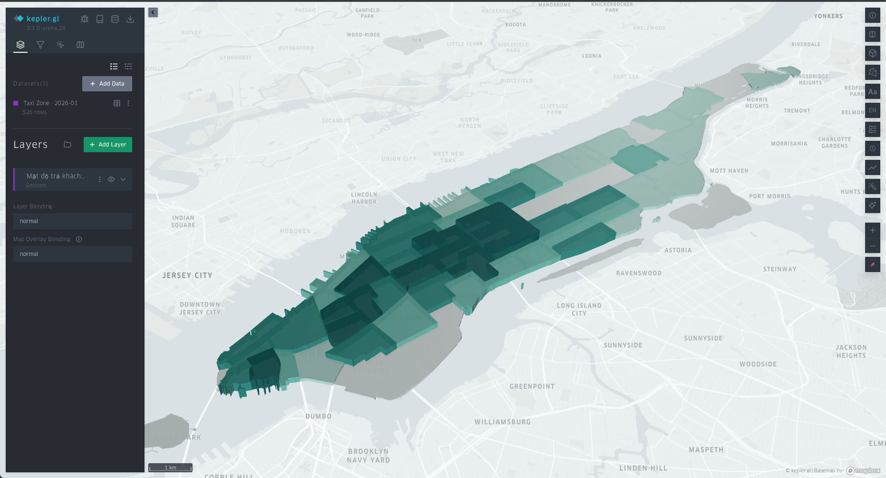

# CHƯƠNG 5. KẾT LUẬN VÀ HƯỚNG PHÁT TRIỂN

Chương này tổng hợp kết quả xây dựng pipeline, đánh giá các phương án xử lý lệch tải trên Apache Spark và phân tích mật độ trả khách tại Manhattan. Bản đồ Kepler.gl 3D minh họa cách khai thác dữ liệu Gold để tra cứu và so sánh các Taxi Zone. Phần cuối trình bày các giới hạn và hướng nghiên cứu tiếp theo.

## 5.1. Kết luận

### 5.1.1. Kết quả xây dựng pipeline và nhận diện khóa nóng

Đồ án tổ chức luồng dữ liệu từ Raw đến Silver và Gold. Silver cung cấp dữ liệu đầu vào cho phép tổng hợp ND2 và phép nối ND3. OD Matrix và danh sách khóa nóng được dựng lại trên đúng phạm vi Silver của từng mức, kể cả S2 tích lũy tháng 01–03 và S3 tích lũy tháng 01–05/2026. Manifest giúp truy nguyên bộ tệp sử dụng trong từng phiên.

Tập khóa nóng được chọn theo phân vị P95 bằng hạng gần nhất trên số chuyến đón khách theo vùng. Đây là quy tắc xác định ứng viên cho salting. Hiệu quả xử lý lệch tải vẫn cần kiểm tra qua kế hoạch thực thi, lượng công việc ở cấp tác vụ và thời gian toàn phần của phép toán.

### 5.1.2. Kết quả ND2

Baseline groupBy có trung vị thấp nhất ở hai pilot S1 và S2, lần lượt là 2,394 và 3,646 giây. Selective Salting có trung vị 5,284 và 7,832 giây. Uniform Salting có trung vị 5,098 và 8,542 giây. Hai biến thể salting đổi thứ tự giữa hai mức và các khoảng đo của chúng chồng lấn ở S1. Trong các phép đo được trình bày ở Chương 4, Selective Salting giảm lượng ghi shuffle so với Uniform Salting. Khi lựa chọn phương án cần cân nhắc thêm bước băm, tổng hợp hai giai đoạn và thời gian thực thi toàn phần.

### 5.1.3. Kết quả ND3

DuckDB đối soát đúng 60.133.386 chuyến và 33 cặp quận ở pilot S2. Nhánh Broadcast tham chiếu được ép bằng hint trong pilot S1 và S2. Trung vị của nhánh này lần lượt là 2,403 và 6,114 giây, thấp nhất trong các phiên tương ứng. Ở lần lặp S2, trung vị của từng phương án cao hơn khoảng 1,53–1,64 lần so với phiên đầu. Kết quả giữ theo từng phiên vì nguyên nhân của chênh lệch chưa xác định được.

Ở phiên mở rộng S3 gồm 10 block và 101.263.728 chuyến, nhánh tự chọn của Spark chạy với AQE tắt, ngưỡng 10 MiB và không có hint. Spark chọn BroadcastHashJoin trong cả 10 lượt của nhánh này, với trung vị 6,788 giây so với 27,884 giây của SMJ. AQE có trung vị 28,189 giây và kết quả ghép cặp chưa phân định lợi thế thực hành theo ngưỡng 5%. Kế hoạch AQE ghi nhận gộp phân vùng, chưa ghi nhận chia phân vùng lệch tải.

Salting S=8 giảm TSR và PSR trung vị từ 1,98 và 1,95 xuống 1,76 và 1,55 ở phiên S3 10 block. Thời gian trung vị tăng lên 32,345 giây, tổng thời gian task tăng từ 106,457 lên 124,898 giây và bảng OD tăng 25.256 dòng sau nhân bản. Nếu cộng thêm thời gian quét P95 lần đầu đo ở ứng dụng riêng, thời gian ước lượng là 36,298 giây. Các con số cho thấy cần đọc chỉ số cân bằng tải cùng tổng công việc và thời gian thực thi.

### 5.1.4. Tính đúng đắn, truy nguyên và độ ổn định

DuckDB xác nhận đầu ra logic theo từng phương án. Application ID, manifest, final plan và thông tin Worker cho phép truy nguyên kết quả về đúng phiên. Hai phiên lặp ND4 qua Airflow trên cùng đầu vào tháng 03 có 36 dòng đo ghi collector OK và audit cấp phương án PASS. Các phiên được đánh giá qua trung vị và khoảng nhỏ nhất–lớn nhất của từng phương án. Những phiên chỉ có ba lượt đo được diễn giải ở mức mô tả.

### 5.1.5. Phân tích mật độ trả khách

Trong Gold tháng 01/2026, trung vị mật độ theo zone của nhóm phía Nam cao hơn nhóm phía Bắc khoảng 2,91 lần ban ngày và 2,57 lần ban đêm. Năm zone biên bị loại khỏi phép so sánh Bắc–Nam và vẫn có thể tra cứu trong bản đồ. Các nhóm dựa trên đường tham chiếu xấp xỉ phố 60th. Kết quả mô tả địa điểm trả khách trong tháng quan sát. Dữ liệu trước chính sách và thiết kế đối chứng cần được bổ sung để đánh giá tác động của thu phí.

## 5.2. Đóng góp của đồ án

### 5.2.1. Pipeline và khả năng tái lập

Pipeline lưu riêng Silver, bảng chiều OD, danh sách P95, đầu ra benchmark và dữ liệu Gold. Các runner và DAG ghi lại đầu vào, cấu hình, thời điểm chạy và mã ứng dụng. Những phiên theo giao thức đã sửa thực thi action warm-up rõ ràng để truy được trong Event Log.

### 5.2.2. Đánh giá phương án thực thi trên Spark

Ma trận thực nghiệm tổ chức các nhánh đối chứng theo cùng dữ liệu và cấu hình trong một phiên. Phiên S3 10 block bổ sung so sánh ghép cặp, thời gian CPU của executor và chi phí phát hiện khóa nóng. Lưới dữ liệu tổng hợp phân tích riêng ảnh hưởng của mức lệch khóa và kích thước bảng chiều. Bảng 4.21 chuyển các quan sát thành các bước kiểm tra trước khi chọn phương án trên workload đích.

### 5.2.3. Đối soát độc lập và lưu bằng chứng

DuckDB kiểm tra số đếm và các đại lượng tổng hợp theo zone hoặc cặp quận. Với ND3, kiểm tra thêm tính duy nhất của khóa OD và số dòng sau nhân bản. CSV cấp lượt, task metrics, final plan và Event Log cho phép đối chiếu số liệu báo cáo với từng ứng dụng Spark.

### 5.2.4. Gold và bản đồ Kepler.gl 3D

Tầng Gold có 526 cặp Taxi Zone–khung giờ, tương ứng 263 vùng và 19.993.097 lượt trả khách tháng 01/2026. Bản đồ Kepler.gl cấu hình lớp đa giác 3D. Diện tích mặt đáy theo hình học Taxi Zone, còn chiều cao được tỷ lệ hóa theo mật độ chuyến/km². Màu biểu diễn thứ hạng mật độ theo thang phân vị. Chiều cao là mã trực quan để nhận biết vùng mật độ cao, còn tooltip cho biết số liệu và đơn vị cần dùng khi so sánh.

*Hình 5.1. Bản đồ Kepler.gl 3D thể hiện mật độ trả khách theo Taxi Zone tại Manhattan, tháng 01/2026.*

Bản đồ có bộ lọc khung giờ, nhóm vùng và Taxi Zone theo tên hoặc mã. Khi xem bản đồ, chọn một khung giờ để tránh chồng hai bản ghi có cùng đa giác. Bảng Top 10 Manhattan xếp riêng cho Ngày và Đêm theo mật độ chưa làm tròn. 526 dòng dữ liệu bản đồ và 20 thứ hạng được đối chiếu lại với Gold CSV.

Penn Station/Madison Sq West có ít lượt trả khách hơn Times Sq/Theatre District trong khung Ban ngày. Diện tích nhỏ hơn khiến mật độ của Penn Station/Madison Sq West cao hơn. Bảng 5.1 minh họa lý do cần hiển thị cùng lúc số chuyến, diện tích và mật độ.

**Bảng 5.1. Ví dụ tra cứu hai Taxi Zone trong khung Ban ngày, tháng 01/2026**

| Taxi Zone | Mã vùng | Lượt trả khách | Diện tích (km²) | Mật độ (chuyến/km²) |
|---|---:|---:|---:|---:|
| Penn Station/Madison Sq West | 186 | 101.155 | 0,3475 | 291.115 |
| Times Sq/Theatre District | 230 | 147.209 | 0,5256 | 280.055 |

*Số liệu hiển thị được làm tròn. Thứ hạng dùng số gốc trong Gold.*

## 5.3. Hạn chế

Cụm Spark dùng hai Worker trên cùng một máy vật lý. Các pilot ba lượt và chênh lệch giữa hai phiên S2 giới hạn kết luận về độ ổn định thời gian và khả năng mở rộng ngang. Phiên S3 10 block có số đo công việc theo tác vụ nhưng thiếu chuỗi telemetry host và cgroup liên tục để giải thích ảnh hưởng riêng của tải nền và I/O.

P95 dùng tần suất vùng đón để nhận diện ứng viên, trong khi tải nối còn phụ thuộc vào phân bố cặp OD, số kết quả khớp và cách chia phân vùng. S=8 là một cấu hình đã khảo sát. Lưới tổng hợp dùng dung lượng Parquet làm trục thiết kế. Chỉ các lượt có BroadcastExchange cung cấp số đo kích thước quan hệ broadcast.

Dữ liệu không gian quan sát một tháng. Taxi Zone là đơn vị tổng hợp và các nhóm Bắc/Nam dựa trên đường 60th xấp xỉ. Hai khung giờ dài 16 và 8 giờ mỗi ngày. Có thể so theo mật độ trung bình một giờ bằng cách chia cho tổng số giờ quan sát tương ứng. Khi chuyển bộ lọc trên bản đồ, nên dùng số liệu từ tooltip và bảng để so sánh giữa các kỳ vì thang hiển thị có thể thay đổi.

## 5.4. Hướng phát triển

### 5.4.1. Quy mô và cụm

Chạy lại trên cụm nhiều máy với manifest S3, kiểm soát tải nền và thu CPU throttling cùng I/O xuyên suốt phiên. Các phép đo này giúp tách biến động giữa phiên khỏi chênh lệch do phương án.

### 5.4.2. Khảo sát dự đoán bằng LightGBM

Có thể dự đoán thời gian nối từ tỷ trọng khóa nóng, tần suất OD, kích thước bảng chiều, khả năng broadcast và số Worker. Chỉ dùng đặc trưng có trước khi chọn phương án, chia tập đánh giá theo thời gian và dùng P95 làm mốc đối chiếu.

### 5.4.3. Tự động lựa chọn phương án

Quy tắc trên lưới hiện tại chọn cùng phương án với mốc luôn chọn AQE trên ba ô giữ lại. Hướng tiếp theo là cố định quy tắc trên tập phát triển và đánh giá ở những workload mà phương án dẫn đầu thay đổi. Phương án nhanh nhất đo được trong mỗi ô dùng để tính regret sau khi chạy thử.

### 5.4.4. Mở rộng workload

Có thể thử Selective Broadcast khi phần khóa nóng của bảng chiều đủ nhỏ. Nhánh nóng dùng broadcast và phần còn lại dùng SMJ hoặc AQE. Cần đo chi phí tách, gộp và đối soát kết quả trên nhiều mức số khóa khớp.

### 5.4.5. Dữ liệu không gian và ranh giới CRZ

Công cụ 3D có thể mở rộng theo tháng và bổ sung mật độ trung bình theo giờ. Nghiên cứu tác động chính sách cần dữ liệu trước và sau, cách gán mức tiếp xúc dựa trên geofence chính thức cùng đơn vị đối chứng phù hợp.

## 5.5. Tổng kết chương

Đồ án xây dựng pipeline taxi NYC, quy trình so sánh hiệu năng trên Spark và bộ đầu ra có thể truy nguyên. Tầng Gold cung cấp dữ liệu cho công cụ Kepler.gl 3D để khám phá mật độ trả khách theo vùng và khung giờ.

Các phép đo cho thấy giảm lệch tác vụ có thể đi kèm thời gian thực thi cao hơn. Chiến lược Spark tự chọn cho kết quả nhanh nhất trong phiên S3 khi bảng OD có thể broadcast. Kết luận áp dụng trong phạm vi workload, cụm và giao thức đã đo.

Các bước tiếp theo là tăng kiểm soát giữa phiên, đánh giá cách chọn phép nối trên workload đa dạng hơn và mở rộng công cụ không gian theo thời gian quan sát.
